# Tessera

> **A declarative, type-safe HTML/CSS view engine and component system for JDK 25 and the latest Chromium and Firefox, with native platform controls and automatically bundled client behaviors.**

[](#) [](#) [](#) [](#) [-critical.svg>)](#)

---

## Overview

Tessera is an advanced server-side UI framework built exclusively for **modern Java 25** and the **latest Chromium and Firefox**. Rather than treating HTML and CSS as untyped strings or shipping client-side JavaScript runtimes to reconstruct the DOM in the browser, Tessera treats the web platform as a first-class compilation target.

The supported browser contract is deliberately bleeding-edge: the latest stable Chromium and Firefox, with no fallback matrix and no legacy polyfills. Native HTML and CSS power dialogs, popovers, layout, styling, and navigation. Components contribute deduplicated ES modules as client behaviors; `SearchPalette` and `ContentTabs` use that path for live filtering, keyboard navigation, and ARIA tabs. Pages that use no behavior receive no script.

Start with the [consumer guide](docs/consumer-guide.md), including the runnable two-page example (`just guide`), component authoring, identity references, URL handling, tokens, assets, and search.

```mermaid
flowchart LR
    subgraph Authoring["Java 25 authoring"]
        Components["RenderOnce and RenderView<br/>Reusable components"]
        References["ElementRef and IdReference<br/>Symbolic identities"]
        Styles["ScopeStyle and Tokens<br/>Scoped CSS and design tokens"]
    end

    subgraph Compiler["Compiler"]
        Layout["1. LayoutPass and ViewExpansion<br/>Expand components, bind IDs, collect styles"]
        Prepaint["2. ReferenceLinker and PageValidator<br/>Link references and collect diagnostics"]
        Paint["3. HtmlWriter<br/>Encode and emit HTML with selected CSS"]
        Layout --> Prepaint -->|Valid page| Paint
    end

    subgraph Browser["Native browser platform"]
        Controls["Dialogs, popovers, and invoker commands"]
        CSS["Cascade layers, scopes, and modern layout"]
        Search["SearchPalette module when used"]
    end

    Authoring --> Layout
    Paint --> Browser
```



---

## Core Pillars & Architectural Principles

### 1. Bleeding-Edge Native Web Standards

Tessera emits purely standard HTML and CSS features available in modern browsers:

- **Invoker Commands**: Declarative button interactions via `commandfor="target-id"` and `command="show-modal"` / `command="toggle-popover"` / custom commands without JavaScript event listeners.
- **Native Light-Dismiss Overlays**: `<dialog closedby="any">` and `[popover="auto"]` with native backdrop styling and top-layer positioning.
- **CSS Cascade Layers (`@layer`)**: Strict, deterministic cascade hierarchy: `@layer reset, base, theme, components, utilities, interactive, container;`
- **Scoped Styling (`@scope`)**: Modular CSS styling isolated directly to component boundaries (`@scope ([data-view="tessera-card"])`) without CSS Modules or naming collisions.
- **OKLCH & `light-dark()`**: Perceptually uniform OKLCH color palettes with automatic OS light/dark mode adaptation via pure CSS variables.
- **Subgrid & Anchor Positioning**: Seamless multi-column card alignments, sticky headers, and pure CSS anchored tooltips.
- **Link Speculation Rules**: Native browser prefetch and prerender for instant multi-page transitions.

#### Browser support

The contract is the latest stable Chromium and Firefox, tested on every build. Features that are still Chromium-leading (`::scroll-button`, `::scroll-marker`, `appearance: base-select`, `@container scroll-state`) degrade to the native behavior in Firefox. `interestfor` hint popovers ship a small fallback behavior where interest invokers are not yet available. There are no polyfills, no version matrix, and no legacy engines.

### 2. JDK 25 Idiomatic Language Features

- **Explicit `RenderContext`**: Render and document callbacks receive their turn's tokens, identity scope and contribution capabilities directly.
- **Algebraic Data Types (ADTs)**: Sealed interfaces and records for type-safe CSS lengths (`CssLength`), tag names (`TagName`, `HtmlTag`, `CustomElement`), and tokens.
- **Markdown Documentation Comments (JEP 467)**: All Javadoc is written using modern `///` Markdown syntax.
- **Zero-Warning Self-Typing**: Fluent builder traits (`Styled<SELF>`, `ParentElement<SELF>`, `InteractiveElement<SELF>`) utilize `SELF self()` overridden by leaf classes—yielding completely type-safe fluent chaining with **zero unchecked casts**.
- **Typed Style Values**: Style methods accept `CssLength`, `CssColor`, `Border`, `Shadow`, `TrackList`, keyword enums, and other sealed values, so no declaration is built from raw text.
- **Typed ARIA**: Roles are `Role` constants and each `aria-*` state has a typed method; the compiler checks every role's name, children, state, and attribute requirements.
- **Source Provenance**: With tracking on, rendered elements carry `data-src="File.java:42"` and diagnostics name the Java line that built them.

### 3. Linker-Style Element Identity

In Tessera, DOM elements are identified by `ElementRef` tokens. References to other elements (such as `commandfor`, `<label for>`, `aria-labelledby`, `aria-describedby`, or `href="#..."`) are strongly-typed `IdReference` handles. During compilation, the **Linker** statically resolves and verifies every reference:

- Unbound references trigger compile-time errors.
- Duplicate bindings and duplicate DOM IDs are reported before HTML is emitted.
- Invoker command targets are checked for existence in the compiled document.
- Accessibility contracts (roles, landmarks, heading order, label targets, focus) are checked on the linked tree.

### 4. Zero `@SuppressWarnings` & Extreme Quality Gates

Tessera enforces an unyielding quality policy:

- Forked `javac` with `-Xlint:all -Xdoclint:all/protected,-missing -Werror`.
- Error Prone combined with Uber's NullAway in `@NullMarked` JSpecify mode.
- Checkstyle 14.4.0 enforcing Markdown docs (`///`) and banning legacy `/** */`.
- SpotBugs 4.10.5 running at `effort=Max` and `threshold=Low`.
- Spotless with google-java-format.
- **Zero `@SuppressWarnings`**: Suppressing warnings is strictly prohibited and verified by CI (`just no-suppress-warnings`).

---

## Component Catalog

Tessera includes a comprehensive catalog of accessible, responsive components:

| Category | Components | Highlights |
| :-- | :-- | :-- |
| **Typography & Prose** | `Prose`, `CodeBlock`, `Formatting`, `Footnotes` | Subgrid alignment, typography scales, line numbering, and language tags. |
| **Status & Badges** | `Badge`, `Pill` | OKLCH tinted, outline, and solid variants across 6 semantic tones, status dot indicators, anchor link support. |
| **Navigation** | `Breadcrumbs`, `DocPager`, `StickyHeader`, `Toc` | Accessible breadcrumbs, pagination, sticky subgrid headers, and collapsible table of contents with integrated scrollspy. |
| **Overlays & Popovers** | `Overlays` (`Modal`, `Drawer`), `Dropdown` | Native `<dialog closedby="any">`, `popover="auto"`, `interestfor` hover hints, zero JavaScript dialogs. |
| **Forms & Input** | `Forms`, `SearchPalette` | Floating labels, native validation states, modal command palette with keyboard shortcuts. |
| **Actions** | `Button`, `IconButton` | Native buttons with separate tone, surface, size, submit, invoker command, disabled, and busy states. |
| **Data Presentation** | `SimpleTable`, `DataTable`, `Card`, `CardGrid` | Responsive tables, card grids with CSS subgrid alignment, hover elevation. |
| **Layout & Containers** | `ContentSection`, `Grid`, `Image`, `Lists`, `Accordion`, `Tabs`, `Carousel` | Responsive columns, scroll reveals, lazy and high-priority LCP image loading, pure CSS accordions and carousels. |

---

## Quick Start

### Prerequisites

- **JDK 25** (with `JAVA_HOME` pointing to JDK 25)
- **`just`** task runner (optional but recommended) or `./mvnw`

### Running the Multi-Page Showcase

Compile and run the showcase. Documentation pages cover the component library, and named cases are published under `/stories/`.

```bash
# Compile the static site into target/site
just site

# Build and launch the built-in HTTP preview server at http://localhost:8080
just demo

# Generate the two-page consumer-guide example
just guide
```

### Running Tests & Quality Gates

```bash
# Install Playwright Chromium and Firefox (once, and after upgrades)
just browsers

# On Linux hosts needing system packages (requires sudo)
just browsers --with-deps

# Run unit tests, browser E2E tests, and all quality gates
just verify

# Run fast unit tests without a browser
just test

# Enforce zero @SuppressWarnings across the entire tree
just no-suppress-warnings

# Format code with Spotless
just format
```

---

## Code Examples

### 1. Defining a Scoped Component (`RenderView`)

```java
public record MetricCard(String title, String value, Badge badge) implements RenderView {
  @Override
  public void configureScope(ScopeStyle scope) {
    scope
        .root(s -> s.layout(
            FlexLayout.column(CssLength.rem(0.5), FlexLayout.Align.START, FlexLayout.Wrap.NOWRAP)))
        .select(".metric-value", s -> s.fontSize(CssLength.rem(1.5)).fontWeight(700));
  }

  @Override
  public Element render(RenderContext context) {
    return div()
        .child(div().children(span().text(title), badge))
        .child(div().attr("class", "metric-value").text(value))
        .intoElement();
  }
}
```

### 2. Badges & Pills

```java
// Badges with semantic tones and variants
Badge.success("Production").solid().dot();
Badge.warning("Deprecated").outline();
Badge.info("v0.1.0").pill();

// Ergonomic Pill factory
Pill.accent("Latest Chromium + Firefox");
Pill.neutral("JDK 25");
```

### 3. Native Dialogs with Invoker Commands

```java
var modal = Overlays.modal("confirm", "Confirm action")
    .bodyText("Are you sure you want to proceed?")
    .closeLabel("Cancel");

// The trigger's commandfor is resolved by the Linker to the dialog's scoped id.
main().children(modal.triggerButton("open-confirm", "Delete item"), modal.asDeferred(10));
```

---

## Project Structure


The showcase depends on the library's public API. Playwright is test-scoped in the showcase module and never becomes a library dependency. Maven `test` runs the unit suite; Maven `verify` also runs the showcase's Failsafe browser tests.

The browser suite compiles the showcase, writes it to a temporary directory, and serves those files over local HTTP. It opens documentation routes and component cases at desktop and mobile widths, and exercises native interactions on both latest Chromium and latest Firefox. Tests use the browser builds bundled with the configured Playwright release. Traces are written to `tessera-showcase/target/playwright/{chromium,firefox}/`; failed tests also save a screenshot there. CI uploads these diagnostics on failure. The suite also runs axe-core WCAG A/AA audits, keyboard flows, forced-colors, reduced-motion, 200% zoom, and text-spacing checks.

For library-only verification, run `./mvnw -pl tessera verify`. For a focused browser run after compilation, use `./mvnw -pl tessera-showcase -am verify -Dit.test=ChromiumShowcaseIT` or `-Dit.test=FirefoxShowcaseIT`.

---

## Documentation

For a comprehensive deep-dive into Tessera's architecture, compiler phases, linker mechanics, and CSS layer design, see the [Canonical Architecture Specification](docs/architecture.md).

For application development, see the [consumer guide](docs/consumer-guide.md).

---

## License

Tessera is open-source software licensed under the [Apache License, Version 2.0](LICENSE).
