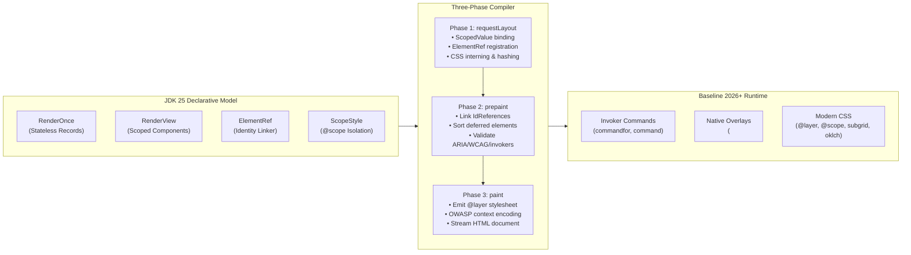

# Tessera

> **A declarative, type-safe HTML/CSS view engine and component system for JDK 25 and Chrome 156+ (Baseline 2026+) web platform primitives, with strictly zero client-side JavaScript.**

[](#)
[](#)
[-success.svg)](#)
[](#)
[-critical.svg)](#)

---

## Overview

Tessera is an advanced server-side UI framework built exclusively for **modern Java 25** and **Baseline 2026+ web standards**. Rather than treating HTML and CSS as untyped strings or shipping client-side JavaScript runtimes to reconstruct the DOM in the browser, Tessera treats the web platform as a first-class compilation target.

By leveraging native HTML5 and CSS capabilities—such as **Invoker Commands** (`commandfor` and `command`), **`<dialog closedby="any">`**, **`popover="auto"`**, **CSS `@scope`**, **Cascade Layers (`@layer`)**, **OKLCH `light-dark()` color spaces**, **CSS Anchor Positioning**, and **Speculation Rules**—Tessera delivers rich, interactive, accessible web applications with **zero bytes of client-side JavaScript**.



---

## Core Pillars & Architectural Principles

### 1. Baseline 2026+ Native Web Standards
Tessera emits purely standard HTML and CSS features available in modern browsers:
- **Invoker Commands**: Declarative button interactions via `commandfor="target-id"` and `command="show-modal"` / `command="toggle-popover"` / custom commands without JavaScript event listeners.
- **Native Light-Dismiss Overlays**: `<dialog closedby="any">` and `[popover="auto"]` with native backdrop styling and top-layer positioning.
- **CSS Cascade Layers (`@layer`)**: Strict, deterministic cascade hierarchy:
  `@layer reset, base, theme, components, utilities, interactive, container;`
- **Scoped Styling (`@scope`)**: Modular CSS styling isolated directly to component boundaries (`@scope ([data-view="tessera-card"])`) without CSS Modules or naming collisions.
- **OKLCH & `light-dark()`**: Perceptually uniform OKLCH color palettes with automatic OS light/dark mode adaptation via pure CSS variables.
- **Subgrid & Anchor Positioning**: Seamless multi-column card alignments, sticky headers, and pure CSS anchored tooltips.
- **Link Speculation Rules**: Native Chrome prefetch and prerender for instant multi-page transitions.

### 2. JDK 25 Idiomatic Language Features
- **`ScopedValue<RenderContext>` (JEP 506)**: Implicit, thread-confined, immutable context propagation across component trees.
- **Algebraic Data Types (ADTs)**: Sealed interfaces and records for type-safe CSS lengths (`CssLength`), tags (`HtmlTag`), and tokens.
- **Markdown Documentation Comments (JEP 467)**: All Javadoc is written using modern `///` Markdown syntax.
- **Zero-Warning Self-Typing**: Fluent builder traits (`Styled<SELF>`, `ParentElement<SELF>`, `InteractiveElement<SELF>`) utilize `SELF self()` overridden by leaf classes—yielding completely type-safe fluent chaining with **zero unchecked casts**.

### 3. Linker-Style Element Identity
In Tessera, DOM elements are identified by `ElementRef` tokens. References to other elements (such as `commandfor`, `<label for>`, `aria-labelledby`, `aria-describedby`, or `href="#..."`) are strongly-typed `IdReference` handles.
During compilation, the **Linker** statically resolves and verifies every reference:
- Unbound references trigger compile-time errors.
- Duplicate bindings or duplicate DOM IDs fail compilation immediately.
- Invoker command targets are validated for element compatibility (e.g. `show-modal` must target a `<dialog>`).

### 4. Zero `@SuppressWarnings` & Extreme Quality Gates
Tessera enforces an unyielding quality policy:
- Forked `javac` with `-Xlint:all -Xdoclint:all/protected,-missing -Werror`.
- Error Prone combined with Uber's NullAway in `@NullMarked` JSpecify mode.
- Checkstyle 14.4.0 enforcing Markdown docs (`///`) and banning legacy `/** */`.
- SpotBugs 4.10.5 running at `effort=Max` and `threshold=Low`.
- Spotless with google-java-format.
- **Zero `@SuppressWarnings`**: Suppressing warnings is strictly prohibited and verified by CI (`just no-suppress-warnings`).

---

## Component Catalog

Tessera includes a comprehensive catalog of accessible, responsive components:

| Category | Components | Highlights |
| :--- | :--- | :--- |
| **Typography & Prose** | `Prose`, `CodeBlock`, `Formatting`, `Footnotes` | Subgrid alignment, typography scales, line numbering, language tags, and **zero-JS declarative copy button** (`commandfor`). |
| **Status & Badges** | `Badge`, `Pill` | OKLCH tinted, outline, and solid variants across 6 semantic tones, status dot indicators, anchor link support. |
| **Navigation** | `Breadcrumbs`, `DocPager`, `StickyHeader`, `Toc` | Accessible breadcrumbs, pagination, sticky subgrid headers, and collapsible table of contents with integrated scrollspy. |
| **Overlays & Popovers** | `Overlays` (`Modal`, `Drawer`), `Dropdown` | Native `<dialog closedby="any">`, `popover="auto"`, `interestfor` hover hints, zero JavaScript dialogs. |
| **Forms & Input** | `Forms`, `SearchPalette` | Floating labels, native validation states, modal command palette with keyboard shortcuts. |
| **Data Presentation** | `SimpleTable`, `DataTable`, `Card`, `CardGrid` | Responsive tables, card grids with CSS subgrid alignment, hover elevation. |
| **Layout & Containers** | `ContentSection`, `Grid`, `Image`, `Lists`, `Accordion`, `Tabs`, `Carousel` | Responsive columns, scroll reveals, lazy and high-priority LCP image loading, pure CSS accordions and carousels. |

---

## Quick Start

### Prerequisites
- **JDK 25** (with `JAVA_HOME` pointing to JDK 25)
- **`just`** task runner (optional but recommended) or `./mvnw`

### Running the Multi-Page Showcase

Compile and run the built-in 8-page showcase static site:

```bash
# Compile the static site into target/site
just site

# Build and launch the built-in HTTP preview server at http://localhost:8080
just demo
```

### Running Tests & Quality Gates

```bash
# Run all unit tests and quality verification
just verify

# Enforce zero @SuppressWarnings across the entire tree
just no-suppress-warnings

# Format code with Spotless
just format
```

---

## Code Examples

### 1. Defining a Scoped Component (`RenderView`)

```java
public record MetricCard(String title, String value, Badge badge) implements RenderView {
  @Override
  public void configureScope(ScopeStyle scope) {
    scope
        .root(s -> s.flexCol().gap(CssLength.rem(0.5)))
        .select(".metric-value", s -> s.fontSize(CssLength.rem(1.5)).fontWeight(700));
  }

  @Override
  public Element render() {
    return div()
        .child(div().children(span().text(title), badge))
        .child(div().attr("class", "metric-value").text(value))
        .intoElement();
  }
}
```

### 2. Zero-JS Declarative Copy Button with CodeBlock

```java
// Emits a syntax block with a language tag and a zero-JS clipboard copy button
// (enabled by default) wired via commandfor="<code-id>" command="--tessera-copy":
CodeBlock.of("""
    public static void main(String[] args) {
      System.out.println("Hello, Tessera!");
    }
    """)
    .language("java")
    .highlightLines(2);
```

### 3. Badges & Pills

```java
// Badges with semantic tones and variants
Badge.success("Production").solid().dot();
Badge.warning("Deprecated").outline();
Badge.info("v0.1.0").pill();

// Ergonomic Pill factory
Pill.accent("Baseline 2026+");
Pill.neutral("JDK 25");
```

### 4. Native Dialogs with Invoker Commands

```java
var modal = Overlays.modal("confirm", "Confirm action")
    .bodyText("Are you sure you want to proceed?")
    .closeLabel("Cancel");

// The trigger's commandfor is resolved by the Linker to the dialog's scoped id.
main().children(modal.triggerButton("open-confirm", "Delete item"), modal.asDeferred(10));
```

---

## Project Structure

```
tessera/
├── .github/workflows/ci.yml       # Automated JDK 25 CI pipeline
├── docs/
│   └── architecture.md            # Canonical Architecture Specification
├── justfile                       # Task runner recipes
├── pom.xml                        # Maven configuration with strict compiler gates
└── src/
    ├── main/java/dev/nthings/tessera/
    │   ├── core/                  # Element hierarchy, linker identity, RenderOnce, RenderView
    │   ├── css/                   # OKLCH tokens, algebraic StyleRefinement, @scope, @layer
    │   ├── render/                # Three-phase compiler (requestLayout, prepaint, paint)
    │   ├── site/                  # Multi-page compiler, speculation rules, preview server
    │   ├── components/            # Complete component catalog
    │   └── showcase/              # Multi-page showcase demonstration site
    └── test/java/dev/nthings/tessera/ # Unit and integration test suites
```

---

## Documentation

For a comprehensive deep-dive into Tessera's architecture, compiler phases, linker mechanics, and CSS layer design, see the [Canonical Architecture Specification](docs/architecture.md).

---

## License

Tessera is open-source software licensed under the [Apache License, Version 2.0](LICENSE).
