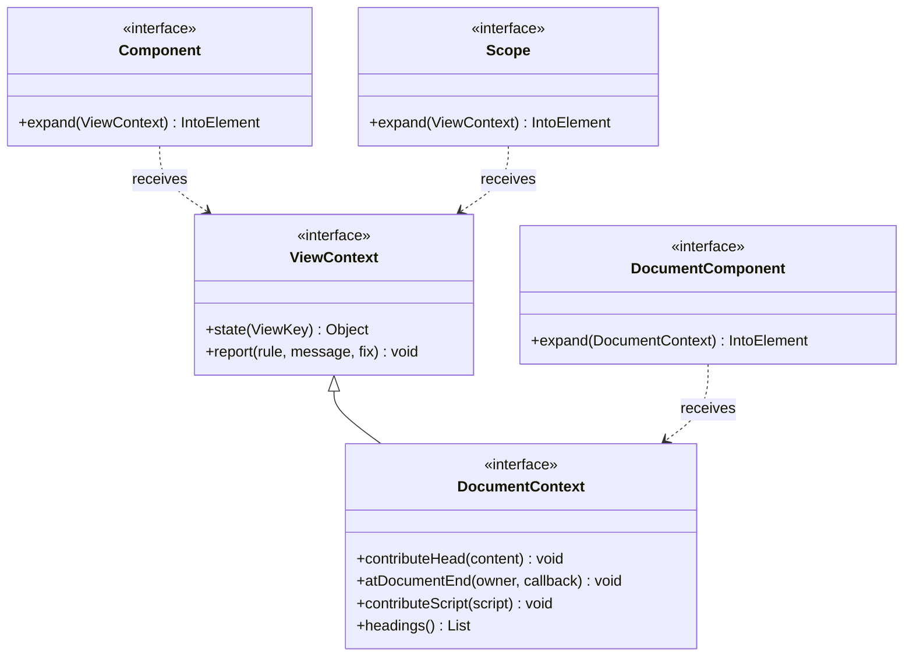
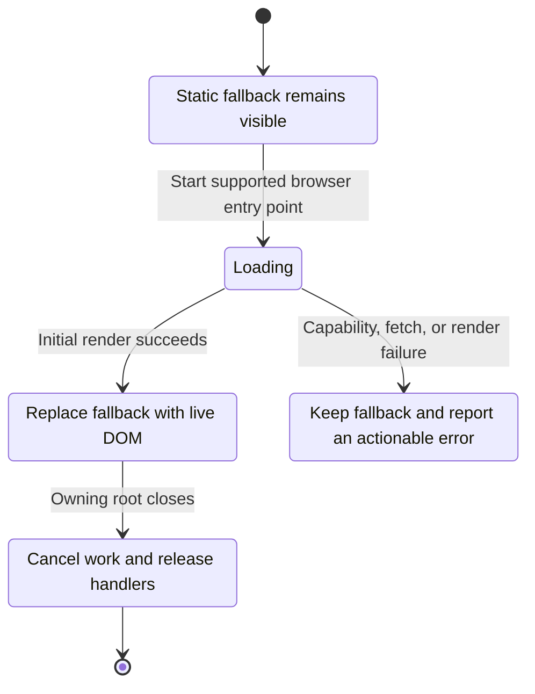

# Browser rendering architecture proposal

This proposal defines a Java-to-WebAssembly backend for mounting Tessera views into the browser DOM. Its APIs are design targets beyond the [experimental backend](browser-rendering.md). That backend is available through the opt-in `wasm` profile; document-context separation, unified control lowering, and compiler-managed mounts remain proposed work.

The design keeps static document authoring focused on HTML/CSS while allowing portable components, live controls, and compiler-managed browser assets. [Architecture](architecture.md) and [browser internals](browser-internals.md) describe the implementation that exists. The [roadmap](roadmap.md) defines delivery order and acceptance evidence.

## Design goals

| Goal | Design rule |
| --- | --- |
| Keep static authoring simple | Keep events, lifetimes, and WebAssembly-specific operations out of universal element builders |
| Make component portability explicit | Distinguish portable expansion from document assembly through context types |
| Share control semantics | Define one initial-state model with separate static and live implementations |
| Publish complete browser bundles | Compile mount descriptors into validated HTML and a resource graph |
| Protect internal contracts | Expose authoring APIs publicly and restrict backend access through module boundaries |

## Context hierarchy and placement

Portable components need render-scoped state and diagnostics. Document templates also need head content, document-end sections, scripts, and navigation headings. A browser mount has no document assembly phase, so these capabilities belong to different contracts.

The diagram summarizes capabilities; the state operation remains generic as `state(ViewKey<T>)`. `Component`, `Scope`, and browser view callbacks receive `ViewContext`. `DocumentComponent` and document callbacks receive `DocumentContext`. Outline headings are collected from elements that carry them; `headings()` reads that collection, and the context does not register headings.

Move `deferred`, `late`, and `rawHtml` placement behind document-only APIs. Portable components should be unable to create document-only nodes, rather than discovering the mismatch during browser rendering.

## Form controls and adaptive widgets

Proposed `TagElement.value(String)`, `checked(boolean)`, and `selectedValues(List<String>)` describe control state for both backends.

| Control state | Static document | Live browser mount |
| --- | --- | --- |
| Input value | Initial `value` attribute | Reconciled DOM value |
| Textarea value | Text content | Reconciled DOM value |
| Checkbox/radio selection | Initial `checked` attribute | Reconciled DOM checked property |
| Select values | `selected` on matching options | Reconciled option selection |

Shared expansion checks host compatibility through `control-value`, `control-checked`, and `control-selection`. Live updates apply after attributes and children and preserve focus, selection, caret position, and active input method editor (IME) composition.

Built-in widgets should use the same declared state with backend-specific behavior:

| Widget | Proposed authoring | Static behavior | Live behavior |
| --- | --- | --- | --- |
| `ContentTabs` | `selected(key)`, optional `onSelect(Consumer<String>)` | Page module selects panels and handles focus | Java handlers update selection and roving focus; invoke the callback |
| `Field` | `validationMessage(text)`, `invalid(error)` | Reveal errors for native invalid state or explicit `aria-invalid` | Apply explicit errors immediately |
| `Modal` / `Drawer` | `opened()` or `open(boolean)`, `dialogRef(ref)` | Native dialog and invokers | Reconcile dialog state in place, with top-layer behavior and focus restoration |
| Interest tooltip | `interestTooltip(callback)` | Native invoker plus Firefox module | Live hover/focus handling or CSS anchoring |

Java callbacks belong to the compiled browser application. Static HTML output does not serialize JVM closures or services. The existing static usage remains documented in the [component guide](consumer-guide.md).

## Browser mounts and resource publication

A proposed `WasmBundle` describes a compiled entry point as an immutable resource graph: launcher script, Wasm image, supplementary chunks, MIME types, and SHA-384 integrity digests.

A mount declaration such as `Elements.mount(hostId, bundle, viewName).fallback(content)` connects a named browser entry point to static fallback content. The compiler should:

1. Expand, link, and validate the non-interactive fallback as part of the document.
2. Publish content-hashed bootstrap, launcher, binary, and manifest resources under the external asset base.
3. Include every resource in `CompiledPage.assets()` or `CompiledSite.files()`.
4. Serialize mount configuration into escaped `data-tessera-*` attributes.
5. Support root and nested asset bases and publish `.wasm` with `application/wasm`.

The host must apply the Content Security Policy (CSP) headers. Target a distribution that runs with `default-src 'self'; script-src 'self' 'wasm-unsafe-eval'; style-src 'self'; object-src 'none'`, without inline script/style exceptions.

Mounting must preserve readable content on failure:

Unsupported capabilities must also preserve the fallback without requiring a successful loader. Streaming Fetch responses should update incrementally, cancel with the owning lifetime/root, and ignore stale completions.

## Module and package boundaries

Extract shared expansion and validation into a backend package while keeping static authoring independent of live runtime types. Java Platform Module System (JPMS) qualified exports should restrict access to backend internals.

| Surface | Proposed boundary |
| --- | --- |
| Public authoring | `foundation`, `css`, `core`, `components` |
| Static compilation and integration | `compiler`, `navigation` |
| Shared backend operations | `view`, exported only to the browser backend module |
| Diagnostic model | Shared `Diagnostic` and `Location` types in `core` |
| Wrapper records and tag inspection | Internal access contract for expansion; author-facing tag APIs retain mutation guards |
| Stylesheet collection | `StyleSheet` in the backend package; public CSS API contains authoring values and callbacks |
| Browser runtime | Events, effects, lifetimes, root ownership, and the internal DOM/Web Image bridge in the browser module |

The proposed browser module is `dev.nthings.tessera.wasm`; final live-package placement remains a design choice. Qualified exports control access between modules but do not grant cross-package access to package-private members. The internal access contract must account for that restriction before wrapper visibility changes.

Acceptance criteria, browser evidence, and delivery constraints belong to the [roadmap](roadmap.md).
