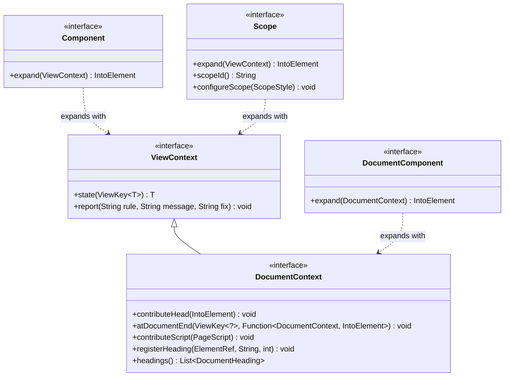
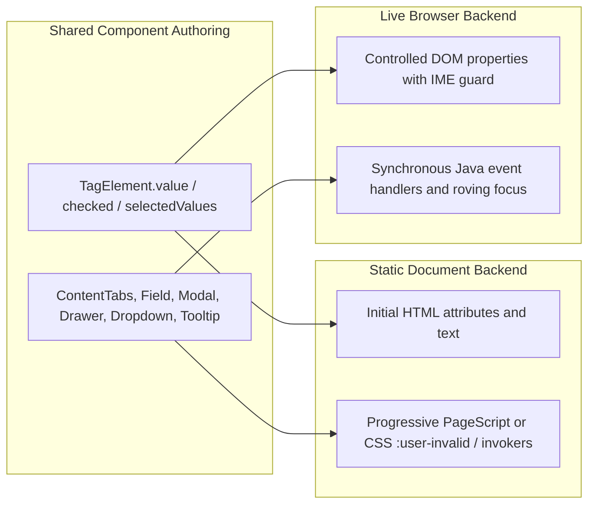
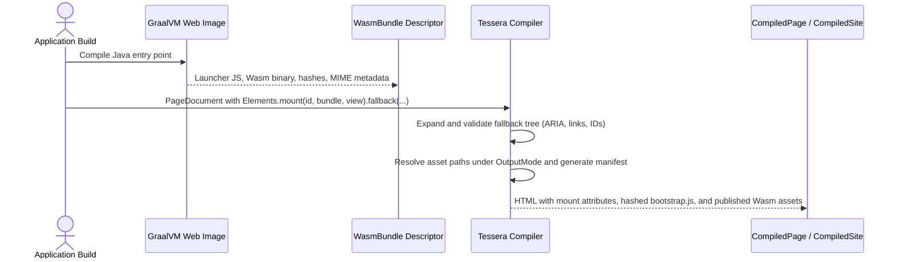

# Proposal: Dual-Backend Architecture without Static Complexity

This proposal defines the target architecture for supporting live browser rendering (`tessera-wasm`) alongside the JVM static compiler (`tessera`). It keeps the static authoring and compilation path free of live-runtime surface area while enabling portable components, unified widget semantics, and first-class asset compilation.

The current implementation is specified in [architecture.md](architecture.md). Execution phases and verification gates are tracked in [roadmap.md](roadmap.md).

## Design goals

| Goal | Architectural rule |
| --- | --- |
| Preserve static simplicity | Static consumers depend only on HTML, CSS, component, and document compilation contracts. No live event, lifetime, or WebAssembly types appear in universal element builders. |
| Eliminate cross-backend traps | Split portable view expansion from document assembly at the type level so unsupported capabilities fail at compile time rather than at render time. |
| Unify form and widget semantics | Form controls and built-in interactive widgets use one authoring model that emits declarative HTML/CSS in static pages and binds native state or Java handlers in mounted roots. |
| Compile browser mounts as assets | Static page and site compilation validate mount fallback trees, emit content-hashed bootstrap and binary resources, and enforce strict Content Security Policy (CSP) headers. |
| Encapsulate backend plumbing | Hide AST wrapper records, element inspection getters, and stylesheet builders behind package-private boundaries and qualified module exports. |

## 1. Context hierarchy and placement separation

Portable components and document templates have distinct capabilities. A component rendered inside a live browser mount has no `<head>`, no end-of-body sections, and no page-level scripts. Passing a document-specific context to every component forces a live backend to reject document calls at runtime with `native-*` diagnostics.



`ViewContext` is the portable expansion contract received by `Component`, `Scope`, and `BrowserRoot` view callbacks. It provides render-scoped state (`state(ViewKey<T>)`) and component diagnostic reporting (`report(rule, message, fix)`).

`DocumentContext` extends `ViewContext` for document compilation. Only `DocumentComponent` and `PageDocument` callbacks receive `DocumentContext`. Document placement factories (`deferred`, `late`, and `rawHtml`) move from `Elements` to `DocumentContext` (or `PageDocument`), preventing portable components from creating unplaceable nodes inside a mounted root.

## 2. Unified form controls and adaptive widgets

Authors configure form controls and built-in widgets once. Each backend lowers that declaration to the mechanism its target platform supports.



### Form control properties

`TagElement.value(String)`, `checked(boolean)`, and `selectedValues(List<String>)` are portable across both backends:

- **Static compilation** lowers them to initial HTML markup: the `value` attribute on `<input>`, text content on `<textarea>`, the `checked` boolean attribute on checkboxes and radios, and `selected` on matching `<option>` elements.
- **Live rendering** reconciles them against live DOM properties after attribute and child patching, preserving caret, selection, focus, and active IME composition.

Host compatibility checks (`control-value`, `control-checked`, `control-selection`) run in shared expansion for both backends. The `native-control-properties` rejection rule is removed.

### Adaptive built-in components

Built-in interactive components expose one declarative state model and adapt their lowering per backend:

| Component | Portable authoring contract | Static document lowering | Live mount lowering |
| --- | --- | --- | --- |
| `ContentTabs` | `selected(key)` and optional `onSelect(Consumer<String>)` | Emits `<tessera-tabs>` and contributes the `tessera-tabs` module script | Binds click and `ArrowLeft`/`ArrowRight`/`Home`/`End` roving-focus handlers in Java without contributing a page script |
| `Field` | `validationMessage(text)` for native constraints; `invalid(error)` for explicit state | Emits `.field-error` revealed by `:user-invalid` or `[aria-invalid="true"]` | Sets `aria-invalid="true"` and reveals `.field-error` immediately when `invalid(error)` is present |
| `Modal` / `Drawer` | `opened()` or `open(boolean)` with `dialogRef(ref)` | Emits `<dialog>` with `command="show-modal"` / `"close"` invokers | Renders in place (using the browser top layer) and reconciles modal state with focus restoration |
| `interestTooltip` | `TagElement.interestTooltip(UnaryOperator<TagElement>)` | Emits `interestfor` popover and contributes `TooltipScript` for Firefox | Binds hover and focus state or pure CSS anchor positioning without contributing `TooltipScript` |

## 3. First-class browser mounts and resource graphs

Static pages and sites embed live browser views through typed mount descriptors compiled by `Compiler`, eliminating hand-written host HTML, ad-hoc bootstrap scripts, and unverified asset paths.



A `WasmBundle` is an immutable resource graph descriptor describing a compiled entry point: its launcher script, `.wasm` image, supplementary chunks, content types (`application/wasm`, `text/javascript`), and SHA-384 integrity digests.

`PageDocument` places a mount with `Elements.mount(hostId, bundle, viewName).fallback(content)`:

1. **Fallback verification:** The compiler expands, links, and validates the non-interactive fallback content as part of the static page, checking IDs, references, landmarks, and accessibility rules before mounting.
2. **Asset publication:** Under `OutputMode.external(assetBase)`, the compiler rewrites and content-hashes the bootstrap module, launcher, and `.wasm` binary under `assetBase`, recording every file in `CompiledPage.assets()` and `CompiledSite.files()`.
3. **CSP and data safety:** Mount configuration is serialized into `data-tessera-*` attributes without inline scripts. The output runs under `default-src 'self'; script-src 'self' 'wasm-unsafe-eval'; style-src 'self'; object-src 'none'`.

## 4. Module encapsulation and package boundaries

Internal compiler nodes and backend hooks are hidden from downstream consumers through Java Platform Module System (JPMS) qualified exports and package-private access.

```mermaid
block
    columns 3
    subgraph Public["Public Authoring & Compilation API (dev.nthings.tessera)"]
        columns 3
        foundation["foundation<br/>Builders & hashing"]
        css["css<br/>Values, tokens & Styled"]
        core["core<br/>Elements, refs & contexts"]
        components["components<br/>Built-in UI catalog"]
        compiler["compiler<br/>Page & site compilation"]
        navigation["navigation<br/>Search & doc pagers"]
    end
    space:3
    subgraph Internal["Qualified Backend SPI"]
        columns 1
        view["view<br/>Expansion, linking, validation & StyleSheet<br/>(exported only to tessera.wasm)"]
    end
    subgraph LiveModule["Live Browser Module (dev.nthings.tessera.wasm)"]
        columns 2
        live["wasm<br/>BrowserRoot, Host & events"]
        reconciler["Internal DOM & Web Image bridge<br/>(package-private)"]
    end

    components --> core
    compiler --> view
    live --> view
    live --> components
```

### Encapsulation rules

| Boundary | Visibility change | Consumer impact |
| --- | --- | --- |
| `dev.nthings.tessera.view` | Exported strictly to `dev.nthings.tessera.wasm` via `exports ... to` in `module-info.java` | `ViewExpansion`, `ViewSnapshot`, `ViewNode`, `ViewRenderer`, and `ViewValidation` disappear from consumer autocomplete |
| `Diagnostic` and `Location` | Moved from `view` to `core` | Shared by `CompilationException` and `ViewException` without exporting `view` |
| `Element` AST records | `ComponentElement`, `ScopeElement`, `TextElement`, `KeyedElement`, `IdReference`, and sibling records become package-private in `core` | Consumers see only `IntoElement`, `Element`, `TagElement`, and `FragmentElement` |
| `TagElement` inspection getters | `attributes()`, `idReferences()`, `childrenList()`, `boundRefs()`, and style extractors move behind a package-private accessor bridge | `TagElement` autocomplete lists only authoring methods |
| `StyleSheet` | Moved from `css` to `view` | `dev.nthings.tessera.css` exposes only style authoring types (`Styled`, `CssValue`, `Theme`, `Tokens`, `ScopeStyle`) |
| Live event and lifetime types | Scoped to `dev.nthings.tessera.live` (or `tessera-wasm`) | Static page authors never import `BrowserEvent`, `EventOptions`, `Effect`, or `Lifetime` |
