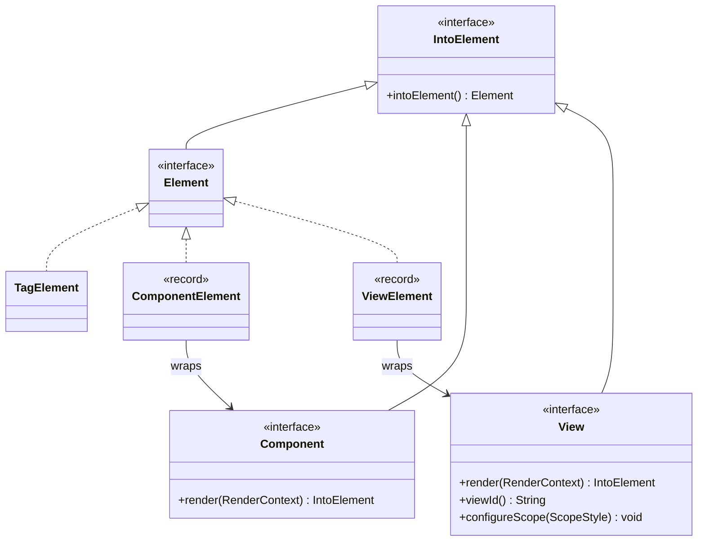
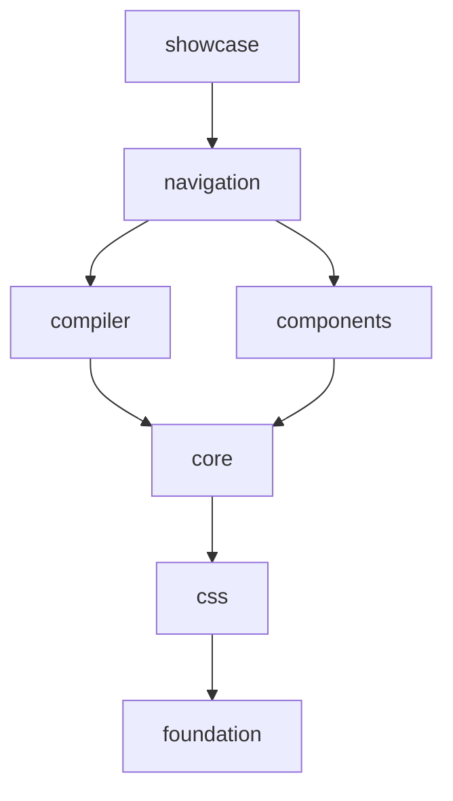
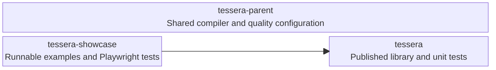
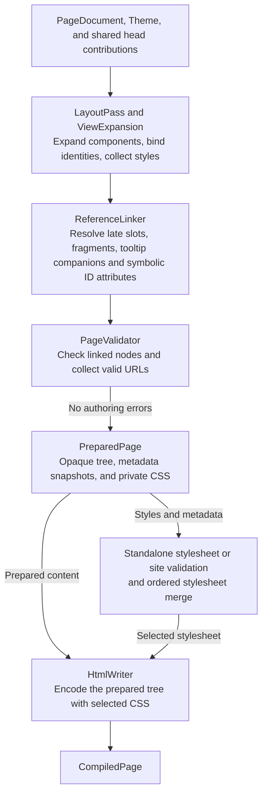
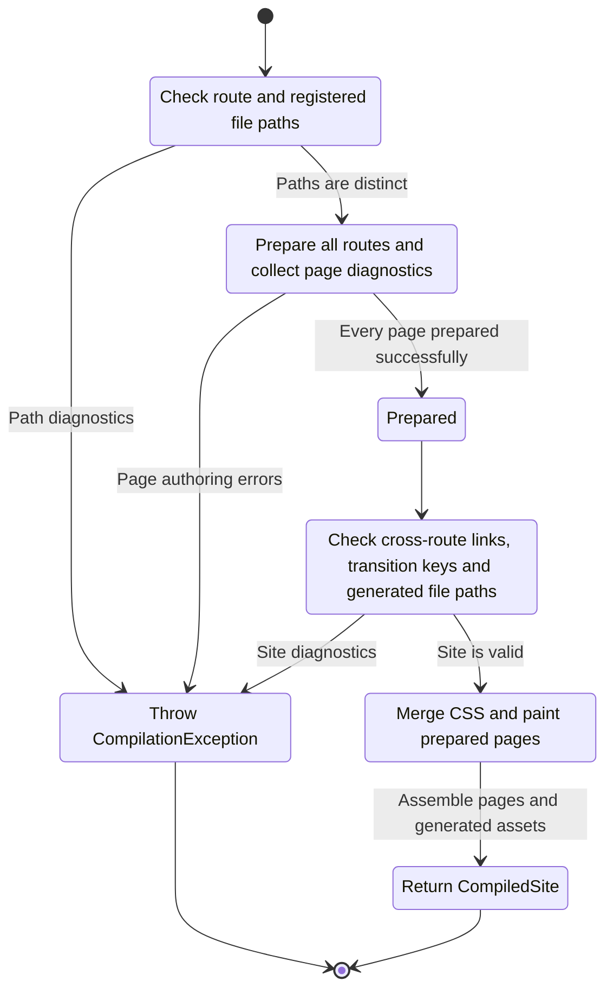
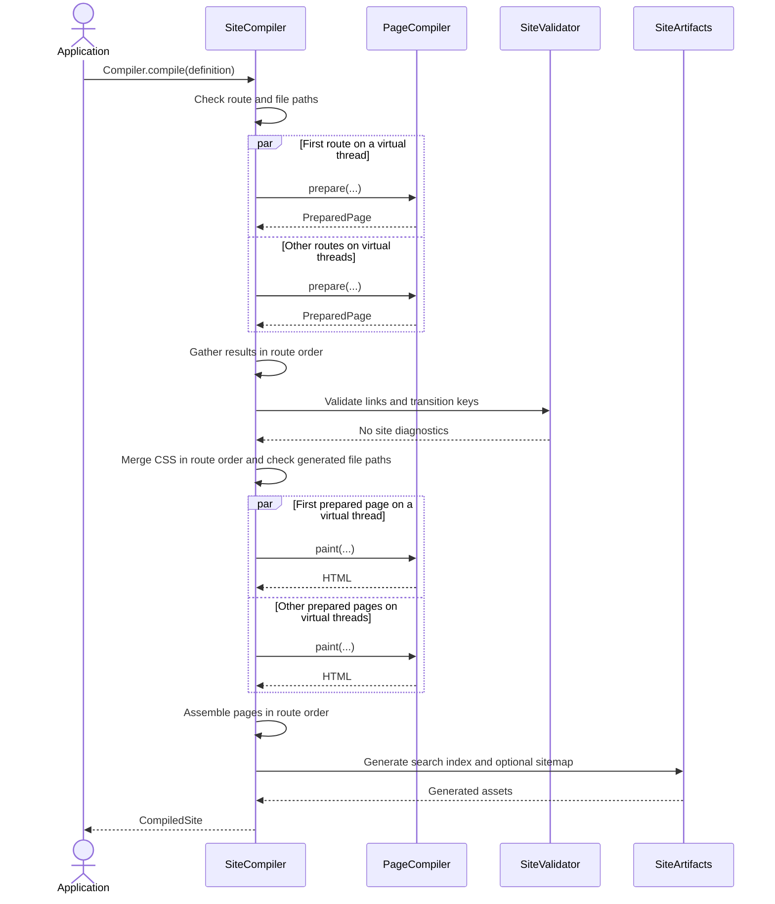

# Architecture and separation of concerns

Tessera is a declarative Java 25 HTML/CSS compiler with a component library and static-site tooling. Authors construct mutable element builders and components. Compilation expands them into a separate linked tree, validates that tree, and emits HTML with inline or external CSS. Site compilation coordinates this process across routes and produces a shared stylesheet and generated artifacts.

## API evolution

Tessera has no external consumers. Evolve APIs directly with breaking changes and zero compatibility shims. Update the implementation, showcase, tests, and documentation together; do not add deprecation wrappers or migration guides.

Documentation diagrams use [Mermaid](https://mermaid.js.org/syntax/all-examples). Select the diagram type that best expresses the structure, relationships, states, or interactions being documented. Exact mappings remain Markdown tables.

## Core abstractions

- `IntoElement` is the authoring conversion contract: anything placeable. The sealed `Element` hierarchy allows exhaustive compiler dispatch. `Elements` factories return `TagElement`, `FragmentElement` or plain `Element`; the leaf and wrapper records (`TextElement`, `DeferredElement`, `ComponentElement`, ...) are public only because the compiler pattern-matches them, and are documented as compiler-facing.
- `Component.render(context)` expands without adding a scope. `View.render(context)` establishes an identity namespace and optional CSS scope before expansion; `viewId()` names the instance and `configureScope(scope)` declares the scoped CSS. Both return `IntoElement`, so a component may return another component. A `View` that is an anonymous class or lambda and keeps the class-name `viewType()` is reported as `unstable-view-type`.
- `FragmentElement` groups sibling elements without emitting a wrapper, preserving direct-child content models.
- `IntoElement.key(key)` wraps content in a compiler-facing `KeyedElement`. Expansion gives each keyed child its own `ViewScope` (a per-list prefix numbered within the enclosing scope, computed once per child list, followed by the key's hexadecimal UTF-16 units), so ids bound inside it follow the key rather than the position. The content is emitted in place; a keyed component takes the key on its own component-path entry instead of gaining another. A key repeated among the children of one parent reports `duplicate-key` at the second sibling.
- `TagName` is the sealed element-name family: the built-in `HtmlTag` enum or an author-defined `CustomElement`.
- `ElementRef` is the only authoring identity: `scoped(name)` (prefixed by the view scope), `page(name)` (literal, page-unique) or anonymous. An element may carry several refs that alias one DOM id; `IdReference` is the compiler-facing record of an attribute that names refs. View scopes are a compiler concept (`ViewScope`, package-private).
- `Command` is sealed: `BuiltinCommand` constants, checked against their targets, or `Command.custom(namespace, name, payload)`.
- `ClientBehavior` is a deduplicated ES module contribution. It emits inline for standalone pages or as a content-hashed asset when output publishes external files.
- `Styled`, `InteractiveElement`, `ParentElement`, and `FluentBuilder` (`onlyIf`, `ifPresent`) share authoring operations without unchecked self casts. No public member is named after a Kotlin keyword or a stdlib scope function (`apply`, `also`, `let`, `run`, `use`, infix `to`), so Kotlin callers never need backticks and `div().apply { ... }` keeps the stdlib meaning.
- `RenderContext` is an author-facing interface: `document(key)`, `contributeHead`, `atDocumentEnd`, `contributeBehavior`, `registerHeading`, `headings()` and `report(rule, message, fix)`. The compiler implements it (`PageContext`, package-private), which also carries the view scope, component path and `StyleSheet`.
- `Styled` is the one public style trait. Its methods are grouped into package-private traits by concern (layout, box, text, effects, scrolling, anchoring) and reached only through `Styled`. Every style method takes a typed value of the category its property accepts, so a color cannot be passed where a length belongs; a keyword property with several useful values takes one enum (`cursor(Cursor)`, `overflow(Overflow)`, `textWrap(TextWrap)`). The last call wins: `StyleRefinement` emits declarations in a fixed property order with every shorthand before its longhands, and writing a shorthand removes the longhands it covers, so `pt(...)` then `p(...)` keeps only `p`, while `p(...)` then `pt(...)` keeps both. `mergeFrom` replays writes through the same rule. Style callbacks and reusable presets are `StyleBlock`s, applied with `Styled.styles(...)`; scope query groups are `ScopeBlock`s. Both are library-owned functional interfaces marked `@KotlinReceiver` (`foundation`), which Kotlin's `sam-with-receiver` plugin turns into receiver lambdas; Java lambdas are unaffected.
- `CssValue` is the sealed family of those values: `CssLength` (dimensions, `calc`, `min`/`max`, `anchor()`), `CssColor` (OKLCH, `color-mix`, `light-dark`, relative colors), `CssNumber`, `CssDuration`, `Easing`, `Border`, `Shadow`, `Background`, `TrackList`, `GridPlacement`, `Transform`, `AspectRatio`, the name handles (`Anchor`, `Counter`, `CustomProperty`), and keyword enums. Values are built only through static factories; the immutable value types (`CssLength`, `CssColor`, `Transform`, `Container`, `FlexLayout`, `Transition`, `Animation`, `Keyframes`, `Theme`) are `@CheckReturnValue`, so Error Prone (enabled for the library build) and Kotlin's return-value checker flag a discarded derived value; their implementation records and the property and keyword plumbing (`CssProperty`, `CssKeyword`) are package-private. `StyleRefinement` accepts declarations only from the `css` package, so no declaration is built from raw text.
- `StyleRefinement` also holds conditional styles: nested refinements keyed by a sealed `Condition` (`State`, `Media`, `ContainerQuery`), a `@starting-style` refinement, and the `Keyframes` its animations use. `Container` and `Keyframes` are handles, so no condition or keyframe rule is written as text.
- `StyleSheet` is the compiler-facing stylesheet builder. The compiler hands it typed inputs only (an element's `StyleRefinement`, a view's `configureScope` callback, which fills a `ScopeStyle` the stylesheet creates, and transition class names a `TransitionKey` has already validated) and receives the class names or scope keys to emit. An element's declarations become a `u-` class (`utilities` layer), its state, media and starting-style rules an `i-` class (`interactive`), and each container query a `cq-` class (`container`). Keyframes used anywhere are emitted once in `@layer base`. It deduplicates rules and renders the layered stylesheet with the `Theme`.
- `Accessible` writes the element's `Role` and typed `aria-*` states. The generic `attr`, `boolAttr`, and `idRef` methods refuse `role` and `aria-*`.
- `SourceProvenance` lets elements record their Java call site as a `SourceLocation` through a scoped `SourceCapture`; `compiler.SourceTracking` supplies the JVM stack-walking capture, so `core` has no stack-walker dependency.
- `DocumentKey<T>` supports per-compilation component state. Footnotes and image coordination retain their own registries without site-layer knowledge.
- `OutputMode` (`inline()` or `external(assetBase)`) describes CSS and module publication independently of filesystem I/O.

The authoring contracts convert components into element wrappers before the layout pass expands them. The class diagram shows the relevant subset of the sealed element hierarchy:

## Dependency graph

Arrows point from consumers to providers. The diagram omits transitive edges for readability; the table lists every direct project dependency. The graph has no package cycles.

| Package | Direct project dependencies | Responsibility |
| --- | --- | --- |
| `foundation` | None | Fluent composition, the `KotlinReceiver` marker, and deterministic identifiers/hashing |
| `css` | `foundation` | CSS values, tokens, authoring traits, collection and serialization |
| `core` | `foundation`, `css` | Elements, component contracts, identities, commands, the render context contract |
| `compiler` | `foundation`, `css`, `core` | Page and site compilation, output, diagnostics, routes, artifacts, filesystem and preview adapters |
| `components` | `foundation`, `css`, `core` | Reusable authored UI |
| `navigation` | `components`, `compiler` | Route-derived search palette and pager composition |
| `showcase` | `components`, `compiler`, `core`, `css`, `navigation` | Example application and CLI |

The component catalog and the compiler are sibling consumers of the element/CSS model. Neither imports the other. Site compilation consumes page metadata without knowing which components produced it. Navigation integrates site models and UI.

Built-in components are public final `IntoElement` classes. They extend one of two package-private bases: `BuiltinComponent` lowers itself to a `ComponentElement` around its package-private `render`, named by the component's simple class name for diagnostics; `BuiltinView<B>` lowers itself through a private `View` adapter that delegates `viewType`, `configureScope` and `render` and reads the instance id. The render protocol therefore stays off the public types, while each component keeps a stable explicit `data-view` name (`modal`, `tessera-badge`, `form-field`, ...). `BuiltinView` holds the optional instance id and provides the one public `id(String)`, returning the concrete type through `FluentBuilder.self()`; `null` lets the compiler number the instance per scope. `Modal` and `Drawer` share a package-private `DialogView` base for their common builder surface. `Button` and `IconButton` are scope-free `BuiltinComponent`s: their face is element-level styles on the `<button>`, so the refs they bind and target resolve in the caller's scope.

Page and site compilation share one package so that the phase split between them (`PageCompiler.prepare`/`paint`, `PreparedPage`, `SiteCompiler`, validators, `HtmlWriter`) stays package-private. The public surface is `Compiler`, its inputs (`PageDocument`, `SiteDefinition`, `SiteRoute`, `Asset`, `OutputMode`, `LinkSpeculation`), its outputs (`CompiledPage`, `CompiledSite`, `PageTree`), its errors (`CompilationException`, `Diagnostic`, `Location`), the publishing adapters (`SiteWriter`, `SitePreviewServer`), and `SourceTracking`.

The reactor builds two child modules under `tessera-parent`:

`dev.nthings:tessera` contains every library package. `tessera-showcase` compiles as a separate module using the public API, with no dependency on library test helpers. Playwright is test-scoped in the showcase module. Shared compiler and quality configuration belongs to the parent; runtime dependencies belong to their modules. Package-private access still protects internal compiler details within the library.

## User-facing APIs

| Task | Entry points and contracts |
| --- | --- |
| Author HTML | `Elements`, `TagElement`, `TagName` (`HtmlTag`, `CustomElement`), `FragmentElement`, `IntoElement`, sealed `Element` variants |
| Build components | `Component`, `View`, `ParentElement`, `InteractiveElement`, `Styled`, `RenderContext.report(...)` |
| Add client behavior | `ClientBehavior`, `RenderContext.contributeBehavior(...)`, `CompiledPage.assets()` |
| Author styles | `Styled`, the `CssValue` family (`CssLength`, `CssColor`, `Border`, `Shadow`, `TrackList`, ...), `StyleRefinement`, `FlexLayout`, `Typography`, `Transition`, `Animation`, `Keyframes`, `Container`, `Condition` (`State`, `Media`, `ContainerQuery`), `ScopeStyle`, `Tone`, `Tokens`, `Theme`, sealed `DesignToken<V>` |
| Declare accessibility semantics | `Accessible`, `Role` (name, children, state, and `aria-*` requirements) |
| Bind identities and interactions | `ElementRef` (`scoped`, `page`, `anonymous`), `TagElement.id(ElementRef)`, `Command` (`BuiltinCommand`, `Command.custom`), `ClosedBy`, `TransitionKey` |
| Trace elements to source | `SourceTracking`, `SourceLocation`, `Compiler.explain(...)`, `PageTree` |
| Contribute document content | The callback's `RenderContext`: `document(key)`, `contributeHead(...)`, `atDocumentEnd(...)`, `registerHeading(...)` |
| Compile a page | `PageDocument`, `Compiler.compile(...)`, `CompiledPage`, `OutputMode`, `Asset` |
| Define and compile sites | `SiteDefinition.builder()`, `SiteDefinition.route(path)`, `SiteRoute`, `Asset`, `LinkSpeculation`, `Compiler.compile(site)`, `CompiledSite` |
| Read compilation errors | `CompilationException.diagnostics()`, `Diagnostic`, `Location` |
| Write and preview | `SiteWriter.writeToDirectory(...)`, `SitePreviewServer.start(...)` |
| Derive navigation | `navigation.SiteNavigation.searchPalette(...)`, `docPager(...)` |
| Use supplied UI | `components`: final classes with `X.of(...)` factories, fluent options and optional `id(String)`; shared `Tone`, `Size` and `Link` |

`CompiledPage` contains HTML, CSS text, and the assets the HTML links: none under inline output; the stylesheet followed by client behavior modules under external output. Consumers publish every asset. `CompiledSite` contains each route's HTML in route order, the shared CSS text, every published file (registered assets, the stylesheet and modules, `search-index.json`, optional `sitemap.xml`), and readers for the generated artifacts. Output types are independent of the functions producing them.

## Page compilation contracts

`PageCompiler` (package-private) coordinates passes. `CompilationState` belongs to one preparation: the page's DOM ids and the references bound to them, generated-id counters, transitions, outgoing links and diagnostics. Binding resolves all refs of one element to one DOM id: the first named ref decides it (scoped refs are qualified by the view scope, page refs are literal), anonymous refs alias it, and a second named ref asking for another id reports `conflicting-element-id`. `ViewExpansion` keeps only deferred priorities and late slots. Neither escapes preparation.

`LayoutPass` orders the document and `ViewExpansion` expands components into `ViewNode`s. Generated ids are numbered within each identity scope, so content added in one view never renumbers another. A failing render, style, late or document-end callback propagates unchanged, with a suppressed `CompilationException` naming the component path. `LayoutPass` creates the root `PageContext` for the document. Derived child contexts share that document's state and styles without changing their parent's scope or component path. Deferred elements expand in their lexical scope and are emitted later in priority/sequence order. Late and document-end callbacks receive their explicit contribution context. End sections may register more end sections; head contributions may add more head contributions. Existing iterative processing and ordering are preserved.

`ReferenceLinker` turns `ViewNode`s into `ResolvedNode`s after identity allocation: it substitutes late slots, splices fragments, places each tooltip companion after its invoker and resolves references. Linking only builds the tree; `PageValidator.index` then records elements by id and labelled control ids for the checks that look them up. `PageValidator` checks images, readable interactive labels, same-page fragments, invoker target existence, and compatibility of built-in commands with dialog and popover targets. `AccessibilityRules` checks the linked body tree (see below). It collects `href`, `src`, and `poster` URLs from both body and head nodes. Image checks run during layout while authored style information is available; tree checks run after linking.

`ViewNode` and `ResolvedNode` are package-private. Only linked `ResolvedNode`s (tags, text and raw HTML) reach validation, inspection and painting. Attributes and child lists are compiler-owned copies, so compilation does not modify authoring builders. Raw HTML is an explicit trusted escape hatch and remains opaque to validation.

`PreparedPage` is package-private. Its metadata consists of snapshots of IDs, outgoing URLs, transition keys, headings, and client behaviors. Its `StyleSheet` is privately owned. `contributeStylesTo(target)` copies rules into the site's stylesheet; `stylesheet(theme)` serializes the page contribution. Painting reuses prepared content without rerunning component callbacks.

Field rendering copies the retained control's authoring configuration before wiring labels, hints, errors and anchors. The copy retains reference identities and child definitions but owns its attribute and reference maps. Setting `hint(null)` or `error(null)` removes that contribution on the next render without leaving stale references on the retained builder.

`HtmlWriter` owns HTML context encoding and the document envelope. External CSS paths derive from final stylesheet content, allowing every route to reference the same merged stylesheet. Client behaviors are emitted once per page: inline module scripts for `OutputMode.inline()`, or content-hashed module assets under the same external asset base for `OutputMode.external(...)`. `HtmlWriter.Resources` hashes and encodes the stylesheet once and each distinct module once per compilation; every page paints the paths of those assets, so site compilation can check generated paths for collisions before painting. The external base must be an absolute path; `OutputMode.external` rejects a relative one. Authored CSS and explicitly raw HTML remain trusted input.

## Document metadata and component state

`DocumentState` (compiler, package-private) owns page-local component registries, ordered head contributions, end sections, and navigation headings. `RenderContext` exposes authoring operations and a `headings()` snapshot; components and the site layer never receive this mutable state. `DocumentKey.getOrCreate(values)` is the one compiler-facing hook that lets the compiler hold per-page component state without seeing its type. `Modal`, `Drawer` and `Dropdown` accept caller-owned element references, allowing independent invokers to target their content. `Image.hero()` keeps one hero per page through a document registry and reports a second as `duplicate-hero-image` with `RenderContext.report`.

`DocumentHeading(target, title, level)` is component-independent metadata whose `target` is an `ElementRef`. `registerHeading(target, title, level)` records it; the component binds `target` on the heading element. After linking, the compiler resolves each target to its DOM id for the search index and reports a target that was never bound as `unbound-reference`. Registration does not automatically index every HTML heading.

`Section` registers its heading while rendering and binds the section to a page-level ref, so `/page/#section-id` links do not depend on the layout a section sits in. `TableOfContents` consumes headings through a late element, so it may precede sections, and links each item with `href(target)`; `headings(List<DocumentHeading>)` lists a fixed set instead. Section components retain supported levels 2 through 4; general metadata supports HTML heading levels 1 through 6. Headings retain registration order.

Search generation reads the resolved headings from `PreparedPage.headings()`. Custom components participate through `registerHeading` without importing or rendering `TableOfContents`. Other component registries remain local implementation details keyed by `DocumentKey<T>`.

## Accessibility rules

`AccessibilityRules` runs on the linked body after `PageValidator` and reports through the same diagnostics. Rules that depend on a role apply to elements that declare one with `Accessible.role(Role)`; native elements are checked where their semantics are unambiguous (`<dialog>`, headings, landmarks, `<label for>`).

| Rule | Reported when |
| --- | --- |
| `role-name-required` | A role that requires an accessible name (or a native `<dialog>`) has no `aria-label`, `aria-labelledby`, `title`, native label, or, for roles named from content, readable content |
| `role-required-children` | A role such as `tablist`, `list`, `listbox`, `menu`, or `tree` owns none of the roles it requires |
| `role-required-attribute` | A custom element lacks a state its role needs (`aria-checked`, `aria-level`, `aria-valuenow`, `aria-selected`); native hosts that expose the state are exempt |
| `aria-attribute-not-allowed` | An `aria-*` attribute is neither global nor supported by the declared role |
| `landmark-name-unique` | Several landmarks of one kind lack distinct accessible names |
| `multiple-main` | A page has more than one main landmark |
| `heading-level-skip`, `empty-heading` | Heading levels jump by more than one in document order, or a native heading has no text; a declared heading role is named under `role-name-required`, which also replaces `interactive-label` on a button or link with a declared role |
| `tabindex-positive` | A positive `tabindex` overrides the natural tab order |
| `label-target` | `<label for>` points at an element a label cannot name |
| `aria-hidden-focusable` | An `aria-hidden` subtree contains a control that stays in the tab order |

Closed dialogs, popovers, and `aria-hidden` subtrees are excluded from landmark and heading structure because they have no accessibility tree. `Role` carries each role's requirements as data, so the rules and the authoring API share one source.

## Source provenance

`SourceTracking` is off by default. While it is active (inside `SourceTracking.enabled(...)` or `SourceTracking.enabledIf(flag, ...)`), each `TagElement` and component wrapper records the first stack frame that is neither Tessera's nor the platform's. Frames are classified by code source, so a library user's own code is never mistaken for Tessera's, even in the same package.

- An element a Tessera component builds during compilation is attributed to the line that placed the component, through the origin carried by `RenderContext` and by head and end-section contributions.
- `Location.source()` carries the `SourceLocation`; `CompilationException` prints it as `<button> (Page.java:42)`.
- `HtmlWriter` emits `data-src="Page.java:42"` for tracked elements, so a rendered element leads back to the line that wrote it.
- Site compilation carries the caller's setting onto its virtual threads.
- `Compiler.explain(...)` snapshots the linked tree as `PageTree`: tag, DOM id, attributes, enclosing components, CSS scope, and source. `PageTree.toText()` prints it; `just explain <route>` prints a showcase route.

## Compilation diagnostics

`Location` is flat: optional route, page title, enclosing components, element tag, optional DOM ID and source. Internally, layout records a page-independent `ViewLocation` (components, tag, DOM ID, source) on each node; `CompilationState` adds the page title when it reports, and site compilation adds the route. `Diagnostic.format()` presents it; a component-level location omits the element, and a site-level file location has neither route nor page.

`PageContext` carries a component path independently of the identity scope. `DocumentState.Contribution<T>` pairs registered head, end-section or heading content with the `ViewLocation` that placed it, allowing layout to expand it with its originating component context. `RenderContext.report(...)` records a component diagnostic at the current component path and origin.

Layout attaches diagnostic locations to resolved tags and retains them when expanding late or deferred content. Linking preserves the location when replacing symbolic attributes. `PreparedPage` snapshots the first location of each outgoing URL and each transition key so site validation can report errors without exposing the intermediate tree.

`CompilationState` collects `Diagnostic` records containing a rule code, message, fix, and location. Recoverable authoring errors accumulate through layout, linking, and validation. Duplicate reference bindings and DOM IDs are marked ambiguous, so target-dependent checks do not select an arbitrary element. Unresolved symbolic attributes remain marked as unresolved and are excluded from dependent checks, avoiding secondary errors such as a missing-label report caused by an unbound label reference. The compiler throws one `CompilationException` with the collected diagnostics before returning a prepared page or emitting HTML.

Site compilation first checks paths, which are known before anything renders: duplicate route paths report `duplicate-route`, and a registered file whose path is taken by a route, another file, `/search-index.json` or (with a base URL) `/sitemap.xml` reports `file-path-collision`. Any such diagnostic stops compilation before pages are prepared. The preparation coordinator maps each route to either a prepared page or collected diagnostics, annotates failures with the route, and gathers diagnostics in route declaration order despite concurrent execution. The shared parallel mapper owns scheduling and result ordering; it has no diagnostic aggregation policy. URL syntax is validated once during page validation: malformed URLs become `invalid-url` diagnostics. Site validation consumes the syntactically valid URL metadata. Cross-route link and transition validation run only after every page prepares successfully and share one diagnostic report with collisions between generated stylesheet or module paths and routes or registered files, all before painting. Application callback failures and internal compiler failures continue to propagate rather than being converted to authoring diagnostics.

For site compilation, validation gates the transition from prepared pages to painted output:

## Site orchestration and I/O

The sequence shows a successful multi-route compilation; the state diagram above describes rejection paths. Each parallel block represents the route batch.

Site definitions require at least one route. Tasks use virtual threads; results are gathered in declaration order. Each page has separate compilation state. CSS merges sequentially and deterministically. Component callbacks should avoid mutating shared application state during concurrent rendering.

`SiteValidator` receives prepared metadata and asset paths. It resolves relative and root-relative URLs against each route's published document URI, validates decoded paths and fragments, and excludes query strings from target lookup. Generated `index.html` URLs are accepted alongside route paths. Absolute and protocol-relative URLs are external to this validation. It also checks transition-key appearances on at least two routes. Output namespace collisions are reported as `file-path-collision` diagnostics rather than thrown. Compilation performs no filesystem writes.

`SiteArtifacts` owns XML/JSON serialization. `SiteWriter` owns directory creation, route-to-output-path mapping, and byte writes. `SitePreviewServer` serves the same compiled routes and assets. `Asset.file(...)` remains explicit input I/O; byte-backed assets are shared by compilation and output adapters.

## Verification and remaining limits

Existing tests cover scoped identities, linking failures, late TOCs, deferred footnotes and overlays, image contributions, merged stylesheets, site links/assets, disk output, and preview HTTP responses. Search integration tests verify that output includes headings registered by a custom component without `TableOfContents`. Tests exercise output rather than package shape or builder implementation details.

The showcase is also the browser acceptance suite. It compiles through the public `Compiler`, writes through `SiteWriter`, and serves the resulting directory with the JDK static HTTP server on an ephemeral port. Browser tests therefore cover published output, rather than substituting in-memory HTML for the generated site.

JUnit runs the same browser suite on the latest Playwright Chromium and Firefox, reusing each browser across its class and creating a fresh browser context per test. Documentation routes are opened at desktop and narrow viewport widths, checking visible headings, applied CSS, image loading, HTTP failures, and horizontal overflow. Named cases are routes under `/stories/{case}/{variant}/{appearance}/{density}/`. Documentation sections and browser tests call the same factories, and each case page contributes the chosen `color-scheme` and density in its document head. Those cases are opened at the same widths for the overflow check. Documentation routes additionally run axe-core WCAG A/AA audits, keyboard flows for every interactive widget, forced-colors, reduced-motion, 200% zoom, and text-spacing checks. These complement the library tests' compiler diagnostics and output assertions.

Surefire runs unit tests during `test`. Failsafe runs `*IT` tests during `integration-test` and checks results at `verify`. Browser installation is an explicit setup command (`just browsers`); CI installs the configured release's Chromium, Firefox, and operating-system dependencies before full verification. There is no browser-version matrix: the contract is the latest stable release of each supported engine. Tests retain Playwright traces and failure screenshots under the showcase module's `target/playwright/{chromium,firefox}` directory.

Invoker checks establish target existence and require the appropriate dialog or popover target for Tessera's built-in commands. Custom commands remain valid for arbitrary existing targets. Trusted raw HTML is not parsed, and JSON escaping retains the existing serializer's behavior. These concerns have isolated owners in validators and artifact serialization.

## Shared design tokens and search

The design tokens in `Tokens` cover colors, font families, the type scale, tracking, spacing, corner radii, line height, motion durations, and component density. `DesignToken<V>` is sealed by category: `Color`, `Length`, `Duration`, `FontFamily`, and `Number`, each also a value of its category (`Length` tokens are `CssLength` values, so they work in length-valued authoring directly). Token names are validated, not sanitized. An immutable `Theme` maps tokens to values; `Theme.with(token, value)` is type-checked against the token's category, so an override cannot change it. Spacing tokens include the density multiplier; font sizes, tracking, and durations do not. `Typography` and `Transition` expand into the same declaration pipeline as other style values. Component roles in `Roles` reference tokens, so a theme replaces the role or the underlying scale through `Theme.with`. Built-in components use CSS variable references, so an override changes rendered appearance without changing the component tree. Layout widths and breakpoint definitions remain separately authored values. `Button` and `IconButton` emit native buttons. Tone, surface, and size are separate from submit and invoker behavior. `Tone` is one css enum shared by buttons, badges and highlights, carrying its base, text and on-solid colors; each component maps it to its own paint privately, and `Callout.Kind` maps to a tone.

`SearchPalette` always renders a functional search input and grouped result links. It contributes a `ClientBehavior` once per document using the render context, so standalone pages and compiled sites carry the behavior automatically. The behavior is inlined for standalone output and published as a content-hashed module asset when the page uses external assets. No component-to-site dependency or manual asset registration is needed. `ContentTabs` uses the same path for ARIA tab selection and roving tabindex. `TooltipBehavior` is contributed when an `interestTooltip` is resolved; it supplies hover and focus handling where native interest invokers are absent.

The search module defines a customized built-in `HTMLDialogElement`. Browser upgrade and lifecycle callbacks scope behavior to each palette; `AbortController` removes listeners when an instance disconnects. Native invoker commands and dialog behavior handle opening, focus trapping, and dismissal. Selection uses native `requestClose()` and anchor navigation, while CSS `:has()` controls empty-group visibility. The module has private instance fields and caches normalized search entries per instance. It needs no document-wide initializer, index fetch, or polyfills for the target browsers. The tabs module defines an autonomous `tessera-tabs` element, selects panels through `aria-controls`, and moves focus with Arrow Left, Arrow Right, Home, and End.

The [consumer guide](consumer-guide.md) and its runnable `GuideSite` demonstrate these public APIs together. Browser tests cover filtered navigation, empty-state recovery, custom token rendering, and encoded relative links over published files.
