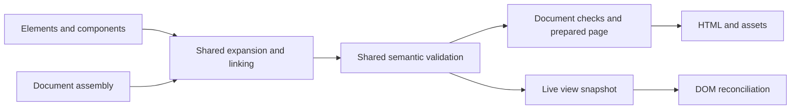

# Architecture

Tessera uses shared expansion, reference linking, validation, and CSS collection for two outputs: static HTML documents and experimental live browser roots. Applications author mutable elements and components; each expansion captures its own tree before output or DOM reconciliation.

This document helps maintainers locate responsibilities in the current implementation. Read [compiler internals](compiler.md) for static pass ownership and [browser internals](browser-internals.md) for runtime behavior. The [proposal](architecture-redesign.md) defines target contracts; the [roadmap](roadmap.md) orders the refactor and later features.

## Rendering paths

Static compilation produces complete documents and assets. Browser rendering produces a linked snapshot for one mounted root, then reconciles it with native DOM. Both paths expand the same portable content; document content reaches only the compiler and live content only a browser root, and the placement types enforce that split at compile time.



## Package boundaries

The default artifact, `dev.nthings:tessera`, declares the Java module `dev.nthings.tessera`. The optional `dev.nthings:tessera-wasm` artifact declares `dev.nthings.tessera.wasm` and exposes the shared authoring API transitively. Each showcase is a separate Maven project.

| Package or artifact | Access and responsibility |
| --- | --- |
| `foundation` | Public fluent composition, Kotlin callback marker, deterministic hashing and identifiers |
| `css` | Public CSS values, tokens, declarations, and style callbacks. Serialization stays package-private |
| `core` | Public portable elements, components, contexts, identities, and diagnostics |
| `document` and `document.components` | Public document placement, assembly contracts, and document-only components |
| `components` | Public portable widgets and document decorators for those widgets |
| `compiler` | Public static compilation, resource, filesystem, and preview APIs. Coordination stays package-private |
| `navigation` | Public route-derived navigation |
| `internal.authoring`, `internal.css`, `internal.components` | Unexported builder data, CSS collection, and shared component implementation |
| `view` | Shared backend operations and linked snapshots, exported only to `dev.nthings.tessera.wasm` |
| `tessera-wasm` | Public live authoring and host services. Reconciliation, live payloads, and the native DOM bridge stay package-private |
| `tessera-showcase`, `tessera-wasm-showcase` | Public API examples and browser tests served over HTTP |

On the module path, consumer applications require the artifact's Java module and use its public packages. The default build has no browser runtime dependency. The `wasm` profile builds both browser entry points with the same library classes on the Web Image classpath. Classpath execution does not enforce JPMS exports. See the [repository layout](development.md#repository-layout).

## Authoring model

Content belongs to one of three placement families. The contracts determine where applications can attach children, including through callbacks and collections.

| Family | Placement contract | Components | Context |
| --- | --- | --- | --- |
| Portable | `IntoElement` | `Component`, `Scope` | `ViewContext` |
| Document | `DocumentContent` | `DocumentComponent`, `DocumentScope` | `DocumentContext` |
| Live | `LiveContent` | `LiveComponent`, `LiveScope` | `LiveContext` |

`Element` is the sealed portable tree. Its concrete tag and fragment builders expose authoring operations. They register accessors for their data in `internal.authoring`, where text, keyed, component, and scope placements also live. During expansion each backend reads this data through the accessors and captures the attributes and children it needs.

A `DocumentElement` or `LiveElement` wraps a portable host and appends its family's children. Document lowering captures raw HTML, deferred and late content, and document callbacks. Live lowering captures live callbacks, bindings, and effects. The two entry points feed the same expansion and linking operations. One type parameter carries backend-owned data through the linked tree. Document leaves carry trusted HTML. Live hosts carry browser bindings, and live leaves carry effects.

The portable `live(...)` style callback compiles to declarations in a document and to a stable custom-property rule in a browser root. Built-in widgets can contribute a library script during document lowering. Application scripts go through `DocumentContext` or `Documents.script(...)`. Portable builders refuse inline event handlers and `srcdoc`. Shared expansion reports `script-url` for script URLs and `svg-namespace` for invalid SVG or HTML placement.

Each scope family returns one explicit host: `Scope.expand` a `TagElement`, `DocumentScope.expand` a `DocumentElement`, and `LiveScope.expand` a `LiveElement`. Expansion stamps `data-scope` on that host. It does not insert a `div`, and it does not retarget an inner scope's host. `ScopeDefinition` holds the identity and styles the three families share.

`Styled`, `ParentElement`, and `FluentBuilder` share authoring operations without unchecked self casts. `StyleBlock`, `ScopeBlock`, and `ElementBlock` carry the `KotlinReceiver` marker for optional [Kotlin receiver lambdas](kotlin.md#enable-receiver-lambdas).

## Built-in components

Built-in portable components expose factories and fluent configuration. Two package-private bases handle their placements.

| Base | Expansion boundary |
| --- | --- |
| `BuiltinComponent` | Wraps a portable component without opening a new identity scope; uses its class name in diagnostics |
| `BuiltinScope<B>` | Uses a private `Scope` adapter for the instance ID, stable scope name, styles, and host expansion |

Components that number, collect, or preload across a page are document content: footnotes, the table of contents, the documentation layout, and the hero decorator returned by `Image.hero()`. `Section.withDocument(...)` returns a document section whose body continues with document content. Other built-in components are portable. An internal `Icons` helper builds structured SVG shared by portable and document widgets. `ContentTabs` and `SearchPalette` declare their bundled behaviors (`BundledBehavior.TABS`, `SEARCH`), and their markup stays readable without the scripts.

`Modal` and `Drawer` share a `DialogView` base. `Button` and `IconButton` are scope-free: their references resolve in the caller's namespace. They carry no handlers; `element()` returns their `<button>` for a browser `LiveElement` to wrap. Components that own a tag, such as `Image`, expose an `ElementBlock` configuration callback.

`TagName` represents built-in `HtmlTag` values, authored `CustomElement` names, and `SvgTag` values with their namespace. `Command` represents checked built-in commands and custom commands with application-supplied payloads.

## Identity model

`ElementRef` carries symbolic identity until linking. The first named reference on an element chooses its DOM ID; anonymous references alias it. A conflicting second named reference becomes a diagnostic. `IdReference` represents attributes that target references.

Package-private `view.ViewScope` values qualify scoped names. Generated counters are local to a scope. Keyed content extends the scope with the key's hexadecimal UTF-16 units and, when present, its nearest named owner. The hexadecimal encoding has no separator ambiguity. A keyed component attaches the key to its component-path entry without adding an extra component wrapper.

`ViewScope` preserves whether an ancestor prefix was generated through both ordinary and keyed extensions. An explicit child scope does not make a generated parent stable. Expansion reports keyed content within any such prefix. See [identity references](consumer-guide.md#link-elements-with-identity-references) and [list keys](consumer-guide.md#key-list-items-that-move) for the authoring rules and fixes.

## Expansion state and contexts

Every callback receives a context derived from the package-private `view.ExpansionContext`, which carries the current identity scope, component path, stylesheet, and origin. Derived contexts share expansion state without changing their parent's location or namespace.

| Context | Implemented by | Adds |
| --- | --- | --- |
| `ViewContext` | `view.ExpansionContext` | `state(ViewKey)` and `report(...)`, for portable callbacks in both backends |
| `DocumentContext` | `view.DocumentView` over the compiler's document backend | Head contributions, document-end sections, page scripts, and collected headings |
| `LiveContext` | `tessera-wasm` over the root's expansion context | The owning `BrowserRoot` |

A portable callback always receives the portable context, even inside document or live content, so it cannot reach another family's operations.

`view.ExpansionRegistry` owns `ViewKey` state and headings for one expansion: one page compilation or one attempted live render. A rejected render discards it with the expansion. `compiler.DocumentState` owns head contributions, document-end sections, and scripts for static output. The hero decorator of `Image.hero()` uses expansion state to detect a second hero image.

`DocumentHeading` is component-independent metadata collected from an element during expansion, not a context side effect. `Heading` carries an optional `DocumentHeading`. `ViewExpansion` records it in either backend, and no context registers headings. Linking resolves the reference to a DOM ID for navigation and search. Search generation reads prepared heading metadata; it does not depend on a table-of-contents component. Other component registries remain local to their owners. Public contribution behavior is described in the [component guide](consumer-guide.md#contribute-document-content).

## Stylesheet assembly

`Styled` is the public style trait. Package-private traits group its methods by concern. `CssValue` types represent lengths, colors, numbers, durations, borders, shadows, grids, transforms, and keyword values. Implementation records and property plumbing remain package-private.

`Declarations` accepts property writes from the CSS package and applies consistent shorthand/longhand replacement. It also retains conditional groups, starting styles, and referenced keyframes. [Styling](styling.md) defines the author-facing operations and precedence rules.

The CSS package constructs and serializes scoped styles and supplies rule data through an internal accessor. `internal.css.StyleSheet` aggregates and deduplicates those rules for documents and mounted roots. The browser uses embedded rules from the qualified `view` package. The cascade follows this layer order.

```css
@layer reset, base, theme, components, utilities, container, interactive;
```

| Contribution | Generated representation |
| --- | --- |
| Element declarations | `u-` classes in `utilities` |
| Element state/media/starting styles | `i-` classes in `interactive` |
| Element container queries | `cq-` classes in `container` |
| Scoped component rules | Deduplicated scope blocks |
| Referenced keyframes | Emitted once in `base` |
| Theme values | CSS custom properties used by component rules |

Design tokens are sealed by category. `Theme.with` preserves those categories, and components use variable references so theme changes do not require a different component tree. Layout widths and breakpoint values remain explicitly authored.

## Compilation and output boundaries

`Compiler` is the public entry point. Inputs include `PageDocument`, `SiteDefinition`, `SiteRoute`, `Asset`, and `OutputMode`. Results are `CompiledPage`, `CompiledSite`, and the inspection result `PageTree`. [Sites](sites.md) defines their publication contracts.

`PageCompiler` coordinates document placement and output. `DocumentExpansion` lowers document and portable placements into shared nodes, and the compiler's `DocumentPass` orders page contributions. Linking and semantic validation run before emission. `PreparedPage` holds the linked tree, stylesheet, and metadata until emission. See [compiler internals](compiler.md).

`ViewRenderer` lowers live content into a linked `ViewSnapshot` and collects semantic diagnostics before publication. The browser runtime reconciles groups and handles the bindings and effects it supplied. See [browser internals](browser-internals.md).

`HtmlWriter` owns context-sensitive encoding and the HTML envelope. `SiteArtifacts` serializes search JSON and sitemap XML. `SiteWriter` owns output paths and file writes; `SitePreviewServer` serves compiled results. Compilation itself writes no files. `Asset.file(...)` is explicit input I/O.

Authored raw HTML, selectors, and script source remain trusted inputs. [Diagnostics](diagnostics.md) describes validation coverage and [Browser support](browser-support.md) describes the generated client behavior.

## Browser ownership

Shared linking lowers typed form defaults into native markup. Browser roots apply that markup on insertion, preserve reset defaults on retained controls, and reconcile live bindings against the current native properties. The same portable form can be published as a static page or mounted into a browser root. See [form ownership](browser-rendering.md#bind-form-values).

`BrowserRoot` owns the view callback, committed references and IDs, scheduling, root lifetime, and styles. `DomReconciler` retains native nodes, logical ranges, listeners, and effect lifetimes. `Host` binds asynchronous work to a root or effect lifetime. The package-private `Dom` bridge contains Web Image interoperability code.

Each render prepares and validates a candidate before DOM mutation. A commit owns what it acquires: it reconciles while registering every created instance before that instance acquires listeners or an effect lifetime, publishes the tree, references and IDs at one boundary, retires replaced resources with their cleanups, then starts new effects. Closure requested at any phase settles there and releases everything once, following the [runtime design](design/runtime.md#own-resources-before-exposing-callbacks).

Styles are shared by roots within one compiled entry. `StyleSink` manages the constructed stylesheet; `StyleLedger` counts rule ownership and bounds unused-rule retention. Independent entries have separate runtimes and ledgers. Frequently changing style values use stable custom-property rules. Detailed event, control, and scheduling behavior belongs in [browser internals](browser-internals.md).

## Current limits

These constraints affect current use and define the work that remains. They are not guarantees of the proposed design.

Each mount host's ID is reserved: a child claiming it is rejected before publication.
