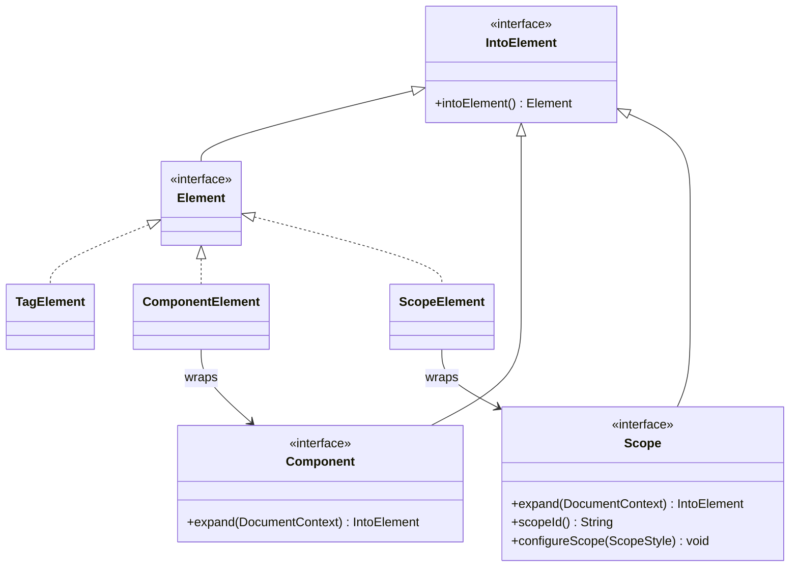

# Architecture

Tessera separates authoring from compilation. Applications build mutable elements and reusable components. The compiler expands them into its own tree, resolves identities, validates the result, and emits HTML and resources. Site compilation coordinates that process across routes.

This document describes the shared model, JVM compiler, and experimental browser integration. See [compiler internals](compiler.md) for pass ownership, [Development](development.md) for verification, and the [browser architecture proposal](architecture-redesign.md) for planned work.

## Package boundaries

All shared library packages belong to `dev.nthings:tessera`. The separate `tessera-showcase` module consumes its public API. The opt-in `tessera-wasm` runtime consumes shared view operations, and `tessera-wasm-showcase` builds its images and acceptance application.

| Package | Direct project dependencies | Responsibility |
| --- | --- | --- |
| `foundation` | None | Fluent composition, Kotlin callback marker, deterministic hashing and identifiers |
| `css` | `foundation` | Typed values, tokens, style authoring, collection, and serialization |
| `core` | `foundation`, `css` | Elements, component contracts, identities, commands, document contributions |
| `view` | `foundation`, `css`, `core` | Shared expansion, linking, validation, snapshots, and diagnostic model |
| `compiler` | `foundation`, `css`, `core`, `view` | Page/site compilation, diagnostics, resources, filesystem and preview adapters |
| `components` | `foundation`, `css`, `core` | Reusable UI |
| `navigation` | `components`, `compiler` | Route-derived search palettes and pagers |
| Showcase application | `components`, `compiler`, `core`, `css`, `navigation` | Examples, command entry points, browser verification |

Components and the shared view layer are sibling consumers of the element/CSS model. The compiler and browser runtime consume shared view operations. Neither imports the other. Navigation connects the site model to UI. Page and site compilation share one package so their intermediate types and coordination APIs can remain package-private.

The parent POM owns common build policies. Runtime dependencies belong to their modules; Playwright stays test-scoped in the showcase. See the [repository layout](development.md#repository-layout).

## Authoring model

`IntoElement` is the placement contract. Components convert to wrappers that the compiler expands; the sealed `Element` hierarchy supports exhaustive dispatch. The diagram shows the relevant subset:



`TagElement` holds private attributes, references, children, and declarations. Compiler-facing getters expose read-only views; typed methods enforce identity and ARIA guards. `FragmentElement` groups siblings without markup. Other element variants represent text, trusted raw HTML, deferred placement, late callbacks, and keyed content.

These wrapper records are public for backend access across packages. They are backend-facing representations; application composition uses the [component contracts](consumer-guide.md#choose-a-component-contract).

A scope root must be one element host. Expansion stamps `data-scope` on that host. It does not insert a `div`, and it does not retarget an inner scope's host.

`Styled`, `ParentElement`, and `FluentBuilder` share authoring operations without unchecked self casts. `StyleBlock`, `ScopeBlock`, and `ElementBlock` carry the `KotlinReceiver` marker for optional [Kotlin receiver lambdas](kotlin.md#enable-receiver-lambdas).

## Built-in components

Public built-in types expose factories and fluent configuration. Their expansion methods remain internal through two package-private bases:

| Base | Expansion boundary |
| --- | --- |
| `BuiltinComponent` | Wraps a component without opening a new identity scope; uses its class name in diagnostics |
| `BuiltinScope<B>` | Uses a private `Scope` adapter for the instance ID, stable scope name, styles, and expansion |

`Modal` and `Drawer` share a `DialogView` base. `Button` and `IconButton` are scope-free: their references resolve in the caller's namespace. Components that own a tag, such as `Image`, expose an `ElementBlock` configuration callback.

`TagName` represents built-in `HtmlTag` values and authored `CustomElement` names. `Command` represents checked built-in commands and custom commands with application-supplied payloads.

## Identity model

`ElementRef` carries symbolic identity until linking. The first named reference on an element chooses its DOM ID; anonymous references alias it. A conflicting second named reference becomes a diagnostic. `IdReference` represents attributes that target references.

Package-private `view.ViewScope` values qualify scoped names. Generated counters are local to a scope. Keyed content extends the scope with the key's hexadecimal UTF-16 units and, when present, its nearest named owner. The hexadecimal encoding has no separator ambiguity. A keyed component attaches the key to its component-path entry without adding an extra component wrapper.

`ViewScope` preserves whether an ancestor prefix was generated through both ordinary and keyed extensions. An explicit child scope does not make a generated parent stable. Expansion reports keyed content within any such prefix. See [identity references](consumer-guide.md#link-elements-with-identity-references) and [list keys](consumer-guide.md#key-list-items-that-move) for the authoring rules and fixes.

## Document state

`DocumentContext` exposes authoring capabilities while package-private `view.ViewContext` carries the current identity scope, component path, stylesheet, and origin. Derived contexts share page state without changing their parent's location or namespace.

`view.DocumentRegistry` owns component state and headings for one page compilation or one live render. `compiler.DocumentState` owns head contributions, document-end sections, and scripts for static output. `DocumentKey<T>` retains state without exposing its concrete type to the backend. `Image.hero()` uses this mechanism to detect a second hero image.

`DocumentHeading` is component-independent metadata collected from an element during expansion, not a context side effect. `Heading` carries an optional `DocumentHeading`. `ViewExpansion` records it, and `DocumentContext` does not register headings. Linking resolves the reference to a DOM ID for navigation and search. Search generation reads prepared heading metadata; it does not depend on a table-of-contents component. Other component registries remain local to their owners. Public contribution behavior is described in the [component guide](consumer-guide.md#contribute-document-content).

## Stylesheet assembly

`Styled` is the public style trait. Package-private traits group its methods by concern. `CssValue` types represent lengths, colors, numbers, durations, borders, shadows, grids, transforms, and keyword values. Implementation records and property plumbing remain package-private.

`Declarations` accepts property writes from the CSS package and applies consistent shorthand/longhand replacement. It also retains conditional groups, starting styles, and referenced keyframes. [Styling](styling.md) defines the author-facing operations and precedence rules.

`StyleSheet` accepts typed declarations, scope callbacks, and validated transition names. It deduplicates rules and returns class names or scope keys to the compiler. The cascade layer order is:

```css
@layer reset, base, theme, components, utilities, interactive, container;
```

| Contribution | Generated representation |
| --- | --- |
| Element declarations | `u-` classes in `utilities` |
| Element state/media/starting styles | `i-` classes in `interactive` |
| Element container queries | `cq-` classes in `container` |
| Scoped component rules | Deduplicated scope blocks |
| Referenced keyframes | Emitted once in `base` |
| Theme values | CSS custom properties used by component rules |

Design tokens are sealed by category. `Theme.with` preserves those categories, and components use variable references so theme changes do not require a different component tree. Layout widths and breakpoint values remain explicitly authored.

## Compilation and output boundaries

`Compiler` is the public entry point. Inputs include `PageDocument`, `SiteDefinition`, `SiteRoute`, `Asset`, and `OutputMode`. Results are `CompiledPage`, `CompiledSite`, and the inspection result `PageTree`. [Sites](sites.md) defines their publication contracts.

`PageCompiler` coordinates document placement and output through the shared `ViewExpansion`, `ReferenceLinker`, and `ViewValidation`. Backend-facing representations are public for cross-package access; document coordination stays package-private. `PreparedPage` exposes metadata snapshots while retaining ownership of its stylesheet and linked tree. Emission uses prepared content without rerunning callbacks. See [compiler internals](compiler.md).

`ViewRenderer` produces a linked `ViewSnapshot` for one mounted render. The browser runtime reconciles its groups, events, controls, and effects against native DOM. See [browser internals](browser-internals.md) for identity, lifetimes, failure handling, and scheduling.

`HtmlWriter` owns context-sensitive encoding and the HTML envelope. `SiteArtifacts` serializes search JSON and sitemap XML. `SiteWriter` owns output paths and file writes; `SitePreviewServer` serves compiled results. Compilation itself writes no files. `Asset.file(...)` is explicit input I/O.

Authored raw HTML, selectors, and script source remain trusted inputs. [Diagnostics](diagnostics.md) describes validation coverage and [Browser support](browser-support.md) describes the generated client behavior.
