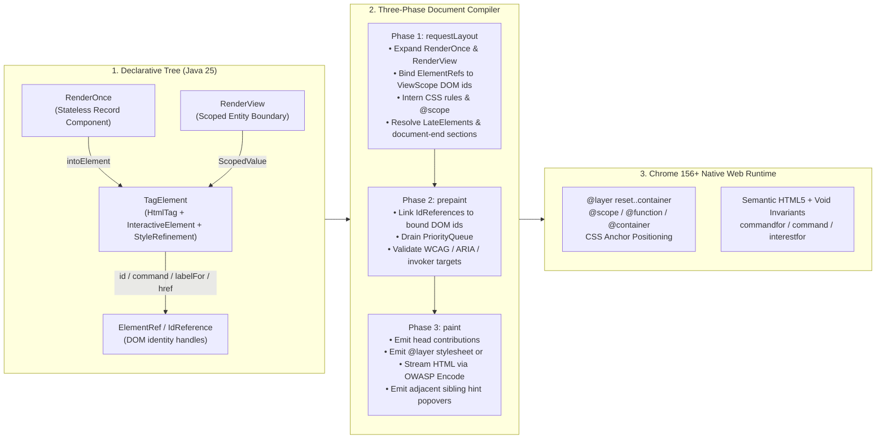

# Tessera: Canonical Architecture Specification (JDK 25 + Chrome 156+ Baseline 2026)

> [!IMPORTANT]
> **Target Environment & Compiler Invariants**
> - **Java Runtime**: **JDK 25 LTS** (`--release 25`), utilizing JEP 506 `ScopedValue`, sealed Algebraic Data Types (ADTs), pattern matching with record patterns, unnamed variables (`_`), and JEP 467 Markdown documentation comments (`///`).
> - **Browser Baseline**: **Chrome 156+ (Baseline 2026+)**. Native browser capabilities are emitted directly without legacy polyfills or fallback shims.
> - **Compiler Strictness**: forked `javac` with `-Xlint:all -Xdoclint:all/protected,-missing -Werror`, paired with Error Prone + NullAway (`@NullMarked` JSpecify mode). Checkstyle bans legacy `/** */` comments (use `///`), and SpotBugs runs at `effort=Max`, `threshold=Low`. **`@SuppressWarnings` is strictly prohibited across the entire codebase** (`just no-suppress-warnings`).

---

## 1. Architectural Synthesis

Tessera is a declarative, multi-phase HTML/CSS view engine for JDK 25 that separates **component composition**, **scoped entity boundaries**, **linker-style element identity**, **algebraic style refinements**, and **multi-phase document emission**.



### Core Architectural Pillars

| Architectural Pillar | Tessera Realization (JDK 25 + Chrome 156+) |
| :--- | :--- |
| **Dual Component Model** | **`RenderOnce`** (stateless `record` components consumed in a single pass) + **`RenderView`** (scoped domain boundaries wrapped with `[data-view="<view-type>"]`, `[data-view-id="<scope-id>"]`, and type-safe `ScopeStyle` `@scope` CSS isolation). |
| **Multi-Phase Compilation** | Three-phase immutable pipeline producing `ResolvedNode` trees: **`requestLayout`** (tree expansion, `ScopedValue` view scoping, `ElementRef` binding, CSS rule & `@scope` deduplication, lexical deferred traversal, late-element resolution) $\rightarrow$ **`prepaint`** (id-reference linking, priority-sorted deferred hoisting, accessibility & invoker target verification) $\rightarrow$ **`paint`** (streaming HTML/CSS emission & shared multi-page CSS bundling via `SiteCompiler`). |
| **Linker-Style Element Identity** | A single concrete **`TagElement`** (backed by an `HtmlTag` enum with void-element awareness) receives a DOM id by binding an **`ElementRef`** identity handle (`id(ElementRef)` / `id(String)`). References to other elements (`commandfor`, `for`, `aria-*`, `list`, `href="#…"`) are **`IdReference`** values resolved by the compiler like linker symbols; unbound refs, refs bound twice, and duplicate DOM ids fail compilation. |
| **Zero-Warning Self-Typing** | Every fluent trait (`FluentBuilder<SELF>`, `Styled<SELF>`, `ParentElement<SELF>`, `InteractiveElement<SELF>`) exposes `SELF self()`, overridden by concrete classes (`return this;`) with zero unchecked `(SELF) this` casts. |
| **Algebraic CSS Engine** | `StyleRefinement` stores declarations in an `EnumMap<CssProperty, String>` for $O(1)$ cascade merging and byte-level deterministic FNV-1a hashing; lengths are a sealed `CssLength` ADT. |
| **Ordered CSS Cascade Layers** | Deterministic 7-layer cascade (`@layer reset, base, theme, components, utilities, interactive, container;`) ensuring pseudo-class states (`@layer interactive`) and `@container` queries (`@layer container`) always override base atomic utilities (`@layer utilities`). |
| **Scoped Lexical Context** | JDK 25 **`ScopedValue<RenderContext>`** (JEP 506) propagates the current `ViewScope`, `StyleSheetCollector`, design token registry, and per-page `DocumentState` implicitly across `RenderOnce::render()` and `RenderView::render()`. |
| **Component-Owned Document Hooks** | Components keep their own per-page registries behind private `DocumentKey`s and extend the page via `contributeHead(...)`, `atDocumentEnd(...)`, and `Elements.late(...)`, so `render/PageCompiler` has no dependency on `components`. |

---

## 2. Targeted Library Stack

Tessera maintains a minimal, zero-reflection dependency footprint:

| Dependency | Maven Coordinates | Scope | Architectural Purpose |
| :--- | :--- | :--- | :--- |
| **JSpecify** | `org.jspecify:jspecify:1.0.0` | `compile` | `@NullMarked` package-level nullness contracts and `@Nullable` type-use annotations. |
| **OWASP Java Encoder** | `org.owasp.encoder:encoder:1.3.1` | `compile` | Context-sensitive encoding of HTML content, attributes, and XML (`Encode.forHtmlContent`, `Encode.forHtmlAttribute`, `Encode.forXmlContent`). |
| **Error Prone + NullAway** | `com.google.errorprone:error_prone_core:2.51.0` + `com.uber.nullaway:nullaway:0.14.3` | `annotationProcessorPaths` | Enforces compile-time null-safety across all `@NullMarked` packages without runtime overhead. |
| **JUnit Jupiter 6 + AssertJ + Jsoup** | `org.junit.jupiter:junit-jupiter:6.1.3` + `org.assertj:assertj-core:3.27.7` + `org.jsoup:jsoup:1.23.2` | `test` | Structural HTML5/CSS verification in tests. |

Build-only quality gates (no runtime footprint): `maven-compiler-plugin` runs a **forked** `javac` (in-process compilation silently ignores `-Xdoclint`), Checkstyle `14.4.0` (`config/checkstyle/checkstyle.xml`, `validate` phase), SpotBugs `4.10.5` (`config/spotbugs/spotbugs-exclude.xml`, `verify` phase), Spotless with google-java-format, and JaCoCo.

---

## 3. Core Component & Element Model (`dev.nthings.tessera.core`)

### 3.1 Package-Level Nullability & Zero-Cast `FluentBuilder<SELF>`

All packages declare `@NullMarked` in `package-info.java`. Every fluent trait derives from `FluentBuilder<SELF>`, which relies on `SELF self()` implemented by concrete leaf classes (`return this;`), eliminating unchecked casts and `@SuppressWarnings("unchecked")`.

```java
public interface FluentBuilder<SELF extends FluentBuilder<SELF>> {

  SELF self();

  default SELF when(boolean condition, Function<SELF, SELF> then) {
    return condition ? then.apply(self()) : self();
  }

  default SELF whenElse(
      boolean condition, Function<SELF, SELF> then, Function<SELF, SELF> otherwise) {
    return condition ? then.apply(self()) : otherwise.apply(self());
  }

  default <T> SELF whenPresent(@Nullable T value, BiFunction<SELF, T, SELF> then) {
    return value != null ? then.apply(self(), value) : self();
  }

  default SELF map(Function<SELF, SELF> mapper) {
    return mapper.apply(self());
  }
}
```

### 3.2 Sealed `Element` Hierarchy & Dual Component Model

Every renderable unit implements `IntoElement`. `Element` is a `sealed` interface permitting only the known structural node types, enabling exhaustive `switch` expressions across all three compiler phases:

```java
public sealed interface Element extends IntoElement
    permits TagElement,
        TextElement,
        RawHtmlElement,
        DeferredElement,
        LateElement,
        EmptyElement,
        RenderOnceElement,
        RenderViewElement {

  @Override
  default Element intoElement() {
    return this;
  }
}
```

1. **`RenderOnce` (Stateless Value Component)**:
   - Modelled as a Java 25 `record` implementing `RenderOnce`.
   - `Element render()` takes zero arguments and accesses contextual tokens, view scope, or per-page state via `RenderContext.current()`.
2. **`RenderView` (Scoped Entity Boundary)**:
   - Represents an isolated UI module with an optional `ElementId entityId()` (default `null`: the compiler assigns a deterministic `<viewType>-<n>` per page), a shared component `viewType()` (defaulting to kebab-case of the class name, e.g., `Card` $\rightarrow$ `"card"`, cached per class in a `ClassValue`), and optional view-scoped CSS rules configured via a type-safe **`ScopeStyle`** builder (`configureScope(ScopeStyle scope)`).
   - Only `RenderView` boundaries extend the lexical `ViewScope` in `RenderContext`, so element ids bound inside a view share a deterministic view-level namespace regardless of how many intermediate `<div>` wrappers surround them.
   - Emits `data-view="<resolved-view-type>"` (for shared `@scope ([data-view="<view-type>"]) to (:scope [data-view] > *)` CSS rules) and `data-view-id="<instance-scope-id>"` (for instance-level DOM identification).

```java
public interface RenderView extends IntoElement {

  /// Instance id within the enclosing view scope; `null` lets the compiler assign
  /// `<viewType>-<n>` deterministically per page.
  default @Nullable ElementId entityId() {
    return null;
  }

  default String viewType() {
    return ViewTypes.DEFAULT_NAMES.get(getClass());
  }

  default void configureScope(ScopeStyle scope) {}

  Element render();

  @Override
  default Element intoElement() {
    return new RenderViewElement(this);
  }
}
```

### 3.3 Deterministic `Fnv1a64`, `ElementId`, & `ViewScope`

`Enum.hashCode()` (derived from `Object.hashCode()`) is non-deterministic across JVM processes. Tessera uses a byte-level 64-bit FNV-1a utility (`Fnv1a64`) over explicit UTF-16 code units and primitive `int`/`long` values (`updateByte`, `updateInt`, `updateLong`, `updateChars`, `toBase36Hash`), sanitizes all DOM/CSS identifier segments to `[a-zA-Z0-9_-]` (`sanitizeIdentifier`), and derives default view types with `toKebabCase`.

`ElementId` is a plain sanitized slug, and `ViewScope` is the DOM id prefix formed by joining the `ElementId` of every enclosing `RenderView` with `--` (which `ElementId` therefore reserves by collapsing runs of `-`):

```java
public record ElementId(String slug) {

  public ElementId {
    slug = Fnv1a64.sanitizeIdentifier(slug).replaceAll("-{2,}", "-");
  }

  public static ElementId of(String name) {
    return new ElementId(name);
  }
}

public record ViewScope(String domId) {

  public static final ViewScope ROOT = new ViewScope("");

  public ViewScope extend(ElementId childId) {
    return new ViewScope(domId.isEmpty() ? childId.slug() : domId + "--" + childId.slug());
  }
}
```

### 3.4 Lexical Context Propagation via JDK 25 `ScopedValue`

`RenderContext` carries the active `ViewScope`, the page's `StyleSheetCollector` and `Tokens`, and a `DocumentState` shared by every context of one compilation:

```java
public final class RenderContext {

  private static final ScopedValue<RenderContext> CURRENT = ScopedValue.newInstance();

  private final ViewScope viewScope;
  private final StyleSheetCollector styles;
  private final Tokens tokens;
  private final DocumentState docState;

  public static RenderContext current() { /* orElseThrow outside a PageCompiler pass */ }

  /// Per-page state for `key`, created on first use.
  public <T> T document(DocumentKey<T> key) { return docState.getOrCreate(key); }

  /// Adds `element` to the page's `<head>` (after `<title>`).
  public void contributeHead(IntoElement element) { ... }

  /// Appends `section` to the end of `<body>` after layout; only the first registration per
  /// `owner` counts.
  public void atDocumentEnd(DocumentKey<?> owner, Supplier<? extends IntoElement> section) { ... }

  /// Runs `work` with this context current again (used to resolve LateElements in place).
  public <R> R reenter(Supplier<R> work) { return ScopedValue.where(CURRENT, this).call(work::get); }

  public <R> R withViewScope(ElementId viewEntityId, Supplier<R> work) {
    var childContext = new RenderContext(viewScope.extend(viewEntityId), styles, tokens, docState);
    return ScopedValue.where(CURRENT, childContext).call(work::get);
  }

  public static <R> R runRoot(StyleSheetCollector styles, Tokens tokens, Supplier<R> work) {
    var rootContext = new RenderContext(ViewScope.ROOT, styles, tokens);
    return ScopedValue.where(CURRENT, rootContext).call(work::get);
  }
}
```

### 3.5 Document Hooks: `DocumentKey`, `DocumentState`, & `LateElement`

- **`DocumentKey<T>`** (`DocumentKey.of(name, type, initial)`) is a typed, identity-compared slot of per-page state. Components keep their keys `private`, so only they can read their registry.
- **`DocumentState`** holds the keyed values (`get(key)` returns `null` when no component on the page created it), the `<head>` contributions (`headElements()`), and the end-of-document sections (`documentEndSections()`, in registration order).
- **`LateElement`** (`Elements.late(Supplier<? extends IntoElement>)`) is a placeholder resolved after the rest of the page's layout, **in the `RenderContext` captured where it appears**, so its content can read registries filled by elements placed anywhere on the page (e.g., a table of contents placed before the sections it lists).

Footnotes, Toc, and Image each keep their own registry this way (see Section 7); `PreparedPage.documentState()` exposes the final state to `SiteCompiler`, which reads search-index headings via `Toc.entries(DocumentState)`.

---

## 4. Element Hierarchy, Shared `InteractiveElement`, & Element Identity

### 4.1 `HtmlTag` with Void-Element Enforcement

`HtmlTag` enumerates semantic HTML5 tags and tracks whether a tag is an HTML5 void element (`INPUT`, `IMG`, `SOURCE`, `TRACK`, `BR`, `HR`, `META`, `LINK`). Attempting to append child elements to a void element fails immediately in `TagElement.appendChild` with `IllegalStateException`, and Phase 3 omits closing tags for void elements.

### 4.2 Shared `InteractiveElement<SELF>` Trait

`TagElement` implements `InteractiveElement<TagElement>`, `ParentElement<TagElement>`, and `FluentBuilder<TagElement>` (`InteractiveElement` extends `Styled<SELF>`); `components.Image` implements the same trait by delegating to its inner ``. The trait exposes attributes, id references, Invoker Commands, popover/dialog control, pseudo-class states, group hover, `:has()`, container queries, and scroll-driven animations regardless of method call ordering.

```java
public interface InteractiveElement<
        SELF extends InteractiveElement<SELF> & Styled<SELF> & FluentBuilder<SELF>>
    extends Styled<SELF>, FluentBuilder<SELF> {

  Interactivity interactivity();

  Map<String, String> attributes();

  /// Attributes whose values are DOM ids of [ElementRef] targets, resolved by the compiler.
  Map<String, IdReference> idReferences();

  default SELF idRef(String attribute, ElementRef... targets) {
    return idRef(attribute, new IdReference("", List.of(targets)));
  }

  default SELF ariaLabelledBy(ElementRef... labels) { return idRef("aria-labelledby", labels); }
  default SELF ariaDescribedBy(ElementRef... descriptions) { ... }
  default SELF ariaErrorMessage(ElementRef message) { ... }
  default SELF labelFor(ElementRef control) { return idRef("for", control); }
  default SELF list(ElementRef datalist) { return idRef("list", datalist); }

  /// Same-page fragment link: `href="#<target dom id>"`.
  default SELF href(ElementRef target) {
    return idRef("href", new IdReference("#", List.of(target)));
  }

  /// Chrome 156+ Invoker Command: `commandfor` + `command`.
  default SELF command(ElementRef target, BuiltinCommand command) {
    return idRef("commandfor", target).attr("command", command.wireValue());
  }

  default SELF hover(UnaryOperator<StyleRefinement> mutator) {
    interactivity().on(InteractiveState.HOVER, mutator);
    return self();
  }

  default SELF container(String containerName) {
    String safeName = Fnv1a64.sanitizeIdentifier(containerName);
    style().put(CssProperty.CONTAINER_NAME, safeName);
    style().put(CssProperty.CONTAINER_TYPE, "inline-size");
    return self();
  }
  // ... attr, boolAttr, ariaLabel, role, title, tabIndex, popover, dialogClosedBy*, focusVisible,
  // active, userInvalid, userValid, group, groupHover, whenHas, onContainer, onContainerStyle,
  // scrollReveal, revealOnce (scroll-triggered), scrollExit, viewTimeline,
  // staggerBySiblingIndex, transitionKey
}
```

An `IdReference(prefix, targets)` reserves the attribute's position in `attributes()` (so resolved ids keep declaration order) and is folded into a space-separated list of resolved DOM ids during the Phase 2 link pass.

### 4.3 `ElementRef` Binding & Baseline 2026+ Invoker Capabilities

An element gets a DOM id by binding an `ElementRef`, an identity handle compared by instance:

- `ElementRef.named("confirm-archive")`: DOM id ends in the sanitized name within the bind site's `ViewScope`.
- `ElementRef.anonymous()`: local id assigned by the compiler as `<tag>-<n>`, deterministic per page.
- `tagElement.id(ElementRef)` binds a ref (re-binding the same element to a different ref throws); `tagElement.id(String)` binds a fresh `ElementRef.named(...)`; `tagElement.ref()` returns the element's ref, binding an anonymous one if none was set.

Any number of elements may reference a ref from anywhere on the page, before or after its bind site (enabling a close button inside a `<dialog>` to target the dialog being built):

- **Declarative Invoker Commands (`commandfor` / `command`)**:
  - `.command(ElementRef target, BuiltinCommand command)` / `.command(TagElement target, BuiltinCommand command)`
  - `.dispatchAction(ElementRef target, Action action)` / `.dispatchAction(TagElement target, Action action)` (custom `--namespace-name` commands plus payload attributes)
- **Labels & Relationships**: `.labelFor(...)`, `.list(...)`, `.ariaLabelledBy(...)`, `.ariaDescribedBy(...)`, `.ariaErrorMessage(...)`, `.href(ElementRef)`.
- **Interest Invokers (`interestfor` + `<span popover="hint">`)**:
  - `.interestTooltip(UnaryOperator<TagElement> tooltipBuilder)`: auto-binds the trigger's ref, attaches `interestfor="<dom-id>--tooltip"`, and emits a phrasing-safe companion `<span id="<dom-id>--tooltip" popover="hint" role="tooltip">` **as an adjacent following sibling** in the DOM (preserving the HTML5 phrasing content model of `<button>`, `<a>`, `<p>`, and `<sup>`). The base tooltip is positioned with `position-area: block-start; position-try-fallbacks: flip-block, flip-inline; margin: 0.25rem` unless the builder overrides it.
- **Popover & `<dialog closedby>` Control**:
  - `.popover(PopoverMode mode)` (`auto`, `manual`, `hint`)
  - `.dialogClosedByAny()` (`closedby="any"`), `.dialogClosedByCloseRequest()` (`closedby="closerequest"`), `.dialogClosedByNone()` (`closedby="none"`)
- **CSS Anchor Positioning & View Transitions**:
  - `.anchorName()` (auto-binds a ref; emits `anchor-name: --anchor-<dom-id>`)
  - `.anchoredTo(ElementRef anchor, String positionArea, String tryFallbacks)` (emits `position-anchor`; the anchor must be laid out earlier on the page)
  - `.transitionKey(TransitionKey key)` for cross-document morphing between routes: stored as a typed key, emitted as `view-transition-name`/`view-transition-class`, and checked unique per page and present on at least two routes

Unbound refs, refs bound to more than one element, and duplicate DOM ids on a page all fail compilation with `AccessibilityViolationException`.

---

## 5. Algebraic CSS Engine, `ScopeStyle`, & 7-Layer Cascade (`dev.nthings.tessera.css`)

### 5.1 `CssProperty` Keys & `EnumMap` Storage

Every CSS property is a `CssProperty` enum constant whose CSS name is derived from the constant name (`POSITION_TRY_FALLBACKS` $\rightarrow$ `position-try-fallbacks`). `StyleRefinement` stores raw values in an `EnumMap<CssProperty, String>` plus a separate map of scoped custom properties:

```java
private final EnumMap<CssProperty, String> declarations = new EnumMap<>(CssProperty.class);

public StyleRefinement put(CssProperty property, String value) { ... }
public StyleRefinement put(CssProperty property, CssLength value) { return put(property, value.toCss()); }
public @Nullable String get(CssProperty property) { return declarations.get(property); }
```

- **Merging (`mergeFrom`)**: `declarations.putAll(other.declarations)` runs in $O(1)$ per set property.
- **Deterministic Hashing (`contentHash`)**: Iterates `declarations` in `CssProperty` ordinal order and folds each ordinal (`updateInt`) and value string into `Fnv1a64`. Ordinal order is also emission order, so shorthands (`TRANSITION`, `ANIMATION`) precede their longhands and never reset them.
- **Lengths**: `CssLength` is a sealed ADT of `Dimension(double value, Unit unit)` (`PX`, `REM`, `EM`, `CH`, `PERCENT`, `CQI`, `DVH`), `Auto`, `Fluid(min, preferred, max)` (emits `--fluid(...)`), and `Expr(String)`, built via `CssLength.rem(...)`, `px(...)`, etc.

### 5.2 `Interactivity` & `InteractiveState`

`Interactivity` stores an element's pseudo-state styles in a `SortedMap<StateRule, StyleRefinement>`, keyed by `StateRule(InteractiveState state, String argument)` and ordered by state, then argument, for deterministic emission. `InteractiveState` declaration order is emission order (`HOVER`, `FOCUS_VISIBLE`, `ACTIVE`, `USER_INVALID`, `USER_VALID`, `GROUP_HOVER`, `HAS`, `MOTION_SAFE`), so later states win the cascade at equal specificity. It also holds registered `@keyframes` rules and `ContainerRule`s (`@container` size and style queries); it holds no invoker or tooltip metadata.

### 5.3 Type-Safe `ScopeStyle` Builder & Content-Addressed `@scope` Deduplication

`RenderView` components author their `@scope` rules via `ScopeStyle` (`configureScope(ScopeStyle scope)`), which expresses `:scope` root declarations (`root(UnaryOperator<StyleRefinement>)`), nested child rules (`select(selector, UnaryOperator<StyleRefinement>)`), top-layer `@starting-style` entry rules (`selectWithStartingStyle(selector, openMutator, startingMutator)`), scoped `@container` size and scroll-state queries (`containerMinInlineSize`, `containerMaxInlineSize`, `containerScrollState`, `container`), motion-safe gating (`motionSafe`), and feature fallbacks (`supportsNot`). The compiler builds the scope and calls `scope.toCssBody()`; views do not render CSS themselves.

`StyleSheetCollector.registerViewScope(viewType, scopedCss)` performs content-addressed `@scope` deduplication:
- View keys are content-addressed: a `RenderView` whose `ScopeStyle` produces CSS gets `data-view="<viewType>-<hash(body)>"`. All instances sharing the same CSS body emit a single `@scope ([data-view="<viewType>-<hash>"]) to (:scope [data-view] > *)` block in `@layer components`; parameterized instances with distinct rules get distinct keys, on any page, so per-page stylesheets merge without conflicts. Views without scoped CSS keep the bare `data-view="<viewType>"` as a scope boundary.

### 5.4 Deterministic 7-Layer CSS Cascade (`@layer`)

In CSS Cascade Layers, layer order takes precedence over selector specificity, and `@container` queries contribute `(0,0,0)` to selector specificity. Tessera therefore emits a 7-layer cascade header:

```css
@layer reset, base, theme, components, utilities, interactive, container;
```

1. **`@layer reset`**: Box-sizing/margin reset, `interpolate-size: allow-keywords` and `color-scheme: light dark` on `:root`, and responsive media defaults.
2. **`@layer base`**: `@media (prefers-reduced-motion: no-preference) { @view-transition { navigation: auto; } }` with `::view-transition-group(*.<class>)` timing for registered transition classes, body defaults, `dialog { margin: auto }`, and collected `@keyframes`.
3. **`@layer theme`**: Reactive design tokens (`--surface-canvas`, `--text-primary`, etc.) via native `light-dark(...)` and the CSS custom `@function --fluid(...)`.
4. **`@layer components`**: Deduplicated donut-scoped `@scope ([data-view="<view-type>"]) to (:scope [data-view] > *)` rules (the limit is inclusive: a view can lay out the root elements of nested views, never their insides) emitted by `RenderView` components via `ScopeStyle`.
5. **`@layer utilities`**: Deduplicated atomic utility classes (`.u-<hash>`) generated from `StyleRefinement`.
6. **`@layer interactive`**: State rules (`.i-<hash>`): `&:hover:not(:disabled)`, `&:focus-visible`, `&:active:not(:disabled)`, `&:user-invalid`, `&:user-valid`, `[data-group="..."]:hover &`, `&:has(...)`, and `@media (prefers-reduced-motion: no-preference)` scroll-driven animations, guaranteed to win over base `@layer utilities`.
7. **`@layer container`**: `@container <name> (inline-size >= ...)` and `@container <name> style(...)` rules (`.cq-<hash>`), guaranteed to win over base `@layer utilities` despite identical `(0,1,0)` class selector specificity.

---

## 6. Three-Phase Compilation Pipeline (`dev.nthings.tessera.render`)

`PageCompiler.compile(PageDocument, Tokens, OutputMode)` (or `compile(PageDocument)` for default tokens and an inline `<style>`) executes three sequential phases over an immutable intermediate `ResolvedNode` representation (leaving input `TagElement` and `RenderOnce` instances untouched and reusable across renders). `PageCompiler.prepare(PageDocument, Tokens, siteHead)` runs Phases 1–2 and returns a `PreparedPage`; `paintPrepared(...)` runs Phase 3. The `render` package depends only on `core` and `css`, never on `components`.

```java
public record PreparedPage(
    PageDocument document,
    StyleSheetCollector styles,
    List<ResolvedNode> bodyNodes,
    Set<String> registeredDomIds,
    Set<String> outgoingHrefs,
    Set<TransitionKey> transitionKeys,
    List<ResolvedNode> headNodes,
    DocumentState documentState) {}
```

### Phase 1: `requestLayout` (Expansion, Lexical Scoping, Binding, & Style Interning)
- Runs inside `RenderContext.runRoot(...)` and recursively expands `RenderOnce` and `RenderView` nodes.
- When entering a `RenderView`, extends the `ViewScope` with `view.entityId()` (or a compiler-assigned `<viewType>-<n>` when it is `null`) via `withViewScope(...)`, configures a fresh `ScopeStyle`, registers its CSS body via `StyleSheetCollector.registerViewScope(view.viewType(), scope.toCssBody())` in `@layer components`, and attaches `data-view` and `data-view-id` to the view's root element (wrapping it in a `<div>` if the root is not a tag).
- Binds every `TagElement`'s `ElementRef`: the DOM id is `viewScope.extend(localId)` at the bind site (anonymous refs get `<tag>-<n>`). Literal `id` attributes are registered too; duplicate DOM ids and refs bound twice throw `AccessibilityViolationException`.
- Adds id-derived styles: `anchor-name: --anchor-<dom-id>`, `position-anchor` for `anchoredTo` targets (already bound), and unique `view-transition-name`s; a `TransitionKey` name may appear at most once per page.
- Validates `` elements as they resolve: `alt` is required (empty `alt=""` only with `role="presentation"` or `aria-hidden="true"`), and either `width` + `height` or CSS `aspect-ratio` must be declared to prevent CLS.
- Interns each node's `StyleRefinement` and `Interactivity` into `StyleSheetCollector`, assigning deterministic `.u-<hash>`, `.i-<hash>`, and `.cq-<hash>` class names.
- Resolves any attached `interestTooltip` element (DOM id `<dom-id>--tooltip`) so its styles are interned during Phase 1, attaching the result as the trigger's companion sibling.
- Traverses `DeferredElement` children **immediately inside their active lexical `ScopedValue<RenderContext>`** (preserving their enclosing view scope and `@scope` attribution) and enqueues `ResolvedDeferred(priority, sequence, node)` into a deterministic `PriorityQueue`.
- Leaves a `ResolvedSlot` for each `LateElement`; after the body is laid out, resolves late elements in their captured contexts (`ctx.reenter(...)`), then lays out every `atDocumentEnd(...)` section (enqueued last, repeating while sections register more sections), then lays out the `contributeHead(...)` elements.

### Phase 2: `prepaint` (Linking, Hoisting, & Static Verification)
- **Link pass**: substitutes late-element slots and folds every pending `IdReference` into its attribute (`prefix` + space-separated resolved DOM ids). A reference to a ref that was never bound on the page throws `AccessibilityViolationException`. Head nodes are linked the same way.
- Drains the `PriorityQueue<ResolvedDeferred>` in `(priority ASC, sequence ASC)` order and appends the hoisted overlay nodes after the body root.
- Walks the linked tree to enforce compile-time HTML5/WCAG invariants (throwing `AccessibilityViolationException` on failure):
  1. Interactive elements (`<button>`, `<a>`) with neither readable text descendants nor accessible labels (`aria-label`, `aria-labelledby`, `title`) are rejected.
  2. Every `commandfor`, `interestfor`, and intra-document `<a href="#<target-id>">` value is verified against the page's registered DOM ids, so literal-string references that bypass `ElementRef` also fail at compile time.
  3. Every `<a href>` is recorded in `outgoingHrefs` for site-wide verification.

### Phase 3: `paint` (Streaming HTML & CSS Emission)
- Streams `<!doctype html>`, `<meta charset>`, the viewport and `text-scale` metas (OS text size), `<title>`, the linked head contributions, then the stylesheet, to any `Appendable` using `org.owasp.encoder.Encode`.
- Emits void elements (`<input>`, ``, `<source>`, `<track>`, `<br>`, `<hr>`, `<meta>`, `<link>`) without closing tags.
- Emits companion `interestfor` `<span id="<id>--tooltip" popover="hint" role="tooltip">` elements immediately after their trigger's closing tag as adjacent siblings.
- Supports both `OutputMode.InlineStyle` (single-file `<style>` in `<head>`) and `OutputMode.ExternalAsset(assetBasePath)` (content-hashed `<assetBasePath>/styles-<hash>.css` `<link rel="stylesheet">`), returning `CompiledPage(html, externalCssPath, cssContent)`.

---

## 7. Foundational Component Library (`dev.nthings.tessera.components`)

Tessera provides a canonical library of zero-JavaScript UI components built on top of `RenderView`, `RenderOnce`, `ScopeStyle`, and `InteractiveElement`:

| Component | Type | Baseline 2026+ Platform Mechanics |
| :--- | :--- | :--- |
| **`DataTable<T>` & `SimpleTable`** | `RenderView` / `RenderOnce` | Focusable `<div tabindex="0" role="region" aria-labelledby="...">` container (labelled by the caption's `ElementRef`; `container-type: inline-size; overflow: auto`), sticky `thead` & `tbody th[scope="row"]`, `font-variant-numeric: tabular-nums` numeric columns, and `@container (inline-size < breakpoint)` stacked card layout injecting `--label-N` CSS variables into `td:nth-child(N)::before`. |
| **`Card` & `CardGrid`** | `RenderView` | 4 direct-child regions (`media`, `header`, `content`, `footer`) inside `<article>` or `<label>`. Adapts to wide containers via `@container` + `:has(> img, > picture, > .media)`. Supports `Content`, `StretchedLink` (`a.card-link::after` with `z-index: 1` elevation on secondary controls), and `Choice` (`:has(> input:checked)`), and aligns tracks across columns via `grid-template-rows: subgrid; grid-row: span 4` in `CardGrid`. |
| **`Grid`** | `RenderOnce` | Intrinsic `repeat(auto-fit, minmax(min(100%, <min>), 1fr))` responsive grids, fixed column grids, and bento cell spanning (`colSpan`, `rowSpan`). |
| **Scroll-Driven Animations** | `InteractiveElement` + `ScrollProgressBar` | Compositor-only `@keyframes` (`opacity`, `transform`) bound to `animation-timeline: view(block|inline)` (`entry` / `exit` ranges), `animation-timeline: scroll(root block)` (`ScrollProgressBar` with `aria-hidden="true"`), and staggered delays via `sibling-index()`, all gated inside `@media (prefers-reduced-motion: no-preference)`. `CssProperty.ANIMATION` precedes `ANIMATION_DELAY`, `ANIMATION_TIMELINE`, and `ANIMATION_RANGE` so shorthand declarations never reset timeline bindings. |
| **`Lists` (`BulletList`, `NumberedList`, `DescriptionList`, `StepList`)** | `RenderOnce` / `RenderView` | Semantic `<ul>`, `<ol>`, `<dl>` (`<dt>`/`<dd>`), and `StepList` using Chrome 156+ `sibling-index()` and `sibling-count()` to compute dynamic `color-mix(in oklch, ...)` step badges. |
| **`Footnotes` (`FootnoteRef`, `FootnotesSection`)** | `RenderOnce` / `RenderView` | `Footnotes.ref(...)` auto-numbers citations in a private `DocumentKey` registry during Phase 1, emitting `<sup id="fnref-...">` + `<a role="doc-noteref">` with an `interestTooltip` preview. `Footnotes.section(...)` renders the `<aside role="doc-endnotes">` list through `Elements.late(...)` so it lists every reference regardless of placement; without an explicit section, one is appended via `atDocumentEnd(...)`. Bidirectional `role="doc-backlink"` links and `:target` highlight styling. |
| **`Formatting`** | Static Factory + `Styled` | Semantic `<mark>`, `<u>`, `<s>`, `<del>`, `<ins>`, `<code>`, `<kbd>` paired with CSS Text Decoration Level 4 (`text-decoration-line`, `text-decoration-style: solid/wavy/dashed/dotted/double`, `text-decoration-color`, `text-decoration-thickness`, `text-underline-offset`, `text-decoration-skip-ink: auto`) and `color-mix(in oklch, var(--token) 24%, transparent)` adaptive highlights. |
| **`Toc` (`DocSection`, `TableOfContents`, `DocLayout`)** | `RenderOnce` / `RenderView` | Dual-mode Scroll-Spy Table of Contents: `Toc.section(...)` / `Toc.subsection(...)` register headings in a private `DocumentKey` registry and `Toc.fromContext(...)` renders them via `Elements.late(...)` (so the TOC may precede its sections), or explicitly via `Toc.of(...)`. `Toc.entries(DocumentState)` exposes the headings to `SiteCompiler`. Emits a `nav` with `scroll-target-group: auto` and styles `:scope a:target-current` with `Tokens.ACCENT_PRIMARY`, `font-weight: 600`, a `3px solid` `border-inline-start` indicator bar, and an OKLCH surface tint. |
| **`Image`** | `RenderOnce` + `InteractiveElement` | `` with validated positive `dimensions(...)`. `Image.hero(...)` sets `fetchpriority="high"`, drops lazy loading, and contributes a `<link rel="preload" as="image">` to `<head>` via `contributeHead(...)`; a private `DocumentKey` slot allows only one hero per page. |
| **`Overlays` (`Modal`, `Drawer`)** | `RenderView` | Top-layer `<dialog closedby="any">` overlays invoked declaratively via `commandfor` / `command="show-modal"` and closed via `command="close"`, Escape, or backdrop light-dismiss. Animated in and out of the top layer via `@starting-style`, `transition-property: ..., display, overlay`, and `transition-behavior: allow-discrete` inside `@media (prefers-reduced-motion: no-preference)`. |
| **`Dropdown`** | `RenderView` | Viewport-aware popover action menu (`<button commandfor="..." command="toggle-popover">` + adjacent sibling `<div popover="auto">` without false ARIA menu roles) tethered via implicit CSS Anchor Positioning (`position-area: block-end span-inline-end; inset: auto; position-try-fallbacks: flip-block, flip-inline, flip-block flip-inline`) and `@starting-style` + `allow-discrete`. |
| **`Accordion`** | `RenderView` | Semantic `<details>` + `<summary>` disclosure groups supporting mutually exclusive accordions via shared `name="<group>"` attributes while keeping hidden content searchable via native Find-in-Page (`hidden="until-found"` behavior). Animates `::details-content` from `block-size: 0; overflow: clip` to `block-size: auto` via `:root { interpolate-size: allow-keywords }` and `transition-behavior: allow-discrete`. |
| **`Tabs` (`NavTabs`, `ContentTabs`)** | `RenderView` | Route navigation tabs (`aria-current="page"`) and zero-JS in-page content tabs (`:has(> input:checked)`) with a shared `::before` active underline tethered to the active tab via CSS Anchor Positioning (`anchor-name`, `position-anchor`, `calc(anchor(bottom) - 2px)`, `anchor(left)`, `anchor(right)`) and `@supports not (position-anchor: auto)` border fallback. |
| **`Breadcrumbs`** | `RenderView` | Semantic `<nav aria-label="Breadcrumb"><ol><li>` hierarchy with `aria-current="page"` on the terminal item and screen-reader-silent CSS separators (`content: "/" / ""`). |
| **`StickyHeader`** | `RenderView` | State-aware sticky header (`position: sticky; inset-block-start: 0; container-type: scroll-state; container-name: sticky-<id>`) that applies frosted glass `backdrop-filter: blur(12px)`, border, and elevation shadow to its inner `.sticky-surface` child inside `@container sticky-<id> scroll-state(stuck: top)`. |
| **`Carousel`** | `RenderView` | CSS Overflow 5 horizontal snap carousel (`scroll-snap-type: x mandatory; scroll-marker-group: after`) with `.carousel-item` (`container-type: scroll-state`) highlighting the active snapped `.carousel-card` via `@container scroll-state(snapped: x)` and styling native `::scroll-marker:target-current` pagination dots. |

---

## 8. Multi-Page Site Compiler & Preview Server (`dev.nthings.tessera.site`)

- **`SiteRoute` & `SiteDefinition`**: `SiteRoute(path, document, title, description)` normalizes route paths (`/`, `/docs`) and maps them to output locations (`index.html`, `docs/index.html`). `SiteDefinition(tokens, outputMode, routes, baseUrl, linkSpeculation, assets)` is built with `SiteDefinition.builder()` (routes and assets accumulate; the other settings start at their defaults) or `SiteDefinition.of(routes)`, and defaults to `OutputMode.externalAsset("/assets")` so all pages share one stylesheet, and to `LinkSpeculation.PRERENDER`, which adds `<script type="speculationrules">` to every page. `SiteAsset`s (`builder().asset(...)`) are static files published at absolute paths: `SiteCompiler` treats them as valid targets for internal `href`, `src` and `poster` URLs (in `<body>` and `<head>`). `CompiledSite.files()` holds every non-page output keyed by URL path (assets, the shared stylesheet, `sitemap.xml`, `search-index.json`), rejecting collisions with routes or each other; `writeToDirectory` writes them and `SitePreviewServer` serves them with their content type. Every page is prepared with the site's `tokens` (design tokens are a compile setting, not part of `PageDocument`), and site-wide head content (speculation rules) is passed as `siteHead`.
- **`SiteNavigation`**: Builds route-derived navigation components: `searchPalette(SiteDefinition)` / `searchPalette(id, routes)` (a `SearchPalette` indexed under "Pages & Guides") and `docPager(SiteDefinition, currentPath)` (previous/next `DocPager` in route declaration order).
- **`SiteCompiler`**:
  1. Rejects duplicate route paths, then executes Phase 1 and Phase 2 (`PageCompiler.prepare`) concurrently across all routes using `Executors.newVirtualThreadPerTaskExecutor()`, preserving route order.
  2. Performs **cross-route link and `#fragment` verification**: validates every internal `<a href="/...">` against the site's registered routes and each target route's `registeredDomIds()`, failing with `AccessibilityViolationException` if a route or anchor target is missing (same-page fragments are already verified by `PageCompiler`).
  3. Verifies that every `TransitionKey` appears on at least two distinct routes, enabling cross-document morphing.
  4. Merges all per-page `StyleSheetCollector` instances in deterministic route order into a single content-addressed `/assets/styles-<hash>.css` bundle, then paints all routes concurrently with `<link rel="stylesheet" href="/assets/styles-<hash>.css">`.
  5. Generates `sitemap.xml` when a `baseUrl` is set, and `search-index.json` with each route's path, title, description, and headings from `Toc.entries(prepared.documentState())`.
  6. `SiteCompiler.writeToDirectory(CompiledSite, Path)` writes all HTML routes and `CompiledSite.files()` to disk.
- **`SitePreviewServer` & `showcase.ShowcaseSite`**:
  - Zero-dependency `com.sun.net.httpserver.HttpServer` bound to `127.0.0.1` and backed by JDK 25 Virtual Threads (`Executors.newVirtualThreadPerTaskExecutor()`), serving compiled routes, the shared stylesheet, `sitemap.xml`, and `search-index.json` from memory with `Cache-Control: no-store`.
  - `ShowcaseSite` (`just site` writes `target/site`; `just demo` also serves it via `--serve <port>`) builds the showcase from a page registry in `dev.nthings.tessera.showcase`: an overview plus Layout, Navigation, Overlays, Forms, Data & code, Docs, and Motion pages. Each component gets a `Demo` section with its platform features, a live example, and its Java usage; navigation, search, and pagers are derived from the registry.
