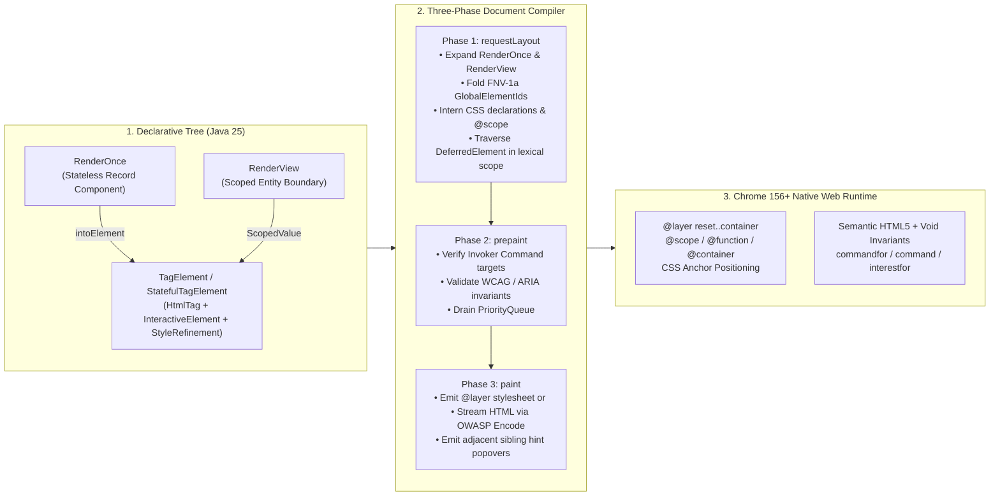

# Tessera: Canonical Architecture Specification (JDK 25 + Chrome 156+ Baseline 2026)

> [!IMPORTANT]
> **Target Environment & Compiler Invariants**
> - **Java Runtime**: **JDK 25 LTS** (`--release 25`), utilizing JEP 506 `ScopedValue`, JEP 485 `Stream::gather` (`Gatherers`), sealed Algebraic Data Types (ADTs), pattern matching with record patterns, and JEP 513 flexible constructor bodies.
> - **Browser Baseline**: **Chrome 156+ (Baseline 2026+)**. Native browser capabilities are emitted directly without legacy polyfills or fallback shims.
> - **Compiler Strictness**: `javac -Xlint:all -Werror` paired with Error Prone + NullAway (`@NullMarked` JSpecify mode). **`@SuppressWarnings` is strictly prohibited across the entire codebase.**

---

## 1. Architectural Synthesis

Tessera is a declarative, multi-phase HTML/CSS view engine for JDK 25 that separates **component composition**, **scoped entity boundaries**, **algebraic style refinements**, and **multi-phase document emission**.



### Core Architectural Pillars

| Architectural Pillar | Tessera Realization (JDK 25 + Chrome 156+) |
| :--- | :--- |
| **Dual Component Model** | **`RenderOnce`** (stateless `record` components consumed in a single pass) + **`RenderView`** (stateful/scoped domain boundaries wrapped with `[data-view="<view-type>"]`, `[data-view-id="<scope-id>"]`, and type-safe `ScopeStyle` `@scope` CSS isolation). |
| **Multi-Phase Compilation** | Three-phase immutable pipeline producing `ResolvedNode` trees: **`requestLayout`** (tree expansion, `ScopedValue` ID scoping, CSS rule & `@scope` deduplication, lexical deferred traversal) $\rightarrow$ **`prepaint`** (accessibility, invoker target, & cross-route link verification, priority-sorted deferred hoisting) $\rightarrow$ **`paint`** (streaming HTML/CSS emission & shared multi-page CSS bundling via `SiteCompiler`). |
| **Type-Safe State Promotion** | Concrete **`TagElement`** (supported by an `HtmlTag` enum with void-element awareness) promotes to **`StatefulTagElement`** via `.id(...)`, unlocking `commandfor`/`command`, `interestfor`, `popover`, and `closedby` APIs while sharing all interactive and layout capabilities through **`InteractiveElement<SELF>`**. |
| **Zero-Warning Self-Typing** | Every fluent trait (`FluentBuilder<SELF>`, `Styled<SELF>`, `ParentElement<SELF>`, `InteractiveElement<SELF>`) exposes `SELF self()`, overridden by concrete classes (`return this;`) with zero unchecked `(SELF) this` casts. |
| **Algebraic CSS Engine** | Sealed **`CssDeclaration`** hierarchy stored in an `EnumMap<CssProperty, CssDeclaration>` inside **`StyleRefinement`** for $O(1)$ cascade merging and byte-level deterministic FNV-1a hashing. |
| **Ordered CSS Cascade Layers** | Deterministic 7-layer cascade (`@layer reset, base, theme, components, utilities, interactive, container;`) ensuring pseudo-class states (`@layer interactive`) and `@container` queries (`@layer container`) always override base atomic utilities (`@layer utilities`). |
| **Scoped Lexical Context** | JDK 25 **`ScopedValue<RenderContext>`** (JEP 506) propagates the current `GlobalElementId` view path, `StyleSheetCollector`, and design token registry implicitly across `RenderOnce::render()` and `RenderView::render()`. |

---

## 2. Targeted Library Stack

Tessera maintains a minimal, zero-reflection dependency footprint:

| Dependency | Maven Coordinates | Scope | Architectural Purpose |
| :--- | :--- | :--- | :--- |
| **JSpecify** | `org.jspecify:jspecify:1.0.0` | `compile` | `@NullMarked` package-level nullness contracts and `@Nullable` type-use annotations. |
| **OWASP Java Encoder** | `org.owasp.encoder:encoder:1.3.1` | `compile` | Zero-allocation, context-sensitive streaming encoding directly into `Appendable`/`Writer` (`Encode.forHtmlContent`, `Encode.forHtmlAttribute`, `Encode.forCssString`, `Encode.forUriComponent`). |
| **Error Prone + NullAway** | `com.google.errorprone:error_prone_core:2.51.0` + `com.uber.nullaway:nullaway:0.14.3` | `annotationProcessorPaths` | Enforces compile-time null-safety across all `@NullMarked` packages without runtime overhead. |
| **JUnit Jupiter 6 + AssertJ + Jsoup** | `org.junit.jupiter:junit-jupiter:6.1.3` + `org.assertj:assertj-core:3.27.7` + `org.jsoup:jsoup:1.23.2` | `test` | Structural HTML5/CSS verification in tests. |

---

## 3. Core Component & Element Model (`dev.nthings.tessera.core`)

### 3.1 Package-Level Nullability & Zero-Cast `FluentBuilder<SELF>`

All packages declare `@NullMarked` in `package-info.java`. Every fluent trait derives from `FluentBuilder<SELF>`, which relies on `SELF self()` implemented by concrete leaf classes (`return this;`), eliminating unchecked casts and `@SuppressWarnings("unchecked")`.

```java
package dev.nthings.tessera.core;

import java.util.Optional;
import java.util.function.BiFunction;
import java.util.function.Function;
import org.jspecify.annotations.Nullable;

public interface FluentBuilder<SELF extends FluentBuilder<SELF>> {

    SELF self();

    default SELF when(boolean condition, Function<SELF, SELF> then) {
        return condition ? then.apply(self()) : self();
    }

    default SELF whenElse(
            boolean condition,
            Function<SELF, SELF> then,
            Function<SELF, SELF> otherwise) {
        return condition ? then.apply(self()) : otherwise.apply(self());
    }

    default <T> SELF whenPresent(
            @Nullable T value,
            BiFunction<SELF, T, SELF> then) {
        return value != null ? then.apply(self(), value) : self();
    }

    default <T> SELF whenOptional(
            Optional<T> optional,
            BiFunction<SELF, T, SELF> then) {
        return optional.map(v -> then.apply(self(), v)).orElseGet(this::self);
    }

    default SELF map(Function<SELF, SELF> mapper) {
        return mapper.apply(self());
    }
}
```

### 3.2 Sealed `Element` Hierarchy & Dual Component Model

Every renderable unit implements `IntoElement`. `Element` is a `sealed` interface permitting only the known structural node types, enabling exhaustive `switch` expressions across all three compiler phases:

```java
package dev.nthings.tessera.core;

@FunctionalInterface
public interface IntoElement {
    Element intoElement();
}

public sealed interface Element extends IntoElement
        permits TagElement, StatefulTagElement, TextElement, RawHtmlElement,
                DeferredElement, EmptyElement, RenderOnceElement, RenderViewElement {

    @Override
    default Element intoElement() {
        return this;
    }
}
```

1. **`RenderOnce` (Stateless Value Component)**:
   - Modelled as a Java 25 `record` implementing `RenderOnce`.
   - `Element render()` takes zero arguments and accesses contextual tokens or scoped state via `RenderContext.current()`.
2. **`RenderView` (Scoped Entity Boundary)**:
   - Represents an isolated UI module with a stable `ElementId entityId()`, a shared component `viewType()` (defaulting to kebab-case of the class name, e.g., `Card` $\rightarrow$ `"card"`), optional view-scoped CSS rules configured via a type-safe **`ScopeStyle`** builder (`configureScope(ScopeStyle scope)`), and its own `GlobalElementId` namespace.
   - Only `RenderView` boundaries advance the lexical `GlobalElementId` path in `RenderContext`, ensuring that `StatefulTagElement` IDs inside a view share a deterministic view-level namespace regardless of how many intermediate `<div>` wrappers surround them.
   - Emits `data-view="<resolved-view-type>"` (for shared `@scope ([data-view="<view-type>"]) to ([data-view])` CSS rules) and `data-view-id="<instance-scope-id>"` (for instance-level DOM identification).

```java
package dev.nthings.tessera.core;

import dev.nthings.tessera.css.ScopeStyle;

@FunctionalInterface
public interface RenderOnce extends IntoElement {

    Element render();

    @Override
    default Element intoElement() {
        return new RenderOnceElement(this);
    }
}

public interface RenderView extends IntoElement {

    ElementId entityId();

    default String viewType() {
        return Fnv1a64.camelToKebab(getClass().getSimpleName());
    }

    default void configureScope(ScopeStyle scope) {}

    default String viewScopeRule() {
        var scope = new ScopeStyle();
        configureScope(scope);
        return scope.isEmpty() ? "" : scope.toCssRuleBody();
    }

    Element render();

    @Override
    default Element intoElement() {
        return new RenderViewElement(this);
    }
}
```

### 3.3 Deterministic Byte-Level `Fnv1a64` & `GlobalElementId`

`Enum.hashCode()` (derived from `Object.hashCode()`) is non-deterministic across JVM processes. Tessera uses a zero-allocation byte-level 64-bit FNV-1a utility (`Fnv1a64`) over explicit UTF-16 code units and primitive `long` values, and sanitizes all DOM/CSS identifier segments to `[a-zA-Z0-9_-]`.

```java
package dev.nthings.tessera.core;

public final class Fnv1a64 {
    public static final long OFFSET_BASIS = 0xcbf29ce484222325L;
    private static final long PRIME = 0x100000001b3L;

    private Fnv1a64() {}

    public static long updateByte(long hash, int b) {
        return (hash ^ (b & 0xFFL)) * PRIME;
    }

    public static long updateChars(long hash, CharSequence cs) {
        long h = hash;
        for (int i = 0, len = cs.length(); i < len; i++) {
            char c = cs.charAt(i);
            h = updateByte(h, c & 0xFF);
            h = updateByte(h, (c >>> 8) & 0xFF);
        }
        return h;
    }

    public static long updateLong(long hash, long value) {
        long h = hash;
        for (int shift = 0; shift < 64; shift += 8) {
            h = updateByte(h, (int) (value >>> shift));
        }
        return h;
    }

    public static String toBase36Hash(long hash) {
        return Long.toUnsignedString(hash, 36);
    }

    public static String sanitizeIdentifier(String raw) {
        if (raw.isEmpty()) {
            throw new IllegalArgumentException("Identifier cannot be empty");
        }
        var sb = new StringBuilder(raw.length());
        for (int i = 0; i < raw.length(); i++) {
            char c = raw.charAt(i);
            if ((c >= 'a' && c <= 'z')
                    || (c >= 'A' && c <= 'Z')
                    || (c >= '0' && c <= '9')
                    || c == '_'
                    || c == '-') {
                sb.append(c);
            } else {
                sb.append('-');
            }
        }
        return sb.toString();
    }
}
```

`ElementId` is a `sealed` ADT with deterministic FNV-1a hashing (`foldHash(long seed)`), and `GlobalElementId` folds the active `RenderView` hierarchy path into collision-free DOM IDs and CSS `--anchor-<id>` custom idents:

```java
package dev.nthings.tessera.core;

public sealed interface ElementId
        permits ElementId.Named, ElementId.Indexed, ElementId.Composite {

    String slug();
    long foldHash(long seed);

    record Named(String name) implements ElementId {
        public Named {
            Fnv1a64.sanitizeIdentifier(name);
        }

        @Override
        public String slug() {
            return Fnv1a64.sanitizeIdentifier(name);
        }

        @Override
        public long foldHash(long seed) {
            long h = Fnv1a64.updateByte(seed, 1);
            return Fnv1a64.updateChars(h, name);
        }
    }

    record Indexed(String prefix, long index) implements ElementId {
        public Indexed {
            Fnv1a64.sanitizeIdentifier(prefix);
        }

        @Override
        public String slug() {
            return Fnv1a64.sanitizeIdentifier(prefix) + "-" + index;
        }

        @Override
        public long foldHash(long seed) {
            long h = Fnv1a64.updateByte(seed, 2);
            h = Fnv1a64.updateChars(h, prefix);
            return Fnv1a64.updateLong(h, index);
        }
    }

    record Composite(ElementId namespace, ElementId local) implements ElementId {
        @Override
        public String slug() {
            return namespace.slug() + "-" + local.slug();
        }

        @Override
        public long foldHash(long seed) {
            long h = Fnv1a64.updateByte(seed, 3);
            h = namespace.foldHash(h);
            return local.foldHash(h);
        }
    }

    static ElementId of(String name) {
        return new Named(name);
    }

    static ElementId of(String prefix, long index) {
        return new Indexed(prefix, index);
    }
}
```

### 3.4 Lexical Context Propagation via JDK 25 `ScopedValue`

```java
package dev.nthings.tessera.core;

import dev.nthings.tessera.css.StyleSheetCollector;
import dev.nthings.tessera.css.Tokens;
import java.util.function.Supplier;

public final class RenderContext {

    private static final ScopedValue<RenderContext> CURRENT = ScopedValue.newInstance();

    private final GlobalElementId viewScope;
    private final StyleSheetCollector styles;
    private final Tokens tokens;

    public RenderContext(GlobalElementId viewScope, StyleSheetCollector styles, Tokens tokens) {
        this.viewScope = viewScope;
        this.styles = styles;
        this.tokens = tokens;
    }

    public static RenderContext current() {
        return CURRENT.orElseThrow(() ->
                new IllegalStateException("RenderContext accessed outside an active PageCompiler pass"));
    }

    public GlobalElementId viewScope() {
        return viewScope;
    }

    public StyleSheetCollector styles() {
        return styles;
    }

    public Tokens tokens() {
        return tokens;
    }

    public <R> R withViewScope(ElementId viewEntityId, Supplier<R> work) {
        var childContext = new RenderContext(viewScope.extend(viewEntityId), styles, tokens);
        return ScopedValue.where(CURRENT, childContext).call(work::get);
    }

    public static <R> R runRoot(StyleSheetCollector styles, Tokens tokens, Supplier<R> work) {
        var rootContext = new RenderContext(GlobalElementId.ROOT, styles, tokens);
        return ScopedValue.where(CURRENT, rootContext).call(work::get);
    }
}
```

---

## 4. Element Hierarchy, Shared `InteractiveElement`, & State Promotion

### 4.1 `HtmlTag` with Void-Element Enforcement

`HtmlTag` enumerates semantic HTML5 tags and tracks whether a tag is an HTML5 void element (`IMG`, `INPUT`, `BR`, `HR`, `META`, `LINK`, `SOURCE`, `TRACK`). Attempting to append child elements to a void element fails immediately in `TagElement.appendChild` with `IllegalStateException`, and Phase 3 omits closing tags for void elements.

### 4.2 Shared `InteractiveElement<SELF>` Trait

Both `TagElement` and `StatefulTagElement` implement `InteractiveElement<SELF>`, `Styled<SELF>`, `ParentElement<SELF>`, and `FluentBuilder<SELF>`. Promoting an element via `.id("card")` to `StatefulTagElement` preserves full access to `.hover(...)`, `.focusVisible(...)`, `.active(...)`, `.group(...)`, `.groupHover(...)`, `.whenHas(...)`, `.container(...)`, `.onContainer(...)`, `.onContainerStyle(...)`, `.attr(...)`, and `.boolAttr(...)` regardless of method call ordering.

```java
package dev.nthings.tessera.core;

import dev.nthings.tessera.css.CssLength;
import dev.nthings.tessera.css.Interactivity;
import dev.nthings.tessera.css.StyleRefinement;
import dev.nthings.tessera.css.Styled;
import java.util.Map;
import java.util.function.UnaryOperator;

public interface InteractiveElement<SELF extends InteractiveElement<SELF> & Styled<SELF> & FluentBuilder<SELF>>
        extends Styled<SELF>, FluentBuilder<SELF> {

    Interactivity interactivity();
    Map<String, String> attributes();

    default SELF attr(String name, String value) {
        attributes().put(name, value);
        return self();
    }

    default SELF boolAttr(String name, boolean enabled) {
        if (enabled) {
            attributes().put(name, "");
        } else {
            attributes().remove(name);
        }
        return self();
    }

    default SELF ariaLabel(String label) {
        return attr("aria-label", label);
    }

    default SELF role(String role) {
        return attr("role", role);
    }

    default SELF hover(UnaryOperator<StyleRefinement> mutator) {
        interactivity().onHover(mutator);
        return self();
    }

    default SELF focusVisible(UnaryOperator<StyleRefinement> mutator) {
        interactivity().onFocusVisible(mutator);
        return self();
    }

    default SELF active(UnaryOperator<StyleRefinement> mutator) {
        interactivity().onActive(mutator);
        return self();
    }

    default SELF group(String groupName) {
        return attr("data-group", Fnv1a64.sanitizeIdentifier(groupName));
    }

    default SELF groupHover(String groupName, UnaryOperator<StyleRefinement> mutator) {
        interactivity().onGroupHover(Fnv1a64.sanitizeIdentifier(groupName), mutator);
        return self();
    }

    default SELF whenHas(String relativeSelector, UnaryOperator<StyleRefinement> mutator) {
        interactivity().onHas(relativeSelector, mutator);
        return self();
    }

    default SELF container(String containerName) {
        String safeName = Fnv1a64.sanitizeIdentifier(containerName);
        style().put(new dev.nthings.tessera.css.CssDeclaration.ContainerName(safeName));
        style().put(new dev.nthings.tessera.css.CssDeclaration.ContainerType(
                dev.nthings.tessera.css.CssDeclaration.ContainerKind.INLINE_SIZE));
        return self();
    }

    default SELF onContainer(
            String containerName,
            CssLength minInlineSize,
            UnaryOperator<StyleRefinement> mutator) {
        interactivity().onContainerMinWidth(
                Fnv1a64.sanitizeIdentifier(containerName), minInlineSize, mutator);
        return self();
    }

    default SELF onContainerStyle(
            String containerName,
            String customProperty,
            String expectedValue,
            UnaryOperator<StyleRefinement> mutator) {
        interactivity().onContainerStyleQuery(
                Fnv1a64.sanitizeIdentifier(containerName), customProperty, expectedValue, mutator);
        return self();
    }
}
```

### 4.3 `StatefulTagElement` & Baseline 2026+ Invoker Capabilities

Calling `tagElement.id("confirm-archive")` or `tagElement.id(ElementId.of("row", index))` returns a `StatefulTagElement` carrying a deterministic `ElementId`. `StatefulTagElement` unlocks ID-dependent Chrome 156+ capabilities and supports referencing targets either by `StatefulTagElement` instance or by `ElementId`/`String` (enabling self-targeting buttons inside a `<dialog>` before the parent dialog variable is bound):

- **Declarative Invoker Commands (`commandfor` / `command`)**:
  - `.command(StatefulTagElement target, BuiltinCommand command)`
  - `.command(ElementId targetId, BuiltinCommand command)`
  - `.command(String targetName, BuiltinCommand command)`
  - `.dispatchAction(StatefulTagElement target, Action action)`
- **Interest Invokers (`interestfor` + `<span popover="hint">`)**:
  - `.interestTooltip(UnaryOperator<TagElement> tooltipBuilder)`: Attaches `interestfor="<global-id>--tooltip"` to the trigger and emits a phrasing-safe companion `<span id="<global-id>--tooltip" popover="hint" role="tooltip">` **as an adjacent following sibling** in the DOM (preserving the HTML5 phrasing content model of `<button>`, `<a>`, `<p>`, and `<sup>`).
- **Popover & `<dialog closedby>` Control**:
  - `.popover(PopoverMode mode)` (`auto`, `manual`, `hint`)
  - `.dialogClosedByAny()` (`closedby="any"`), `.dialogClosedByCloseRequest()` (`closedby="closerequest"`), `.dialogClosedByNone()` (`closedby="none"`)
- **CSS Anchor Positioning & View Transitions**:
  - `.anchorName()` (emits `anchor-name: --anchor-<id>`)
  - `.anchoredTo(StatefulTagElement anchor, String positionArea, String tryFallbacks)`
  - `.viewTransitionName(String transitionClass)`

---

## 5. Algebraic CSS Engine, `ScopeStyle`, & 7-Layer Cascade (`dev.nthings.tessera.css`)

### 5.1 Sealed `CssDeclaration` Hierarchy & `EnumMap` Storage

Every CSS property is represented by a `CssProperty` enum constant and a `sealed` `CssDeclaration` record. `StyleRefinement` stores declarations inside an `EnumMap<CssProperty, CssDeclaration>`:

- **Merging (`mergeFrom`)**: `declarations.putAll(other.declarations)` runs in $O(1)$ per set property.
- **Deterministic Hashing**: Iterates `declarations.entrySet()` in natural `CssProperty` ordinal order and folds each property ordinal and CSS value string into `Fnv1a64`.

### 5.2 Type-Safe `ScopeStyle` Builder & Content-Addressed `@scope` Deduplication

`RenderView` components author their `@scope` rules via `ScopeStyle` (`configureScope(ScopeStyle scope)`), which reuses `Styled<ScopeStyle>` for `:scope` root declarations, nested child rules (`select(selector, Consumer<StyleRefinement>)`), and scoped `@container` queries (`containerMinInlineSize`, `containerMaxInlineSize` with nested `RuleGroup`).

`StyleSheetCollector.registerViewScope(viewType, scopedCss)` performs content-addressed `@scope` deduplication:
- All instances of a `RenderView` sharing the same CSS body emit a single `@scope ([data-view="<viewType>"]) to ([data-view])` block in `@layer components` and share `data-view="<viewType>"`.
- Parameterized `RenderView` instances whose `ScopeStyle` produces distinct CSS rules receive a disambiguated `data-view="<viewType>-<hash>"` attribute so distinct rules never collide.

### 5.3 Deterministic 7-Layer CSS Cascade (`@layer`)

In CSS Cascade Layers, layer order takes precedence over selector specificity, and `@container` queries contribute `(0,0,0)` to selector specificity. Tessera therefore emits a 7-layer cascade header:

```css
@layer reset, base, theme, components, utilities, interactive, container;
```

1. **`@layer reset`**: Box-sizing reset and `interpolate-size: allow-keywords` on `:root` for intrinsic `height: auto` transitions.
2. **`@layer base`**: Document defaults, `@media (prefers-reduced-motion: no-preference) { @view-transition { navigation: auto; } }`, and default anchor positioning for companion hint popovers (`[popover="hint"] { position-area: block-start; position-try-fallbacks: flip-block, flip-inline; margin: 0.25rem; }`).
3. **`@layer theme`**: Reactive design tokens (`--surface`, `--text-primary`, etc.) via native `light-dark(...)` and CSS custom `@function` definitions (`@function --fluid(...)`).
4. **`@layer components`**: Deduplicated donut-scoped `@scope ([data-view="<view-type>"]) to ([data-view])` rules emitted by `RenderView` components via `ScopeStyle`.
5. **`@layer utilities`**: Deduplicated atomic utility classes (`.u-<hash>`) generated from `StyleRefinement`.
6. **`@layer interactive`**: Pseudo-class and relational rules (`&:hover:not(:disabled)`, `&:focus-visible`, `&:active:not(:disabled)`, `[data-group="..."]:hover &`, `&:has(...)`), guaranteed to win over base `@layer utilities`.
7. **`@layer container`**: `@container <name> (inline-size >= ...)` and `@container <name> style(...)` rules, guaranteed to win over base `@layer utilities` despite identical `(0,1,0)` class selector specificity.

---

## 6. Three-Phase Compilation Pipeline (`dev.nthings.tessera.render`)

`PageCompiler.compile(PageDocument, OutputMode)` executes three sequential, side-effect-free phases over an immutable intermediate `ResolvedNode` representation (leaving input `TagElement` and `RenderOnce` instances untouched and reusable across renders):

### Phase 1: `requestLayout` (Expansion, Lexical Scoping, & Style Interning)
- Recursively expands `RenderOnce` and `RenderView` nodes.
- When entering a `RenderView`, pushes `view.entityId()` onto `RenderContext.current().viewScope()` via `ScopedValue.where(...)`, registers the view's `ScopeStyle` rule via `StyleSheetCollector.registerViewScope(view.viewType(), scopedRule)` in `@layer components`, and attaches both `data-view="<resolved-view-type>"` and `data-view-id="<instance-scope-id>"` to the view's root element.
- Resolves every `StatefulTagElement` DOM ID as `RenderContext.current().viewScope().extend(stateful.elementId())` and records it in the document's registered ID table.
- Interns each node's `StyleRefinement` and `Interactivity` into `StyleSheetCollector`, assigning deterministic `.u-<hash>` and `.i-<hash>` class names.
- Recursively resolves any attached `interestTooltip` element so its styles and children are interned during Phase 1, attaching the resulting `ResolvedNode` as the trigger's companion sibling.
- Traverses `DeferredElement` children **immediately inside their active lexical `ScopedValue<RenderContext>`** (preserving their enclosing `RenderView` ID prefix and `@scope` attribution) and enqueues `ResolvedDeferred(priority, insertionSequence, resolvedChild)` into a deterministic `PriorityQueue`.

### Phase 2: `prepaint` (Static Accessibility & Invoker Verification)
- Walks the `ResolvedNode` tree and all queued `ResolvedDeferred` portals to enforce compile-time HTML5/WCAG invariants (throwing `AccessibilityViolationException` on failure):
  1. `` elements must declare `alt` (empty `alt=""` permitted only when `role="presentation"` or `aria-hidden="true"`).
  2. Interactive elements (`<button>`, `<a>`) with neither text descendants nor accessible labels (`aria-label`, `aria-labelledby`, `title`) are rejected.
  3. Every `commandfor="<target-id>"` and `interestfor="<target-id>"` attribute is verified against the set of resolved DOM IDs in the document so dangling invoker references fail at compile time.
- Drains the `PriorityQueue<ResolvedDeferred>` in `(priority ASC, insertionSequence ASC)` order and appends the hoisted overlay nodes to the root `<body>` container.

### Phase 3: `paint` (Streaming HTML & CSS Emission)
- Streams `<!doctype html>` and the document tree to any `Appendable` using `org.owasp.encoder.Encode`.
- Emits void elements (``, `<input>`, `<br>`, `<hr>`, `<meta>`, `<link>`, `<source>`, `<track>`) without closing tags.
- Emits companion `interestfor` `<span id="<id>--tooltip" popover="hint" role="tooltip">` elements immediately after their trigger's closing tag as adjacent siblings.
- Supports both `OutputMode.InlineStyle` (single-file `<style>` in `<head>`) and `OutputMode.ExternalAsset` (content-hashed `/assets/styles-<hash>.css` `<link rel="stylesheet">` plus stylesheet payload in `CompiledPage`).

---

## 7. Foundational Component Library (`dev.nthings.tessera.components`)

Tessera provides a canonical library of zero-JavaScript UI components built on top of `RenderView`, `RenderOnce`, `ScopeStyle`, and `InteractiveElement`:

| Component | Type | Baseline 2026+ Platform Mechanics |
| :--- | :--- | :--- |
| **`DataTable<T>` & `SimpleTable`** | `RenderView` / `RenderOnce` | Focusable `<div tabindex="0" role="region" aria-labelledby="...">` container (`container-type: inline-size; overflow: auto`), sticky `thead` & `tbody th[scope="row"]`, `font-variant-numeric: tabular-nums` numeric columns, and `@container (inline-size < breakpoint)` stacked card layout injecting `--label-N` CSS variables into `td:nth-child(N)::before`. |
| **`Card` & `CardGrid`** | `RenderView` | 4 direct-child regions (`media`, `header`, `content`, `footer`) inside `<article>` or `<label>`. Adapts to wide containers via `@container` + `:has(> img, > picture, > .media)`. Supports `Content`, `StretchedLink` (`a.card-link::after` with `z-index: 1` elevation on secondary controls), and `Choice` (`:has(> input:checked)`), and aligns tracks across columns via `grid-template-rows: subgrid; grid-row: span 4` in `CardGrid`. |
| **`Grid`** | `RenderOnce` | Intrinsic `repeat(auto-fit, minmax(min(100%, <min>), 1fr))` responsive grids, fixed column grids, and bento cell spanning (`colSpan`, `rowSpan`). |
| **Scroll-Driven Animations** | `InteractiveElement` + `ScrollProgressBar` | Compositor-only `@keyframes` (`opacity`, `transform`) bound to `animation-timeline: view(block|inline)` (`entry` / `exit` ranges), `animation-timeline: scroll(root block)` (`ScrollProgressBar` with `aria-hidden="true"`), and staggered delays via `sibling-index()`, all gated inside `@media (prefers-reduced-motion: no-preference)`. `CssProperty.ANIMATION` precedes `ANIMATION_DELAY`, `ANIMATION_TIMELINE`, and `ANIMATION_RANGE` so shorthand declarations never reset timeline bindings. |
| **`Lists` (`BulletList`, `NumberedList`, `DescriptionList`, `StepList`)** | `RenderOnce` / `RenderView` | Semantic `<ul>`, `<ol>`, `<dl>` (`<dt>`/`<dd>`), and `StepList` using Chrome 156+ `sibling-index()` and `sibling-count()` to compute dynamic `color-mix(in oklch, ...)` step badges. |
| **`Footnotes` (`FootnoteRef`, `FootnotesSection`)** | `RenderOnce` / `RenderView` | Phase 1 auto-numbered citations (`RenderContext.registerFootnote`) emitting `<sup id="fnref-...">` + `<a role="doc-noteref" interestfor="...">` with an adjacent `<span popover="hint" role="tooltip">` preview, paired with an explicit or auto-hoisted `<aside role="doc-endnotes">` section with bidirectional `role="doc-backlink"` links and `:target` highlight styling. |
| **`Formatting`** | Static Factory + `Styled` | Semantic `<mark>`, `<u>`, `<s>`, `<del>`, `<ins>`, `<code>`, `<kbd>` paired with CSS Text Decoration Level 4 (`text-decoration-line`, `text-decoration-style: solid/wavy/dashed/dotted/double`, `text-decoration-color`, `text-decoration-thickness`, `text-underline-offset`, `text-decoration-skip-ink: auto`) and `color-mix(in oklch, var(--token) 24%, transparent)` adaptive highlights. |

---

## 8. Multi-Page Site Compiler & Preview Server (`dev.nthings.tessera.site`)

- **`SiteRoute` & `SiteDefinition`**: Defines normalized route paths (`/`, `/telemetry`, `/typography`) mapped to output locations (`index.html`, `telemetry/index.html`) and shared `Tokens`.
- **`SiteCompiler`**:
  1. Executes Phase 1 (`requestLayout`) and Phase 2 (`prepaint`) concurrently across all routes using `Executors.newVirtualThreadPerTaskExecutor()`.
  2. Performs **cross-route link and `#fragment` verification**: validates every internal `<a href="/...">` and `<a href="#...">` against the site's registered routes and each target route's resolved DOM IDs (`registeredIds()`), failing at compile time with `AccessibilityViolationException` if a route or anchor target is missing.
  3. Merges all per-page `StyleSheetCollector` instances in deterministic route order into a single content-addressed `/assets/styles-<hash>.css` bundle, then streams all HTML routes with `<link rel="stylesheet" href="/assets/styles-<hash>.css">`.
  4. `CompiledSite.writeToDirectory(Path outputDir)` writes all HTML routes and the shared CSS asset to disk.
- **`SitePreviewServer` & `ShowcaseSite`**:
  - Zero-dependency `com.sun.net.httpserver.HttpServer` backed by JDK 25 Virtual Threads (`Executors.newVirtualThreadPerTaskExecutor()`) serving compiled routes in memory with `Cache-Control: public, max-age=31536000, immutable` for hashed CSS assets.
  - `ShowcaseSite` (`just site` and `just demo`) provides a 3-route interactive showcase (`/`, `/telemetry`, `/typography`) exercising every Tessera primitive and component.


