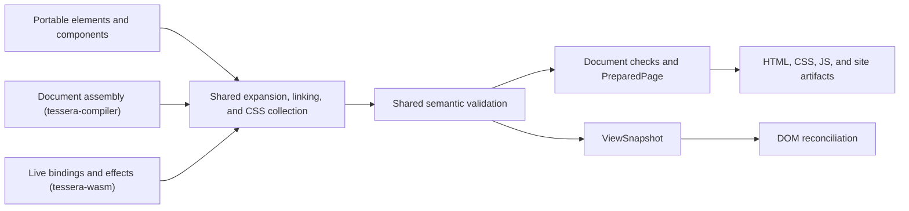
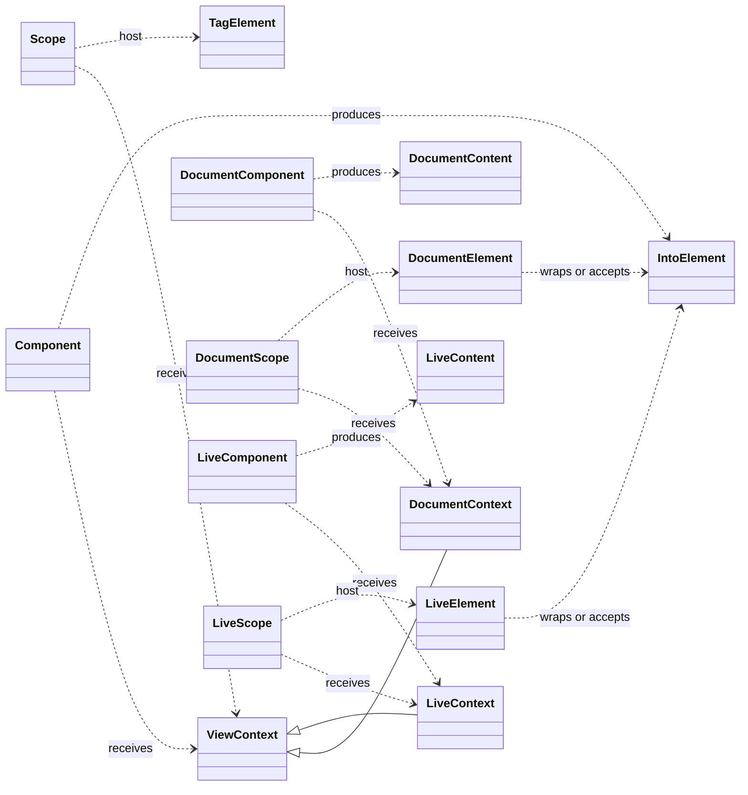

# Architecture

Tessera runs one shared expansion, reference-linking, semantic validation, and CSS collection engine across two backends: static HTML site compilation and experimental live WebAssembly browser roots. Applications compose mutable builders; each expansion captures an immutable linked tree before emitting HTML or reconciling the DOM.

This guide helps maintainers navigate module boundaries, placement types, identity scoping, and CSS assembly. See [Compiler internals](compiler.md) for static pass orchestration and [Browser runtime internals](browser-internals.md) for DOM reconciliation and lifecycle ownership.

## Rendering paths

Static compilation prepares complete HTML pages, shared stylesheets, and static assets. Browser rendering produces a linked `ViewSnapshot` for a single mounted root and reconciles it against the live DOM. Compile-time placement types guarantee that document-only content never reaches a browser root and live content never reaches the static compiler.



## Module and package boundaries

Tessera ships three runtime Maven artifacts and JPMS modules, plus two separate showcase/test projects. Neither `tessera-compiler` nor `tessera-wasm` depends on the other; both require `dev.nthings.tessera` transitively.

| Module and artifact | Package | Visibility and responsibility |
| --- | --- | --- |
| `dev.nthings.tessera` (`tessera`) | `foundation` | Public fluent composition traits and `@KotlinReceiver` marker |
| `dev.nthings.tessera` | `css` | Public typed CSS values, tokens, declarations, and `ScopeStyle`; serialization stays package-private |
| `dev.nthings.tessera` | `core` | Public portable elements, `Component`, `Scope`, `ViewContext`, `ElementRef`, `OutlineHeading`, and `Diagnostic` |
| `dev.nthings.tessera` | `components` | Public portable widgets |
| `dev.nthings.tessera` | `internal.authoring`, `internal.foundation` | Closed builder data, source capture, and deterministic hashing; `internal.authoring` is qualified-exported to `dev.nthings.tessera.compiler` and `dev.nthings.tessera.wasm`, `internal.foundation` only to `dev.nthings.tessera.compiler` |
| `dev.nthings.tessera` | `internal.css`, `internal.components`, `internal.view` | Shared `StyleSheet`, structured SVG icons, widget bridges, `ViewExpansion`, `ReferenceLinker`, `LinkedNode`, and `ViewValidation`; qualified-exported to `dev.nthings.tessera.compiler` and `dev.nthings.tessera.wasm` |
| `dev.nthings.tessera` | `view` | Live rendering entry point (`ViewRenderer`, `LiveNode`, `ViewSnapshot`, `ViewException`); qualified-exported only to `dev.nthings.tessera.wasm` |
| `dev.nthings.tessera.compiler` (`tessera-compiler`) | `document`, `document.components` | Public document placement (`DocumentContent`, `DocumentElement`, `Documents`), `WasmBundle`, and document-only components |
| `dev.nthings.tessera.compiler` | `compiler` | Public `Compiler`, `SiteDefinition`, `GraalWebImage`, `SiteWriter`, `SitePreviewServer`, and `SourceTracking`; pass coordinators stay package-private |
| `dev.nthings.tessera.compiler` | `navigation` | Public route-derived `SiteNavigation` |
| `dev.nthings.tessera.compiler` | `internal.document` | Unexported document node data and cross-package builder access |
| `dev.nthings.tessera.wasm` (`tessera-wasm`) | `wasm` | Public live authoring (`LiveContent`, `LiveElement`, `Live`, `BrowserEntry`, `BrowserRoot`, `Host`, live adapters); reconciliation, control sync, and Web Image DOM bridge stay package-private |
| `tessera-showcase`, `tessera-wasm-showcase` | Showcase projects | Public-API examples and HTTP-served Playwright integration suites |

On the module path, portable component libraries require only `dev.nthings.tessera` (which has no `jdk.httpserver` or Web Image dependency), static applications require `dev.nthings.tessera.compiler`, and browser applications require `dev.nthings.tessera.wasm`. Classpath execution (including GraalVM Web Image builds) does not enforce JPMS qualified exports.

## Content families and contexts

Three placement families separate capabilities at compile time:



- **Closed portable tree**: `Element` is sealed. Concrete builders (`TagElement`, `FragmentElement`) write into package-internal storage accessed by `internal.authoring` accessors registered at class load, keeping public builders free of inspection escape hatches.
- **Parameterized backend payloads**: Document lowering (`DocumentExpansion`) and live lowering (`ViewRenderer`) both feed `ViewExpansion<M>` and `ReferenceLinker<M>` with a single internal type parameter `M` for backend-owned data. Document leaves carry trusted HTML; live hosts carry event/control/widget bindings and live leaves carry effects.
- **Explicit scope hosts**: Every scope family returns its single authored host (`TagElement`, `DocumentElement`, or `LiveElement`). `ScopeDefinition` shares `scopeName()`, `scopeId()`, and `configureScope(ScopeStyle)`. Expansion stamps `data-scope` and `data-scope-id` directly onto the returned host without inserting wrapper elements or overwriting inner scopes.
- **Context isolation and lifetime**: Every callback receives a context backed by `internal.view.ExpansionContext`. Portable components always receive `ViewContext` even when expanded inside a document or live root, preventing cross-family leakage. `internal.view.ExpansionRegistry` owns `ViewKey` state and collected `OutlineHeading` entries for one expansion (one compiled page or one attempted live render); rejected browser renders discard it. `compiler.DocumentState` separately holds static head, document-end, and script contributions.

## Built-in components and widgets

Portable built-in widgets extend package-private `BuiltinComponent` (no new identity scope; records class name in diagnostics) or `BuiltinScope<B>` (adapts a private `Scope` for stable scope naming, CSS scoping, and instance ID). `Modal` and `Drawer` share `DialogView`; `Button`, `IconButton`, and `Image` implement `TagHost` so `DocumentElement.of(...)` and `LiveElement.of(...)` wrap them directly.

Widgets that number, collect, or preload across a page (`Footnote`, `Footnotes`, `TableOfContents`, `DocLayout`, `HeroImage`, `DocumentSection`) live in `tessera-compiler`'s `document.components`. Portable widgets never import `document` or `wasm`. Interactive portable widgets (`ContentTabs`, `SearchPalette`, `Dropdown` command menus) declare bundled behaviors via `internal.components.WidgetBridge`: static lowering attaches their bundled ES modules, while `tessera-wasm` adapters attach Java controllers to the same markup.

`OutlineHeading` metadata attaches directly to `Heading` elements during expansion rather than mutating context state, allowing linking to resolve fragment IDs for both `TableOfContents` and `search-index.json`.

## Identity scoping

`ElementRef` represents symbolic element identity until linking. The first named reference bound to an element selects its DOM ID, anonymous references alias it, and conflicting named references become diagnostics.

`internal.view.ViewScope` qualifies scoped IDs and tracks per-scope generated counters. Keyed children extend the scope using the nearest named owner element (if any) and the hexadecimal UTF-16 encoding of the key, avoiding separator collisions. `ViewScope` also tracks whether any enclosing scope prefix was encounter-order-generated, allowing expansion to reject unstable keyed content with `generated-scope-id`.

## Stylesheet assembly

`Styled` composes package-private property traits over `Declarations`, which enforces shorthand/longhand replacement and retains conditional groups, `@starting-style` rules, and referenced `Keyframes`. The `css` package keeps serialization package-private and exposes rule collection to `internal.css.StyleSheet` via `CssAccess`. `Declarations` and `ScopeStyle` describe their rules once, as a walk over a package-private `CssSink`: one sink serializes the walk to text and another folds it into a 64-bit FNV-1a hash, so equal hashes mean equal text by construction, and a nested rule that writes nothing reaches neither. Utility, interactive, container, and scope rules are named by those structural hashes, computed in one pass over each element's style, and a stylesheet serializes a rule only the first time it registers that name. Nesting goes through one `Enclosing` chain of the conditions in force, so a state, media feature, or container query that already holds is not nested again. A live root builds each turn's stylesheet from the previous one, so a rule that persists across turns is serialized once for the life of the root.

Both static documents and mounted browser roots emit from the same `StyleSheet` rules in this cascade order:

```css
@layer reset, base, theme, components, utilities, container, interactive;
```

| Source | Generated representation |
| --- | --- |
| Element base declarations | `u-*` classes in `utilities` |
| Element container queries | `cq-*` classes in `container` |
| Element states, media, starting styles | `i-*` classes in `interactive` |
| `ScopeStyle` rules | Deduplicated `@scope ([data-scope="..."])` blocks in `components` |
| Referenced `Keyframes` | Emitted once in `base` |
| `Theme` overrides | CSS custom properties in `theme` |
| `live(...)` declarations | Static declarations in HTML; element-local `--tl-*` custom properties with `@property` in browser roots |

## Backend ownership boundaries

- **Static compiler (`tessera-compiler`)**: `PageCompiler` and `SiteCompiler` separate preparation (`PreparedPage`) from emission (`HtmlWriter`), keeping compilation pure and side-effect-free. `SiteWriter` and `SitePreviewServer` handle disk and HTTP publication. See [Compiler internals](compiler.md).
- **Browser runtime (`tessera-wasm`)**: `BrowserRoot` owns the view callback, committed tree, reference map, ID set, scheduling, root lifetime, and `StyleSink` handle. `DomReconciler` manages native DOM patching, listeners, control properties, and effect lifetimes; `Dom` encapsulates GraalVM Web Image interop. See [Browser runtime internals](browser-internals.md).
