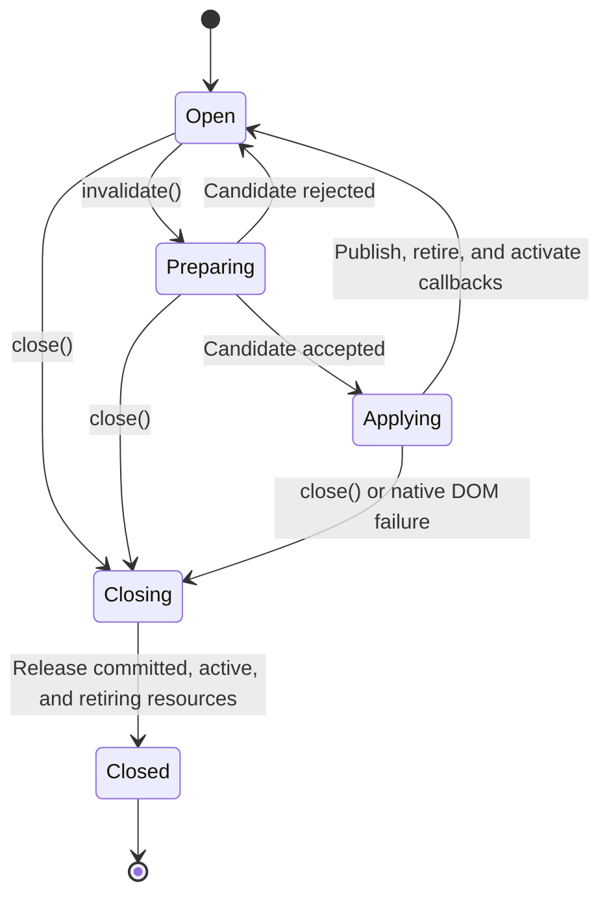

# Browser runtime internals

This guide documents the implementation contracts of the experimental `tessera-wasm` runtime. See [Browser rendering](browser-rendering.md) for user-facing authoring and setup, and [Architecture](architecture.md) for shared module boundaries.

## Live rendering pipeline

`ViewRenderer.render(...)` (qualified-exported from `dev.nthings.tessera.view` only to `dev.nthings.tessera.wasm`) lowers `LiveNode<M>` trees through shared `ViewExpansion`, `ReferenceLinker`, and `ViewValidation` before any DOM mutation occurs. `tessera-wasm` supplies a `LiveContext` wrapper around the shared `ExpansionContext`, while portable callbacks still receive only `ViewContext`.

The browser module owns the concrete payload type `M` carrying event listeners, `ControlProperties`, widget controllers, and effect descriptors. Shared expansion carries `M` through `LinkedNode` without interpreting browser types and invokes `ViewRenderer.HostValidator` to validate live control bindings alongside shared semantic checks.

## Commit ownership and root lifecycle

Each `BrowserRoot` owns its committed tree and at most one active commit. Every newly acquired native listener, composition tracker, widget controller, style acquisition, and effect lifetime is registered with the active commit as it is acquired, before any application callback can run.

```mermaid
sequenceDiagram
    accTitle: Browser commit ownership and callback phases
    accDescr: BrowserRoot expands and validates a candidate, acquires resources and applies DOM patches, publishes references and IDs atomically, retires obsolete work, and starts new effects only if the root remains open.
    participant Root as BrowserRoot
    participant Render as ViewRenderer
    participant Reconcile as DomReconciler
    participant App as Application callbacks

    Root->>Render: Expand, link, and validate candidate
    Render-->>Root: ViewSnapshot (tree, embedded CSS, refs, IDs)
    Root->>Root: Verify introduced DOM IDs against document
    Root->>Reconcile: Acquire styles and listeners; patch DOM off-callback
    Reconcile-->>Root: Publish committed tree, references, and owned IDs
    Root->>Reconcile: Retire replaced resources
    Reconcile->>App: Run obsolete effect cleanups (newest first)
    alt close() called during retirement
        App->>Root: close()
        Root->>Reconcile: Finish teardown and release all owned resources
    else Root remains open
        Root->>App: Start newly committed effects
        Root->>App: Run queued afterRender tasks while open
    end
```

`BrowserRoot` transitions through a strict lifecycle where `Closing` is terminal and idempotent:



No application effect cleanup runs mid-reconciliation. If a native DOM event or callback triggers `close()` during an active phase, the root marks itself closing immediately, disables event dispatch and scheduling, settles at the next phase boundary, never publishes a pending candidate, and runs all remaining cleanups once.

### Failure containment

Failures are surfaced as readable browser `Error` reports naming the host root rather than raw WebAssembly/Java proxy exceptions:

| Failure point | Runtime behavior |
| --- | --- |
| Validation diagnostics, `cross-root-id`, or throwing render/style callback | Rejects candidate; committed DOM (or initial fallback) stays untouched; later invalidation retries. Callback failures include component and key path. |
| Initial mount preparation or pre-publication DOM failure | First mount builds off-host and preserves original fallback nodes until publication succeeds; partial acquisitions are released and other hosts continue mounting. |
| Unexpected native DOM failure during update of live tree | Enters `Closing`, releases all acquired and committed resources, and reports the error without claiming arbitrary DOM rollback. |
| Event handler or effect startup failure | Reports error with context; root stays open and interactive unless `close()` was requested. |
| Cleanup failure during retirement or close | Continues running all remaining cleanups and reports collected failures together once. |
| Async completion after cancellation or close | Ignored; never invokes application callback or invalidates the root. |

## Native identity and DOM reconciliation

Linking preserves components, scopes, fragments, and keyed items as `LinkedNode.Group` nodes carrying an optional sibling key and a stable definition (`scopeName()` for scopes, `FragmentElement` for fragments, or the authoring type for components and keyed elements). `DomReconciler` brackets each group between two anchor comment nodes and manages the entire range between them.

| Candidate node | Matching strategy |
| --- | --- |
| Keyed group | Exact sibling key and same authoring definition within the same parent |
| Unkeyed group | Earliest unmatched prior sibling group with the same authoring definition |
| Element | Earliest unmatched prior sibling element with the same tag name |
| Text | Earliest unmatched prior sibling text node |
| Mismatched node | Create replacement node or range; retire the obsolete subtree |

- **Minimal movement**: Retained sibling ranges on the longest increasing subsequence stay fixed in the DOM; only out-of-order ranges move, using state-preserving `moveBefore` when the browser supports it. New nodes insert directly at their final positions.
- **Namespace-aware creation**: Elements are created in their `TagName` namespace, keeping inline SVG nodes valid in the DOM.
- **Selective patching**: Unchanged attributes are skipped so unrelated updates never clobber dirty native input state.

## Event dispatch and form property synchronization

- **Listeners**: Listener identity is `(type, capture)`. Re-rendering with unchanged `EventOption` flags swaps the Java callback behind the single native listener without re-registering; changed flags re-register, and omitted listeners detach immediately. A spent `ONCE` listener stays spent until a render omits it.
- **Portable defaults**: Shared `ControlLowerer` lowers `initialValue`, `initialChecked`, and `initialSelectedValues` identically for both backends and tags each default declaration in `ViewSnapshot`. On insertion, `DomReconciler` establishes the native reset baseline; on updates to retained controls, user edits survive. Newly added `<option>` elements still apply their declared default on arrival.
- **Live control bindings**: `ControlProperties` applies bound values, checked flags, and multi-select lists after DOM children are patched so native radio-group updates settle first. Before patching, the reconciler snapshots current native state on bound controls so removing a binding hands control back to the browser seamlessly. Only actual property differences are written.
- **IME composition**: Inputs and textareas track composition state per native node. Controlled value writes defer until `compositionend`, which also dispatches the bubble-phase `input` handler once more with committed text and `composing() == false` before requesting reconciliation.

## Lifetimes, effects, and host services

`Live.effect(key, effect)` lowers into a keyed `LinkedNode.Group` leaf holding an effect payload, anchored by a comment node. Disposing a `Lifetime` executes cleanups newest first; subtrees dispose descendant first. Registering a cleanup on an already-disposed lifetime runs it immediately.

`BrowserRoot.host()` returns a `Host` bound to `root.lifetime()`. `host.within(lifetime)` caches one scoped `Host` per `Lifetime` so repeated calls register no duplicate cleanups. Pending timers (`timeout`, `interval`, `frame`) and `fetchText` requests own individual native cancellation handles and `AbortController` instances that release automatically upon cancellation, lifetime disposal, or root closure.

Element operations on `Host` resolve `ElementRef` through the latest published `ViewSnapshot.references()` map and look up the element inside the root's own host container, preventing cross-root access and never exposing raw JS objects.

## Bootstrap protocol and cross-root identity

Every page with at least one `Documents.wasmMount` receives one shared `wasm-bootstrap.js` module and host markers (`data-tessera-bundle`, `data-tessera-entry`, `data-tessera-integrity`, `data-tessera-image`, `data-tessera-resources`, `data-tessera-view`).

1. The bootstrap starts downloading all entries' SHA-384-verified binary resources concurrently while probing WasmGC capability.
2. Each distinct launcher script loads once, sequentially. Because every GraalVM Web Image launcher assigns the global `GraalVM` object, the bootstrap captures each launcher's instance immediately after load and restores the previous global value.
3. Each entry runs with its own `Config` (carrying verified bytes in `config.tesseraResources`) and receives its assigned `host=view` pairs as `main(String[] args)`.

Cross-root identity checks inspect the live document across all entries:

- Mounting rejects any host that already holds a root, sits inside an active root, or contains one.
- Every DOM ID introduced by a candidate (present in `ViewSnapshot.ids()` and absent from the root's previous commit) is checked against the host element and all DOM nodes outside the root's owned descendants. Any match, including the host's own reserved ID, rejects the candidate with `cross-root-id`.
- Already-committed IDs belong to the root until a later render stops emitting them; reintroducing a released ID checks it again.

## Embedded styles and style ledger

All roots within one compiled Web Image entry share one constructed `CSSStyleSheet` adopted into `document.adoptedStyleSheets`, requiring no inline `<style>` element and operating cleanly under the full `style-src 'self'` deployment CSP.

- **Root isolation**: `StyleSheet.embeddedBaseRules(theme)` scopes reset and base rules beneath `[data-tessera-root]` and theme tokens under a content-addressed `data-tessera-theme` key (`StyleSheet.themeKey(theme)`). Mounting never styles `:root`, `body`, or surrounding host markup, and omits cross-document view transitions.
- **Keyed incremental diffing**: Each rule from `StyleSheet.embeddedRules()` carries a short key (`u-*`, `i-*`, `cq-*`, `data-scope`, or `@property` name). `StyleSink.Root` caches rule text per key, acquires new rules before DOM mutation, and releases retired rules only after publication succeeds.
- **Bounded retention**: `StyleLedger` reference-counts active rules across roots in the entry and retains up to **512** unused rules in LRU order for reuse across renders. `StyleSheet.LAYER_ORDER` stays pinned at index 0 so reinserted rules never disturb cascade layer order.
- **Live style values**: `TagElement.live(...)` compiles each dynamic property via `StyleSheet.registerLive` as `property: var(--tl-property)` paired with an `@property` declaration (`inherits: false`). Reconcilers update `--tl-*` via CSSOM `style.setProperty`, avoiding rule churn while keeping values in their proper cascade layer.

## Scheduling internals

`BrowserRoot` schedules flushes into a macrotask queue, coalescing repeated `invalidate()` calls before the flush runs. Each flush applies up to `workBudget` (default `8`) turns before yielding to `requestAnimationFrame` so the browser can paint. If `runawayLimit` (default `32`) consecutive turns each invalidate the root again, scheduling halts with one browser `Error` and preserves the last committed tree until an external event or call invalidates the root.
