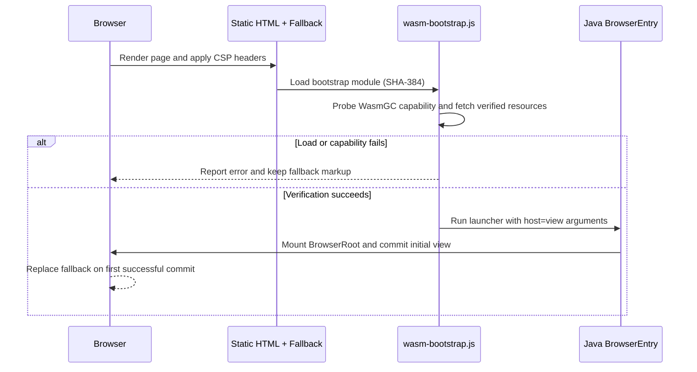
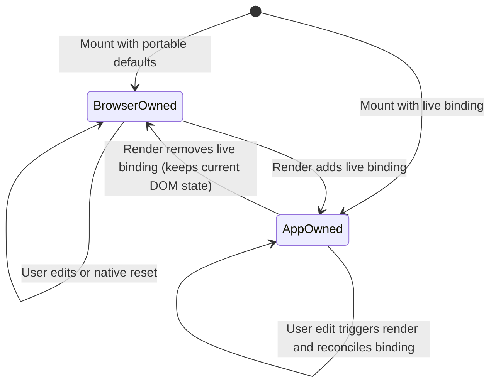

# Browser rendering (experimental)

Build the experimental `tessera-wasm` module from source with the opt-in `wasm` profile. It compiles portable Tessera components to WebAssembly through GraalVM Web Image and mounts them as live browser roots. When application state changes, a mounted root re-renders and reconciles the native DOM while preserving focus, selection, and uncontrolled form edits.

A browser root renders `LiveContent`: portable `IntoElement` content plus live handlers, form bindings, widget adapters, and effects. Placement types enforce separation at compile time: live content cannot enter portable or static document trees, and document-only content (raw HTML, deferred or late nodes, document components) cannot enter a browser root.

Import live authoring types (`BrowserEntry`, `BrowserRoot`, `MountOptions`, `Live`, `LiveContent`, `LiveElement`, `LiveComponent`, `LiveScope`, `Events`, `EventType`, `EventOption`, `BrowserEvent`, `PointerEvent`, `KeyboardEvent`, `ControlEvent`, `BasicEvent`, `FetchResult`, `Effect`, `Lifetime`, `Host`, and live widget adapters) from `dev.nthings.tessera.wasm`. Modular Java applications require `dev.nthings.tessera.wasm`, which exports `dev.nthings.tessera` transitively.

## Build and verify the showcase

The `wasm` profile requires:

- **Oracle GraalVM 25.5.5.0.3+1.1** on `JAVA_HOME`, matching the `webimage-preview` SDK pinned in [tessera-wasm/pom.xml](../tessera-wasm/pom.xml).
- Native Image build prerequisites for your platform.
- **Binaryen 119 or later** on `PATH`.
- Playwright browsers installed once via `just browsers`.

The default JVM build does not invoke Web Image or Binaryen. Use the `wasm` recipes to build and verify:

```sh
# Build both showcase entries and publish the site under tessera-wasm-showcase/target/published-web
just wasm

# Serve the published files locally (note: jwebserver does not send CSP headers)
jwebserver -b 127.0.0.1 -p 8000 -d tessera-wasm-showcase/target/published-web

# Build, publish, and verify real Wasm images with full CSP headers in Chromium and Firefox
just wasm-verify
```

## Publish a browser bundle

Compile your GraalVM Web Image entry with `-H:-AutoRunVM`. On the JVM side, load the generated launcher and `.wasm` image with `GraalWebImage.read` (in `tessera-compiler`, with no dependency on `tessera-wasm`) and declare a mount point using `Documents.wasmMount`:

```java
var bundle = GraalWebImage.read(Path.of("editor.js"), Path.of("editor.js.wasm"));
var page =
    Compiler.forPage()
        .withOutputMode(OutputMode.external("/assets/editor"))
        .compile(
            PageDocument.of(
                "Editor",
                Documents.wasmMount(
                    "editor", "editor", bundle, Elements.a("/edit/", "Open the static editor"))));
```



Follow these deployment rules when publishing pages with mounts:

- Publish every asset in `page.assets()` (or `site.assets()`) at its path with matching media types (`.wasm` as `application/wasm`).
- Apply `page.headers()` (or `site.headers()`) to the HTML response. External output enables the full Content Security Policy: `default-src 'self'; script-src 'self' 'wasm-unsafe-eval'; style-src 'self'; object-src 'none'`.
- Bundle files always publish as external assets; under `OutputMode.inline()`, they default to `/assets/wasm/`.
- Prepared `WasmBundle` values can also declare supplementary binary resources, which compatible launchers receive by logical name via `config.tesseraResources` after SHA-384 verification.
- See [Sites](sites.md#publish-and-preview) for `SiteWriter` and `SitePreviewServer`, which apply compiled headers automatically.

## Mount a view

In your Web Image entry's `main`, pass a map of view names to mount factories into `BrowserEntry.start(args, views)`. Each view is a `LiveComponent` receiving `LiveContext`:

```java
public final class Editor {
  private String name = "";
  private boolean saved;

  public static void main(String[] args) {
    var editor = new Editor();
    BrowserEntry.start(args, Map.of("editor", host -> BrowserRoot.mount(host, editor::view)));
  }

  private LiveContent view(LiveContext context) {
    var root = context.root();
    var input = Forms.text("name");
    return LiveElement.of(Elements.main().child(Elements.label().labelFor(input.ref()).text("Name")))
        .child(
            LiveElement.of(input)
                .bindValue(name)
                .on(
                    Events.INPUT,
                    event -> {
                      name = event.control().value();
                      root.invalidate();
                    }))
        .child(LiveElement.of(Button.of("Save")).onClick(root.update(() -> saved = true)))
        .child(Elements.p(saved ? "Saved " + name : "Not saved"));
  }
}
```

- `LiveElement.of(tag)` wraps a portable `TagElement` without mutating it, so portable subtrees remain safe for static compilation.
- Portable content is accepted directly as a child of live builders; use `LiveContent.of(...)` where a `LiveContent` return value is required.
- Multiple entries can share a page; each launcher executes once regardless of how many hosts it mounts.
- The first committed render replaces the host's static fallback. A rejected render keeps the fallback and retries on a later invalidation. Calling `root.close()` disposes listeners, effects, styles, and DOM children so the host can be mounted again.
- The replacement keeps the reader's place when fallback and live content render the same IDs. The fallback is compiled in the root's ID scope, so generated and `ElementRef.scoped` IDs carry the host prefix in both: a live control keeps what the user typed, checked, or selected in the fallback control with the same ID, focus on a fallback element moves to the live element with the same ID, and a window scrolled into the host keeps the first visible fallback element with an ID at the same height. A control property bound with `bindValue`, `bindChecked`, or `bindSelectedValues` shows application state instead of what the user entered in the fallback. See [First-commit fallback handoff](browser-internals.md#first-commit-fallback-handoff).
- Generated and `ElementRef.scoped` IDs are prefixed with the host ID. Claiming the host's own ID or an external DOM ID already in use rejects the candidate with `cross-root-id`.

## Schedule updates

Call `root.invalidate()` after mutating application state. Multiple invalidations before the scheduled task coalesce into one render, and invalidating during a render schedules a later turn instead of recursing.

`root.update(Runnable)` wraps a state mutation and invalidates the root, even when the mutation throws part-way, so whatever it changed still renders. Once `root.close()` runs, the wrapper becomes a no-op so late callbacks never touch a disposed root.

State that `host.frame(task)` advances renders within the same animation frame: every frame task of the root runs in one batch, and the render they request commits before the browser paints.

Configure per-root theme or scheduling limits with `MountOptions`. `withTheme` applies the static compiler's [theme contrast check](diagnostics.md#theme-contrast) and throws `IllegalArgumentException` for a failing theme; inside a `BrowserEntry` mount, the failure is reported as a failed mount and the host keeps its fallback content:

```java
var root =
    BrowserRoot.mount(
        "app",
        state::view,
        MountOptions.DEFAULT.withScheduling(new BrowserRoot.Scheduling(8, 32)));
```

| Limit | Default | Behavior |
| --- | --- | --- |
| `workBudget` | `8` | Maximum render turns per browser task before yielding to an animation frame for paint |
| `runawayLimit` | `32` | Maximum consecutive self-invalidating turns before reporting an error and halting until an external invalidation |

## Handle events

Attach typed listeners to a `LiveElement` with `on(EventType<E>, Consumer<E>, EventOption...)` or `onClick(Runnable)`:

```java
LiveElement.of(Elements.div())
    .on(Events.CLICK, event -> audit(), EventOption.CAPTURE)
    .on(Events.WHEEL, event -> zoom(event.clientX(), event.clientY()), EventOption.PASSIVE)
    .child(
        LiveElement.of(Elements.a("/help", "Help"))
            .on(
                Events.CLICK,
                event -> {
                  event.preventDefault();
                  openHelp();
                }));
```

- Handlers execute synchronously within native browser dispatch and user activation, so `preventDefault()`, `stopPropagation()`, and gesture-gated operations such as `showModal()` work immediately.
- `Events` keys deliver compile-time typed events from the sealed `BrowserEvent` hierarchy (`PointerEvent`, `KeyboardEvent`, `ControlEvent`, or `BasicEvent` via `Events.custom(name)`).
- `KeyboardEvent.composing()` is `true` for keys that belong to an input method composition, such as the Enter that confirms a candidate. Skip shortcuts while it is `true`.
- Each element keeps one listener per event type and capture phase. Re-renders update the Java handler in place without re-registering when the `EventOption` flags match.
- A `ONCE` listener remains spent across subsequent renders until a render omits it and a later render attaches it again.

## Bind form values

Declare native reset defaults on portable controls with [`initialValue`, `initialChecked`, or `initialSelectedValues`](components.md#set-form-defaults). Attach live bindings on `LiveElement` when application state should control the current property across renders:

```java
var enabled =
    LiveElement.of(Elements.input(InputType.CHECKBOX).initialChecked(true))
        .bindChecked(state.enabled)
        .onCheckedChange(checked -> root.update(() -> state.enabled = checked).run());

var picks =
    LiveElement.of(
            Elements.select()
                .boolAttr("multiple")
                .initialSelectedValues(List.of("en"))
                .children(
                    Elements.option("en", "English"), Elements.option("pt", "Portuguese")))
        .bindSelectedValues(state.picks)
        .onSelectedValuesChange(values -> root.update(() -> state.picks = values).run());
```

| Live binding | Supported hosts | Typed change callback |
| --- | --- | --- |
| `bindValue(String)` | Editable `<input>`, `<textarea>`, single `<select>` | `onValueChange` (on `input`) |
| `bindChecked(boolean)` | Checkbox or radio `<input>` | `onCheckedChange` (on `change`) |
| `bindSelectedValues(List<String>)` | Multiple `<select>` | `onSelectedValuesChange` (on `input`, in option order) |



- **Controlled reconciliation**: User edits on a bound control always trigger a render. If application state does not accept the edit, the render writes the bound value back to the DOM.
- **IME composition**: Controlled text writes pause while an input method composes text. When composition ends, the element's bubble-phase `input` handler and `onValueChange` run once more with the committed text and `composing()` set to `false`.
- **Native form reset**: Reset restores the portable insertion defaults, and the next render reapplies any live bindings. Update application state in the form's `reset` handler when reset should clear bound state too.

## Adapt portable widgets

Browser roots do not load static component ES modules. Wrap built-in portable widgets with live adapters to run their interactive behavior in Java while sharing identical markup and CSS:

| Adapter | Behavior and state ownership |
| --- | --- |
| `LiveTabs.of(tabs)` | Browser owns selection by default; if the selected tab disappears, selection moves to the next enabled tab, then previous, or none. Use `bindSelection(Optional<String>)` and `onSelectionRequest` for application ownership. Give `ContentTabs` an explicit `id`. |
| `LiveField.of(field, bindControl)` | Wraps the field's control through `bindControl` and toggles `validation(invalid, message)` without resetting the control. |
| `LiveDialog.of(modalOrDrawer)` | Browser owns open state by default; use `bindOpen`, `onOpenRequest`, and `onDismiss` for application ownership. Select `mode(Mode.NON_MODAL)` for non-modal opening and `focusFallback(ref)` when the opener may vanish or cannot take focus. |
| `LiveSearchPalette.of(palette)` | Place `triggerButton()` and the adapter in the root. Preserves query and result focus across list updates, handles arrow keys, and dismisses on Escape or link activation. |
| `LiveTooltip.of(trigger)` | Adapts a tag configured with `interestTooltip` for hover/focus reveal and Escape dismissal. |

```java
var dialog =
    LiveDialog.of(
            Modal.of("Discard changes?")
                .body(Elements.p().text("Unsaved changes will be lost.")))
        .bindOpen(state.confirming)
        .onOpenRequest(() -> state.confirming = true)
        .onDismiss(() -> state.confirming = false);

return LiveElement.of(Elements.div()).child(dialog.triggerButton("Discard")).child(dialog);
```

- For `LiveTabs`, automatic activation applies by default; `ContentTabs.Activation.MANUAL` moves focus with arrows, Home, and End, and requests selection on Enter or Space. A bound selection must name an enabled tab (or `Optional.empty()` when none are enabled); update the binding in the same render that removes a selected tab or the candidate is rejected with `tab-selection`.
- For bound `LiveDialog`, update bound state to `false` in `onDismiss` to accept dismissal, or leave it `true` to keep the dialog open. The adapter invalidates the root after each callback.

## Preserve identity across updates

Call `key(String)` on elements, components, scopes, or `Live.fragment(...)` children whose sibling positions change:

```java
var entries = LiveElement.of(Elements.div());
for (var item : items) {
  entries.child(
      Live.fragment(
              LiveContent.of(Field.of(item.label(), Forms.text(item.id()))),
              LiveElement.of(Button.of("Choose " + item.label()))
                  .onClick(() -> choose(item)))
          .key(item.id()));
}
```

Keyed children retain their DOM nodes, focus, and form state across insertions, removals, and reorders; changing the tag or component type replaces the node. Unkeyed children match the earliest unmatched prior sibling of the same kind (tag, text, or component type), so optional siblings such as a field hint or error message do not reset an adjacent input. Scope ID and duplicate-key rules follow [Key list items that move](components.md#key-list-items-that-move).

## Bind work to a lifetime

Place side effects inside the view tree with `Live.effect(key, effect)` and register teardown on the supplied `Lifetime`:

```java
var ticker =
    Live.effect(
        "ticker-" + intervalMillis,
        lifetime -> {
          var timer = startTimer(intervalMillis, lifetime.guard(root.update(() -> ticks++)));
          lifetime.onDispose(timer::cancel);
        });
```

- An effect starts after its render commits and stays alive as long as subsequent renders place the same key in the same parent. Encode effect dependencies in its key.
- Effect keys share the sibling key namespace with keyed children, so collisions report `duplicate-key`.
- Removing the effect, changing its key, or closing the root disposes its `Lifetime` (newest cleanup first); on a key change, the old lifetime disposes before the new effect starts.
- Use `root.lifetime()` for root-wide cleanup.

## Use browser host services

Access browser APIs through `root.host()` without handling raw JavaScript objects. Element operations resolve an `ElementRef` against the root's committed DOM:

```java
final class Discard {
  final ElementRef confirm = ElementRef.scoped("confirm");
  final ElementRef draft = ElementRef.scoped("draft");
  FocusReturn returnFocus;
  String saved = "";
  String error = "";

  LiveContent view(LiveContext context) {
    var host = context.root().host();
    return LiveElement.of(
            Elements.main(
                Elements.input(InputType.TEXT).id(draft).ariaLabel("Draft"),
                Modal.of("Discard changes?").dialogRef(confirm)))
        .children(
            LiveElement.of(Button.of("Discard"))
                .onClick(
                    () -> {
                      returnFocus = host.rememberFocus();
                      host.showModal(confirm);
                    }),
            LiveElement.of(Button.of("Select draft")).onClick(() -> host.selectAll(draft)),
            LiveElement.of(Button.of("Autosave"))
                .onClick(
                    () ->
                        host.fetchText(
                            "/save",
                            result -> {
                              switch (result) {
                                case FetchResult.Ok(var body) -> saved = body;
                                case FetchResult.HttpError(var status, _) ->
                                    error = "HTTP " + status;
                                case FetchResult.NetworkError(var message) -> error = message;
                              }
                            })));
  }
}
```

`Host` covers:

- **Scheduling**: `timeout`, `interval`, `frame`, and `afterRender`. Timers invalidate the root after running, and `frame` tasks render before that frame paints; `afterRender` runs once after the next commit without re-invalidating.
- **Requests**: `fetchText(url, onResult)` delivers a sealed `FetchResult` (`Ok`, `HttpError`, or `NetworkError`) and aborts automatically when cancelled or disposed.
- **Focus and selection**: `focus`, `focused`, `rememberFocus`, `selection`, `select`, and `selectAll`.
- **Dialogs and popovers**: `showModal`, `show`, `close`, `open`, `showPopover`, `hidePopover`, and `togglePopover`.
- **Media**: `play`, `pause`, `seek`, `muted`, and `media`.

Call `host.within(lifetime)` inside an effect so all timers and requests started through that handle cancel automatically when the effect disposes.

References resolve against the latest committed tree. Synchronous event handlers may use refs created during that render; asynchronous work (timers, requests, effects, `afterRender`) must use a ref stored in application state and passed to the component on every render (such as `Modal.dialogRef(ref)`, `Drawer.dialogRef(ref)`, or `Dropdown.panelRef(ref)`).

## Animate values without new rules

Ordinary CSS declarations generate one content-addressed rule per distinct value. For values that change frequently across renders, wrap them in `live(...)`:

```java
Elements.div()
    .blockSize(CssLength.px(4))
    .live(style -> style.inlineSize(CssLength.px(progress)));
```

In a browser root, `live(...)` keeps one stable CSS rule and updates an element-local custom property through CSSOM, staying compatible with `style-src 'self'`. Static pages compile `live(...)` like ordinary declarations.

See [Browser runtime internals](browser-internals.md) for commit ownership, reconciliation matching, failure containment, and stylesheet ledgers.
