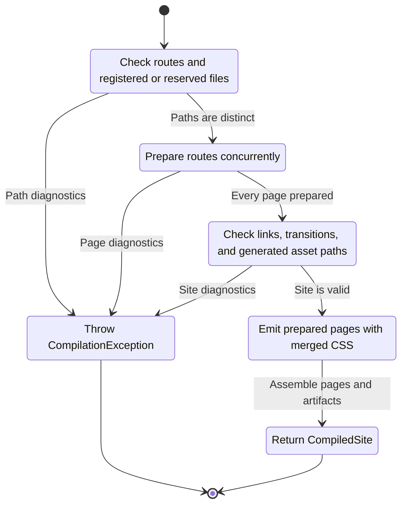

# Compiler internals

The compiler separates preparation from emission so a site can validate every route and merge styles before producing HTML. Public inputs and outputs are described in [Sites](sites.md); [Architecture](architecture.md) defines package boundaries.

## Prepare a page

`PageCompiler` coordinates the passes. The sequence shows the successful path:

```mermaid
sequenceDiagram
    participant Page as PageCompiler
    participant Document as DocumentPass
    participant Expand as Expansion
    participant Link as ReferenceLinker
    participant Validate as PageValidator
    participant Prepared as PreparedPage

    Page->>Document: Lay out document and contributions
    Document->>Expand: Expand components in their contexts
    Expand-->>Document: Expanded nodes and collected styles
    Document->>Expand: Link ordered body and head content
    Expand->>Link: Resolve slots and references
    Link-->>Expand: Linked nodes
    Expand-->>Document: Linked document
    Document->>Expand: Resolve registered heading references
    Document-->>Page: Linked nodes, headings, and compilation state
    Page->>Validate: Index and validate linked document
    Validate-->>Page: Metadata and diagnostics
    Page->>Page: Fail if diagnostics exist
    Page->>Prepared: Retain linked tree, styles, and metadata snapshots
```

| Owner | Responsibility |
| --- | --- |
| `DocumentPass` | Root context, deferred priorities, late slots, and processing document contributions |
| `Expansion` | Expand components/scopes, allocate identities, collect styles, and preserve origins |
| `ExpansionState` | Reference bindings, DOM IDs, generated counters, transition identities, and preparation diagnostics |
| `ReferenceLinker` | Resolve symbolic references and late slots, check sibling keys, splice transparent wrappers, and place tooltip companions |
| `CompilationState` | Read-only identity/transition views, validation indexes, outgoing URLs, and accumulated diagnostics |
| `PageValidator` / `AccessibilityRules` | Validate linked elements, commands, URLs, and accessibility semantics |
| `PreparedPage` | Own the linked tree and stylesheet; snapshot IDs, headings, URLs, transitions, and scripts |

### Placement and linking

Deferred content expands in its lexical scope and is emitted in priority/sequence order. Late callbacks resolve before document-end sections and head contributions. Contribution processing allows end sections to register more end sections and head contributions to register more head content.

`ReferenceLinker` converts `ExpandedNode` values to `ResolvedNode` values. Components, scopes, fragments, and keyed children keep their own child namespaces while emitting no wrapper markup of their own. Expanded keyed wrappers retain keys and locations until linking, so keys returned by late callbacks participate in the surrounding sibling namespace. Tooltip companions are placed after their invokers.

Only linked tags, text, and raw HTML reach validation, inspection, and emission. Their attributes and child lists are compiler-owned copies. `TagElement.copy` also copies descendant elements while retaining reference identities and nested component/scope instances. `Field` and `Image` use copies when adding labels, hints, errors, and anchors, so repeated compilation does not mutate the caller's retained builder.

### Validation and preparation

After references and headings resolve, `CompilationState` receives read-only identity and transition views and copies diagnostics. It does not retain allocation counters or reference bindings. Indexing records targets by ID and labelled control IDs for later checks.

Image checks run during expansion while authored style information is available. Linked-tree checks validate interactive names, fragments, invoker targets, and built-in command compatibility. Accessibility rules inspect the body tree; URL collection reads `href`, `src`, and `poster` in both body and head. Malformed URLs become page diagnostics before site validation uses their metadata.

Ambiguous bindings and unresolved attributes remain marked so dependent checks do not choose arbitrary targets or report secondary errors. All collected authoring diagnostics fail preparation together. The [diagnostics guide](diagnostics.md) defines the public reporting behavior and accessibility rule codes.

A prepared page retains its own stylesheet. `contributeStylesTo(target)` copies its rules to the site stylesheet; `stylesheet(theme)` serializes a standalone contribution. Prepared metadata snapshots keep the first location for each outgoing URL and transition key, allowing site validation without exposing the intermediate tree.

## Coordinate a site

Site compilation gates each stage before proceeding. The diagram describes authoring-error paths; application callback and internal compiler exceptions propagate directly.



Route preparation and emission run on virtual threads. The shared parallel mapper owns scheduling and ordered results; the coordinator owns diagnostic aggregation. Page failures, output pages, and stylesheet contributions retain route declaration order. Each page has separate compilation state; shared application state must be safe for concurrent callbacks.

`SiteValidator` consumes prepared metadata and registered asset paths. It resolves local URLs from each route's document URI, decodes paths and fragments, ignores queries for target lookup, and accepts generated `index.html` aliases. It also checks that transition keys appear on at least two routes. [Sites](sites.md#write-links-as-browser-urls) gives URL examples.

CSS merges sequentially in route order. The coordinator checks generated stylesheet and module paths for collisions with routes or registered files before emitting. `SiteArtifacts` then generates the search index and optional sitemap from prepared metadata.

## Emit resources

`HtmlWriter` encodes the linked tree and document envelope using the selected output mode. Its `Resources` object hashes and encodes the final stylesheet once and each distinct page module once per compilation. Every page references those selected resources. Resource paths and returned asset collections follow the [output-mode contract](sites.md#choose-an-output-mode).

`PreparedPage` is opaque to callers. Emission reads its prepared content without invoking application callbacks again. Trusted raw HTML bypasses parsing and encoding; typed text and attribute output use context-sensitive encoding.

## Preserve source and diagnostic context

`Location` records optional route, page, component path, element tag, DOM ID, and source. Contribution records pair head, end-section, and heading content with the registering location. Expansion and linking carry that location through deferred and late content.

`SourceProvenance` captures locations through the `SourceCapture` contract in `core`. The JVM implementation, `SourceTracking`, lives in `compiler` and uses stack walking. Code-source classification distinguishes platform/library frames from application frames, including applications using Tessera-like package names. Elements built during component expansion inherit the component placement origin.

Tracking is off by default and is propagated to site virtual threads when enabled. Public usage and inspection commands are in [Diagnostics](diagnostics.md#trace-elements-to-java-source).
