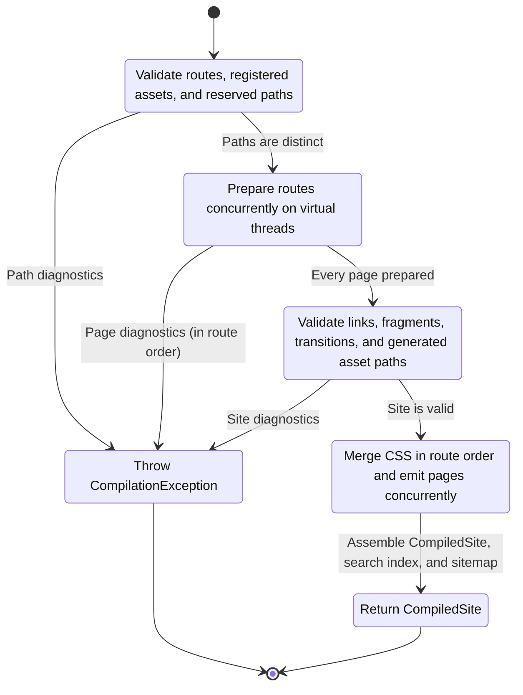

# Compiler internals

The static compiler in `tessera-compiler` separates page preparation from HTML emission so multi-page sites can validate every route, resolve cross-page links, and merge one deterministic stylesheet before writing output. It shares expansion, linking, validation, and CSS collection with the [browser runtime](browser-internals.md).

See [Architecture](architecture.md) for package boundaries and [Sites](sites.md) for public compilation inputs and outputs.

## Prepare a page

`PageCompiler` orchestrates document expansion, reference linking, validation (including the `wasm-mount-placement` check), and metadata snapshotting:

```mermaid
sequenceDiagram
    accTitle: Static page preparation pipeline
    accDescr: PageCompiler delegates layout to DocumentPass, which invokes shared ViewExpansion and ReferenceLinker, then runs ViewValidation before snapshotting a PreparedPage.
    participant Page as PageCompiler
    participant Doc as DocumentPass
    participant Expand as ViewExpansion
    participant Link as ReferenceLinker
    participant Validate as ViewValidation
    participant Prepared as PreparedPage

    Page->>Doc: Lay out body, deferred, late, and contributions
    Doc->>Expand: Expand portable and document nodes
    Expand-->>Doc: ViewNode tree and collected styles
    Doc->>Expand: Link ordered body and head trees
    Expand->>Link: Resolve ElementRefs, late slots, keys, and tooltips
    Link-->>Expand: LinkedNode tree
    Expand-->>Doc: Linked document
    Doc->>Expand: Resolve collected OutlineHeading refs
    Doc-->>Page: Linked trees, headings, scripts, and state
    Page->>Validate: Index IDs and run semantic and accessibility rules
    Validate-->>Page: Outgoing URLs, metadata, and diagnostics
    Page->>Page: Throw CompilationException if diagnostics exist
    Page->>Prepared: Snapshot linked tree, styles, IDs, headings, and URLs
```

| Collaborator | Responsibility |
| --- | --- |
| `DocumentPass` | Orders deferred priorities, resolves late callbacks, expands document-end sections and head contributions, and resolves outline heading refs |
| `DocumentExpansion` | Lowers `DocumentNode` placements, registers `BundlePublication` entries, and contributes bundled widget scripts |
| `ViewExpansion` | Expands components and scopes, enforces one element host per scope, allocates `ViewScope` identities, collects styles and outline headings, and preserves origins |
| `ViewState` | Tracks reference bindings, DOM IDs, scope counters, transition keys, and expansion diagnostics |
| `ReferenceLinker` | Resolves `ElementRef` targets and late slots, validates sibling keys, lowers form defaults (`ControlLowerer`), preserves transparent groups, and places tooltip companions |
| `CompilationState` | Holds read-only identity/transition snapshots, collected outgoing URLs, and accumulated diagnostics |
| `ViewValidation` / `AccessibilityRules` | Runs markup, security, image, command, URL, and ARIA checks |
| `PreparedPage` | Retains linked trees, page `StyleSheet`, and immutable snapshots of IDs, headings, URLs, transition keys, scripts, and bundle assets |

### Placement, linking, and defensive copying

Deferred nodes expand in their lexical `ViewScope` and emit at the end of `<body>` ordered by ascending priority, then encounter order. Late callbacks resolve FIFO after body expansion, before document-end sections and head contributions. Document-end and head passes loop until fixed point so contributions can register further contributions.

`ReferenceLinker` transforms `ViewNode` trees into `LinkedNode` trees. Component boundaries, scope boundaries, fragments, and keyed children remain transparent `LinkedNode.Group` wrappers (flattened during HTML emission) so keyed content returned from late callbacks participates in its enclosing sibling namespace. Tooltip companions are spliced immediately after their invokers.

Linked tags own copies of their attribute maps and child lists. `TagElement.copy` copies descendant tags while preserving `ElementRef` identities and nested component/scope instances. Built-in wrappers such as `Field` and `Image` copy elements when adding labels, hints, errors, or anchors so repeated compilations never mutate a caller's retained builder.

### Validation and preparation snapshots

Image checks run during expansion while authored CSS dimensions are available. Linked-tree validation then checks interactive labels, fragment targets, invoker commands, URLs (in both `<head>` and `<body>`), and body accessibility rules. Ambiguous ID bindings and unresolved references are flagged so dependent checks do not emit secondary errors.

`PreparedPage` retains its own `StyleSheet` (`contributeStylesTo` merges it into a site stylesheet) and keeps only the first location for each outgoing URL and `TransitionKey`. Emission reads `PreparedPage` without ever calling application callbacks a second time.

## Coordinate a site

`SiteCompiler` gates compilation into four ordered stages. Application exceptions propagate directly; authoring errors halt at the end of the failing stage and throw `CompilationException`:



- **Theme contrast**: The `Compiler` constructor rejects a theme whose `Theme.contrastDiagnostics()` is not empty, so neither `PageCompiler` nor `SiteCompiler` receives a failing theme. The theme computes its diagnostics once, resolving each token once per color scheme; the pairs come from `ThemeContrast`'s token pairs and the `internal.css.Tint` recipes the components paint with. See [Theme contrast](diagnostics.md#theme-contrast).
- **Concurrency and determinism**: Route preparation and page emission run on virtual threads (`Executors.newVirtualThreadPerTaskExecutor`), preserving route declaration order for diagnostics, CSS merging, search entries, sitemap entries, and returned `pages()`.
- **Cross-route validation**: `SiteValidator` resolves local URLs against each route's `documentUri()`, decodes percent-encoding, ignores queries, accepts `index.html` aliases, validates fragments against target page IDs, and verifies that every `TransitionKey` spans at least two routes.
- **Asset collision check**: After merging route stylesheets and collecting deduplicated scripts, Wasm bundle assets, and external speculation rules, `SiteCompiler` checks every generated asset path against routes and registered assets before emitting HTML.

## Emit resources

`HtmlWriter` handles context-sensitive OWASP encoding and the HTML envelope. Its `Resources` helper hashes and encodes the final stylesheet once and each distinct `PageScript` once per compilation. `BundlePublication` resolves `WasmBundle` graphs into content-hashed files under `<assetBase>/wasm/`, publishes the shared `wasm-bootstrap.js`, and supplies deployment CSP headers.

`SiteArtifacts` generates `search-index.json` (from routes and prepared outline headings) and optional `sitemap.xml` (when `baseUrl` is configured).

## Preserve diagnostic and source provenance

`Location` captures optional route, page title, component path, element tag, DOM ID, and `SourceLocation`. Contribution records pair head, document-end, and heading registrations with their originating locations across deferred and late boundaries.

`SourceProvenance` reads caller locations via `internal.authoring.SourceCapture`. On the JVM, `SourceTracking` implements capture with `StackWalker`, skipping JDK and Tessera library frames by code-source classification so applications using similar package names still receive accurate source lines. Tracking is off by default and propagates automatically across site virtual threads when enabled. See [Diagnostics](diagnostics.md#trace-elements-to-java-source) for public usage.
