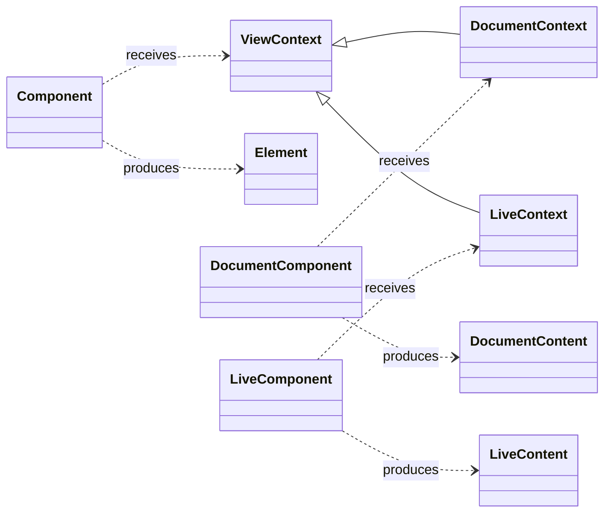

# Authoring design

This target design makes portability a property of the content that a component can produce and accept. Read it when changing component interfaces, child builders, scope roots, or widget state. [Current authoring](../consumer-guide.md) remains the guide to APIs available in the checkout.

## Separate capabilities from placement

A context grants operations during expansion. A content type controls what can be placed in the result. Both boundaries are necessary: restricting the context does not prevent a component from accepting a document-only child from its caller.

| Component family | Expansion context | Result | Accepted child families |
| --- | --- | --- | --- |
| Portable `Component` | `ViewContext` | `IntoElement`, producing portable `Element` | Portable only |
| `DocumentComponent` | `DocumentContext` | `DocumentContent` | Portable and document |
| `LiveComponent` | `LiveContext` | `LiveContent` | Portable and live |

`DocumentContent` and `LiveContent` are placement contracts with library-owned node representations. Their component interfaces convert to those representations through internal wrappers. `DocumentComponent` and `LiveComponent` do not implement `IntoElement`. Their content types do not extend portable `Element`. Document and live builders accept portable children through explicit overloads or conversion methods. They provide no conversion in the reverse direction and no direct conversion between document and live content.

The closed portable `Element` hierarchy contains tags, text, fragments, keyed content, and portable component or scope placements. It contains no raw HTML, deferred placement, late callbacks, browser events, or effects. Application-defined components can implement `Component`, but must still produce that portable output.

A portable wrapper that accepts children takes `IntoElement`, including in collections and callback results. It must not accept `Object`, an unrestricted common node interface, or a wildcard that admits document or live content. Document and live builders may share internal storage and construction code without widening their public child signatures.

Document factories own raw HTML, deferred content, late callbacks, and browser mount descriptors. Live factories own event bindings and keyed effects. Binding an event to a portable element produces `LiveContent`; it does not mutate the portable builder into a live node. This keeps a reusable portable value valid for both backends.

The extra document and live composition surfaces are a deliberate cost of enforceable placement. Reuse portable subtrees and shared internal construction rather than duplicating the component library or introducing capability parameters on every public CSS and element type.

## Assign existing components to a family

Classify components by their required operations, not by their current package. A portable component must remain portable under every configuration it accepts. A configuration that adds document or browser capabilities returns the corresponding content type.

| Current responsibility | Target owner |
| --- | --- |
| Footnotes, table of contents, and document layout using late or end contributions | Document components |
| Section markup and headings | Portable structure; document lowering collects navigation metadata |
| Image markup and eager-loading attributes | Portable image; a document decorator owns hero uniqueness and head preload |
| Carousel expansion-local anchor numbering | Portable render state through `ViewKey` |
| Tabs, search palette, and tooltip interactions | Portable structure with document or browser behavior adapters |
| Bundled SVG icons | Typed portable SVG nodes with namespace-aware DOM creation |
| Application-supplied raw icon markup | Document-only placement, subject to the raw-HTML trust boundary |

Replace bundled raw SVG with structured nodes before claiming that icon-bearing components are portable. Do not hide raw HTML inside an icon abstraction that bypasses placement restrictions. Document-oriented navigation remains free to accept document content; portable layout components do not.

## Give contexts a defined lifetime

`ViewContext` supplies diagnostics and `state(ViewKey<T>)`. Its state lasts one expansion: one prepared document or one attempted browser render. Derived contexts share that expansion's state. A rejected render discards it.

`DocumentContext` extends those operations with head contributions, ordered document-end content, scripts, and heading metadata. Document assembly belongs to the static backend. Portable heading markup can appear in either backend; collecting headings for a site index is a document operation.

`LiveContext` adds access to the owning root's invalidation handle and browser services. Persistent application state belongs to the application, outside render callbacks. Timers, subscriptions, and requests start in effects or event handlers and belong to explicit lifetimes. Expansion callbacks must not start external work whose cleanup depends on a successful commit.

Context inheritance alone does not grant permission to place the corresponding output. A document callback can use a portable component; that component still receives only `ViewContext` and returns portable content.

## Require explicit scope roots

A styled scope owns one authored host element. Portable `Scope.expand(ViewContext)` returns a `TagElement`. Document and live scope factories likewise require an explicit host from their own builder family. A scope cannot return another scope, a fragment, text, or an empty result as its host.

Authors place nested scopes inside that host. Each nested scope retains its own CSS marker and identity namespace. The outer scope never overwrites the inner markers, and expansion never inserts a generic `
` to make a result fit.

For wrapper-free content, use a component or fragment. For a scoped list item, author an `<li>` host; for a scoped table row, author a `<tr>` host. This keeps content-model choices with the author and prevents a scope wrapper from silently changing the document structure.

Keys continue to identify siblings. Identity scopes continue to qualify references. Neither requires inventing a DOM element beyond the host explicitly chosen for a styled scope. Keyed content inside an encounter-order-generated scope still needs a stable enclosing identity.

## Distinguish initial state from live ownership

Portable control declarations specify initial state for both backends. Live bindings specify state the application continues to own after mounting. Do not overload one setter to mean both initialization and ongoing ownership.

Names such as `initialValue`, `bindValue`, and `onValueChange` below identify separate operations; their exact spelling can follow the public naming review.

| Operation | Static document | First browser insertion | Later browser renders |
| --- | --- | --- | --- |
| Portable initial input value | Emit `value` attribute | Initialize value and reset baseline | Preserve user edits |
| Portable initial textarea value | Emit text content | Initialize value and reset baseline | Preserve user edits |
| Portable initial checked state | Emit `checked` attribute when true | Initialize checked state and reset baseline | Preserve native changes |
| Portable initial select values | Mark matching options selected | Initialize selection and reset baseline | Preserve native changes |
| Live value, checked, or selection binding | Unavailable to document placement | Apply application state | Reconcile against actual DOM state |
| Remove a live binding | Not applicable | Not applicable | Keep current DOM state; return ownership to the browser |

A live binding takes precedence over an initial declaration. Initial declarations set the browser's native form-reset baseline and are not reapplied when a retained control re-renders. To initialize a replacement, replace its identity deliberately. For a bound control, a form-reset handler must also reset application state; the next render otherwise reapplies the application value.

Typed state declarations are the single source for the corresponding initial properties. Reject conflicting generic `value`, `checked`, or `selected` configuration, and conflicting textarea text, rather than silently selecting one source. Validate host compatibility and select multiplicity during shared expansion.

Change callbacks report the user's requested value. The application updates its state and invalidates the root; the callback does not secretly change the bound value. Compare desired state with actual DOM properties, avoid equal-value assignments, and defer controlled text writes during input method editor (IME) composition. Apply controls after attributes and children.

## Adaptive widgets

Keep portable structure and initial state in the component library. Document lowering supplies static scripts when needed. Browser adapters return live content with the bindings below. Static compilation never serializes Java callbacks.

| Widget | Portable state | Live ownership and notifications |
| --- | --- | --- |
| Tabs | Initial selected key, panels, labels, and enabled state | Optional selected-key binding and selection-request callback |
| Field | Label, hint, validation message, and explicit invalid state | Render supplied validation state; keep control edits governed by the control binding |
| Dialog or drawer | Content, accessible name, and optional initially open non-modal state | Explicit modal/non-modal mode, open-state binding, and dismissal notification |
| Interest tooltip | Trigger, content, and reference relationship | Browser adapter owns hover/focus behavior and its cleanup |
| Search palette | Search entries, labels, and result structure | Browser adapter owns query updates, filtering, result focus, and dismissal |

### Tabs

Without a binding, the widget owns selection after initialization and keeps it while its selected tab remains enabled and present. If that tab disappears, select the next enabled tab in document order, then the previous one; with no enabled tabs, select none. Keyboard focus and selection must follow the widget's activation mode.

With a binding, the application supplies a valid selected key or an explicit empty selection when no enabled tab exists. A click or keyboard action reports a selection request. The application accepts or rejects it through the next supplied value. Removing the selected tab requires updating the bound key in the same render; an invalid combination rejects the candidate.

### Dialogs and drawers

An HTML `open` attribute means a visible non-modal dialog. A modal opening uses the browser's modal operation and top layer. Keep those meanings separate in initial configuration, live binding, and host-service methods.

For application-owned open state, native Escape, cancel, close commands, and light dismissal report a request to the application. Accepted dismissal updates the bound state to closed. If application state remains open, the next reconciliation restores that state deliberately. A model update must not depend on an unrelated later render to acknowledge a dismissal.

For browser-owned dialogs, native actions update native state and unrelated renders preserve it. Opening records a focus-return target; closing restores it or a declared fallback if the target was replaced. Runtime disposal releases that ownership even when the dialog disappears with its subtree.

## Authoring outside the shared model

Trusted raw HTML stays a document operation. It is not parsed into portable nodes or adopted by the browser renderer. A compiled browser bundle is also document content: it places a validated static fallback and declares a separate live root, rather than inserting `LiveContent` into a static tree.

See the [runtime design](runtime.md) for the ownership and publication rules behind those roots. The [roadmap](../roadmap.md) defines the consumer examples and browser scenarios needed to accept this authoring model.
