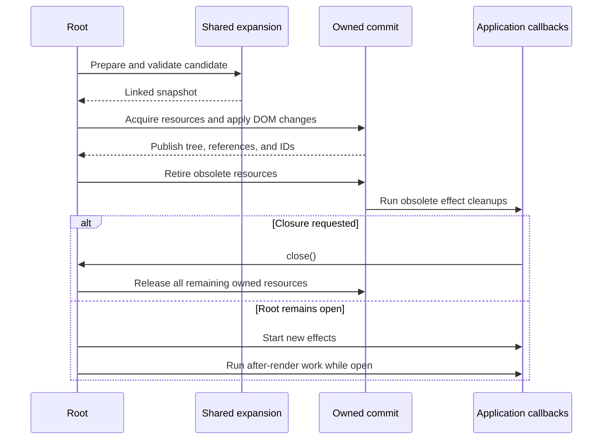
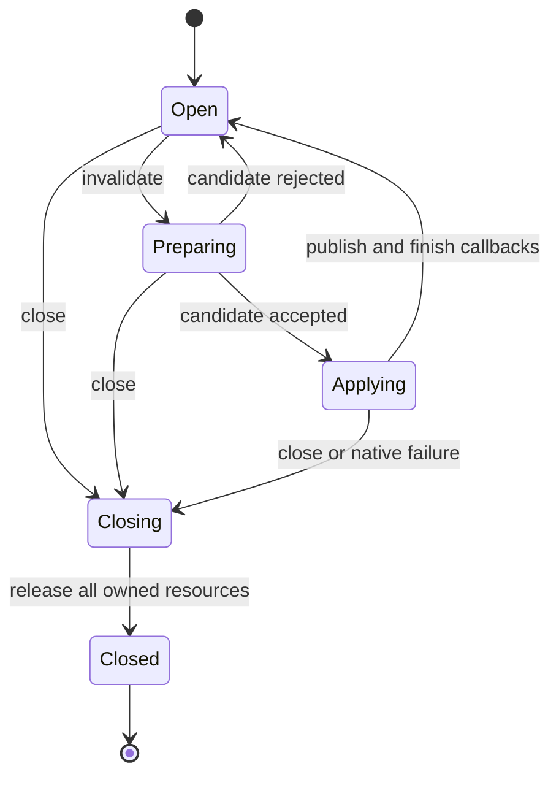

# Runtime and publication design

This target design defines who owns a browser render, when callbacks run, and what remains after rejection or disposal. It also defines the boundary between a compiled browser application and static site publication. See [browser internals](../browser-internals.md) for the implementation available now.

## Own resources before exposing callbacks

A root owns its committed tree and an optional in-progress commit. The commit owns newly acquired listeners, composition handlers, effect lifetimes, scheduled work, and styles until they transfer to the committed tree or are released. Register ownership as each acquisition succeeds, before any callback can request closure.

Retained resources transfer once. Obsolete resources remain owned by a retiring set until disposal finishes. These sets are implementation responsibilities, not public collections or a general transaction framework. Their purpose is to make every release path complete, including partial native failures.

| Phase | Owner and permitted work |
| --- | --- |
| Prepare | Expansion owns a candidate snapshot; no DOM mutation or external effect work |
| Acquire and apply | The root owns both the committed tree and resources acquired by the active commit |
| Publish | Install the new tree, references, and IDs together; transfer retained and new resources |
| Retire | Release obsolete resources and run their application cleanups |
| Activate | Start new effects, then run queued after-render work if the root remains open |
| Close | Disable dispatch and scheduling; release committed, in-progress, and retiring resources once |



Do not invoke application effect cleanups halfway through sibling reconciliation. Native DOM operations can still cause synchronous callbacks. A close request at that point marks the root closing immediately and settles at the next safe commit boundary. It must not allow the candidate to publish or start effects afterward.

Public reference operations resolve only the published tree. Retirement cleanups release the resources they own; they do not gain access to removed nodes through the new reference map. Internal disposal closes transient native UI directly. Work that outlives a render uses application-owned references, as described in [host services](../browser-internals.md#host-services).

## Make closure a terminal transition

Closure is idempotent. Mark the root closing before calling any application cleanup, stop event dispatch and scheduling, cancel pending work, and then release owned resources. Repeated close requests join that teardown. One failing cleanup does not prevent the remaining cleanups from running.



Closing during effect startup or an after-render callback prevents later callbacks in that batch from starting. Closing during application expansion discards its result. A root cannot publish a snapshot after it enters closing, and detached nodes cannot continue dispatching application handlers after teardown.

Keep keyed effect identity, newest-first cleanup within a lifetime, and descendant-first subtree disposal. A changed key retires the old lifetime before starting the new one. The root releases render closures and obsolete snapshots as well as native handles.

## Define failure boundaries

| Failure | Required result |
| --- | --- |
| Expansion, validation, or introduced-ID collision | Reject the candidate; preserve the committed tree and allow later invalidation |
| Initial preparation or pre-publication commit failure | Keep or restore the original fallback nodes; release resources acquired for the failed attempt |
| Native failure during an update to an established live tree | Close the root and report the failure; do not claim arbitrary DOM rollback |
| Effect startup or event handler failure | Report the failure; preserve the root unless closure was requested |
| Cleanup failure | Finish releasing the other resources; report collected failures |
| Completion after cancellation or closure | Do not invoke the application callback or invalidate the root |

For initial mounting, build the candidate off the host where possible and retain the actual fallback nodes until publication succeeds. Do not reconstruct fallback from serialized HTML, which can lose its native state. Effect startup occurs after publication; an effect failure is not an initial render rollback. Native side effects outside owned DOM are not transactional.

## Reserve identity at the correct boundary

The mount host belongs to the surrounding document. Its ID is reserved even though DOM containment APIs consider the host to contain itself. A candidate may not claim that ID.

Before publication, check every introduced ID against the host and document elements outside the root's owned descendants. Check the candidate itself for duplicate IDs and unresolved references. Generated and scoped IDs use the host namespace, but namespacing does not replace collision checks.

Once published, a root retains ownership of its IDs until a later publication removes them. Host-page code remains responsible for avoiding conflicting mutations after publication. Do not add continuous document polling to police external markup. Reintroducing a released ID performs the collision check again.

Keep reconciliation identity separate from DOM identity: sibling keys and component definitions select retained ranges; `ElementRef` resolves authored relationships. Changing a key or component definition replaces that logical subtree and retires its resources.

## Keep rendering and styling bounded

Retain coalesced invalidation, explicit work and runaway limits, and a paint opportunity between batches. Invalidating during a render schedules subsequent work rather than recursive rendering.

Styles belong to the same ownership lifecycle as listeners and effects. Acquire candidate rules before use, release retired rules after successful publication, and release acquisitions from failed commits. Keep the unused-rule cache bounded. Frequently changing values use stable rule shapes with element-local custom properties.

Use one stylesheet ledger per compiled entry. Multiple roots of that entry share it; independent entries own independent Java runtimes. Do not introduce a cross-image Java object registry merely to deduplicate a few rules. Distribution measurements must include the cost of loading more than one image.

## Publish complete browser bundles

Bundle publication is a separate feature after the authoring and ownership refactor. The static compiler consumes an already built `WasmBundle`; it does not invoke GraalVM, resolve toolchain installations, or transfer JVM closures into a page.

The bundle describes a closed graph of launcher, Wasm image, supplementary chunks, and bootstrap resources. Each resource records its content, media type, digest, and references to other resources. Publication assigns content-derived paths and rewrites supported references consistently. Reject an unsupported launcher layout rather than guessing file names.

| Boundary | Responsibility |
| --- | --- |
| Image build adapter | Produce the resource graph from the pinned toolchain's output |
| Bundle validation | Check graph completeness, supported references, and digest consistency |
| Document mount | Declare host identity, entry/view name, and document fallback |
| Compiler resource assembly | Publish every required file and escaped mount attribute under the selected asset base |
| Bootstrap | Check capabilities, load each entry once, isolate failures between hosts, and report actionable errors |
| Hosting adapter | Serve correct media types and the deployment's response headers |

A document mount accepts document fallback content, including portable components, but no live callbacks. The fallback participates in document validation and remains useful before Java starts. Existing native controls and links need not be disabled merely because they are fallback content.

Support root and nested asset bases. Publish `.wasm` as `application/wasm`, include every resource in compiled outputs, and exclude build intermediates. SHA-384 metadata is useful only if checked: apply script integrity where supported and verify fetched binary or chunk bytes before using them. A digest in an unchecked manifest is not integrity enforcement.

## Establish policy and performance evidence early

The target Content Security Policy is:

```text
default-src 'self'; script-src 'self' 'wasm-unsafe-eval'; style-src 'self'; object-src 'none'
```

Exercise the actual launcher, binary loading, controls, and dynamic styles under that complete policy. Do not weaken it to make a test pass or infer full-policy support from a stylesheet-only check. The hosting adapter applies the headers; compilation returns the required resources and deployment information.

Before broad API migration, establish a representative form and keyed-list workload, one-entry and two-entry distributions, repeatable hardware/network conditions, and explicit budgets. Measure compressed transfer size, cold boot to interaction, update latency, and retained resources over repeated mount/close cycles. Store measurements outside architecture prose; the [roadmap](../roadmap.md#p3-establish-browser-feasibility) defines the gate for acting on them.

Streaming requests are a subsequent host-service feature. Deliver chunks incrementally, cancel the reader and request with their owner, and ignore late chunks after cancellation. Keep this feature separate from changes to content types and module exports.
