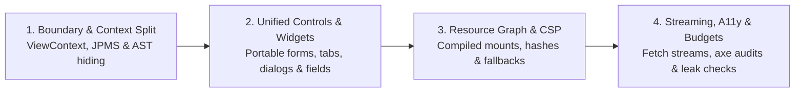

# Roadmap: browser-native Java rendering

`dev.nthings:tessera-wasm` is an experimental GraalVM Web Image backend that mounts portable Tessera components into the browser DOM. Shared contracts and current behavior are defined in [architecture.md](architecture.md) and the [consumer guide](consumer-guide.md). The structural redesign separating static compilation from live browser concerns is specified in [architecture-redesign.md](architecture-redesign.md).

Completion requires executable evidence from the published browser distribution in both Chromium and Firefox, not only JVM unit tests or AOT compilation. Breaking changes across core, components, and compiler APIs are permitted without compatibility shims.



## Next steps and verification gates

Execute phases in order. A checkbox is complete only when its scenario passes in the real HTTP-served image across Chromium and Firefox.

### Phase 1: Boundary encapsulation and context separation

Implement the [context and module boundary redesign](architecture-redesign.md#1-context-hierarchy-and-placement-separation) so static consumers see only static authoring APIs and unsupported document operations are prevented at compile time.

- [ ] **Portable `ViewContext` vs `DocumentContext`.** Split `ViewContext` (portable state and `report`) from `DocumentContext` (head, document-end, scripts, headings) and move `deferred`, `late`, and `rawHtml` to document-only contracts. Evidence: compiler and live expansion tests confirming portable components compile without `DocumentContext` and cannot invoke document-only placement in a browser mount.
- [ ] **Module and package encapsulation.** Add `module-info.java` exporting `view` only to `tessera-wasm`, move `StyleSheet` into `view`, and make AST wrapper records and `TagElement` inspection getters package-private. Evidence: API surface audit and showcase compilation proving zero backend-facing types or getters leak into public autocomplete.

### Phase 2: Unified controls and adaptive widgets

Align static and live semantics for form controls and interactive components as specified in [Unified form controls and adaptive widgets](architecture-redesign.md#2-unified-form-controls-and-adaptive-widgets).

- [ ] **Portable form control bindings.** Lower `value`, `checked`, and `selectedValues` to initial HTML attributes and text in static compilation while retaining live DOM property reconciliation and IME composition guards in `tessera-wasm`. Evidence: static/live parity tests for `<input>`, `<textarea>`, and `<select>` without `native-control-properties` diagnostics.
- [ ] **Adaptive interactive widgets.** Support `ContentTabs` selection and roving tabindex in Java for mounted views, explicit `Field` error states via `aria-invalid`, in-place `Modal` and `Drawer` lifecycle with focus restoration, and script-free live tooltips. Evidence: browser tests adding and removing tabs while selected, opening and dismissing dialogs, and toggling field errors with verified focus and ARIA state.

### Phase 3: Resource graph, distribution integrity, and CSP

Integrate Wasm bundles and mount hosts into `Compiler` as described in [First-class browser mounts and resource graphs](architecture-redesign.md#3-first-class-browser-mounts-and-resource-graphs).

- [ ] **Immutable resource graph and path publication.** Compile `WasmBundle` mounts through `PageDocument` and `SiteDefinition`, emitting content-hashed launchers, `.wasm` binaries, and manifests under root (`/`) and nested (`/subpath/assets`) base paths with `application/wasm` MIME types. Evidence: root and nested publication integration tests plus manifest integrity verification.
- [ ] **Strict Content Security Policy and data safety.** Serve the compiled distribution under a documented CSP with no `unsafe-inline` script or style exceptions and only required WebAssembly permissions (`script-src 'self' 'wasm-unsafe-eval'; style-src 'self'`). Evidence: Playwright acceptance suite passing with zero CSP violations and escaping tests for mount configuration.
- [ ] **Fallback preservation and load failure recovery.** Validate non-interactive fallback content during page compilation, replace it only on a successful initial render, and preserve readable fallback content with an actionable error when browser capabilities, launchers, or `.wasm` assets fail. Evidence: browser tests simulating unsupported WebAssembly capabilities, HTTP 404 assets, and throwing initial renders.

### Phase 4: Streaming, accessibility, and production budgets

Verify runtime resilience, dynamic accessibility compliance, and binary performance budgets on the packaged application.

- [ ] **Streaming Fetch and lifetime cancellation.** Stream responses incrementally through browser Fetch, abort in-flight streams when the owning `Lifetime` or `BrowserRoot` disposes, and ignore stale completions. Evidence: browser streaming tests covering incremental DOM updates, mid-stream abort, and post-close completion.
- [ ] **Dynamic accessibility verification.** Run keyboard navigation flows, accessibility-tree assertions, and axe-core WCAG A/AA checks after dynamic DOM mutations in Chromium and Firefox, including `prefers-reduced-motion` and `forced-colors` modes. Evidence: automated Playwright axe and keyboard verification suite.
- [ ] **Build budgets and leak verification.** Verify that the packaged resource graph excludes compiler intermediates and remote dependencies, and record compressed binary size, boot-to-interactive timing, render turn latency, and retained handle counts across repeated mount/close cycles. Evidence: generated build budget report and memory/handle leak assertions.
- [ ] **Standalone acceptance application.** Publish an interactive form and filterable list application built solely with Tessera and `tessera-wasm`, while keeping the static showcase verification green. Evidence: deployed acceptance fixture passing full browser verification.

## Exclusions

| Capability | Status |
| --- | --- |
| Server-rendered DOM hydration or adoption | Outside scope; mounts replace fallback content on initial render |
| Implicit observable state stores | Outside scope; invalidation remains explicit via `BrowserRoot` |
| Worker-based DOM rendering or WASI targets | Outside scope; targets browser main-thread WasmGC via Web Image |
| Serializing JVM closures or services to the client | Outside scope; entry points compile ahead of time |

## Environment and commands

Use Oracle GraalVM **25.4.4.1.1**, `org.graalvm.sdk:webimage-preview:25.4.4.1.1`, Native Image prerequisites, and Binaryen **119 or later** on `PATH`. Select the distribution with `sdk use java 25.4.4+1-graal` or point `JAVA_HOME` to it. The default JVM build runs on Temurin 25 without invoking Web Image or Binaryen.

```bash
# Compile the images and assemble the browser host under tessera-wasm-showcase/target/web
just wasm

# Serve the generated distribution locally over HTTP
jwebserver -b 127.0.0.1 -p 8000 -d tessera-wasm-showcase/target/web

# Run real-image browser verification in Chromium and Firefox
just wasm-verify
```

## References

- [Canonical architecture specification](architecture.md)
- [Dual-backend architecture redesign proposal](architecture-redesign.md)
- [Consumer guide](consumer-guide.md)
- [GraalVM Web Image reference manual](https://www.graalvm.org/latest/reference-manual/web-image/)
- [Web Image JavaScript interoperability API](https://www.graalvm.org/latest/reference-manual/web-image/api-guide/)
