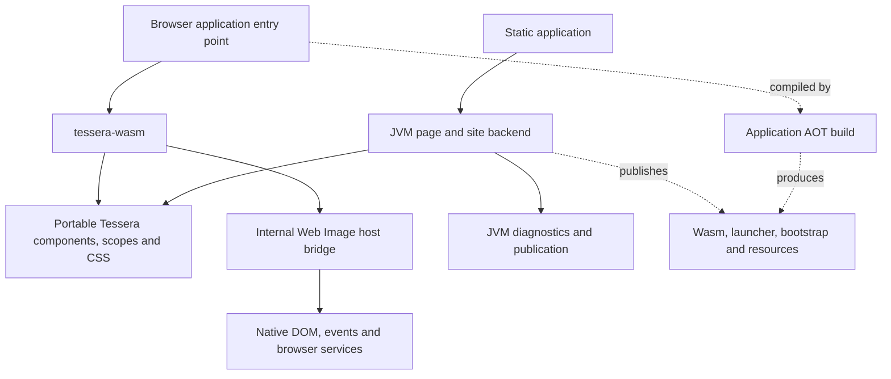
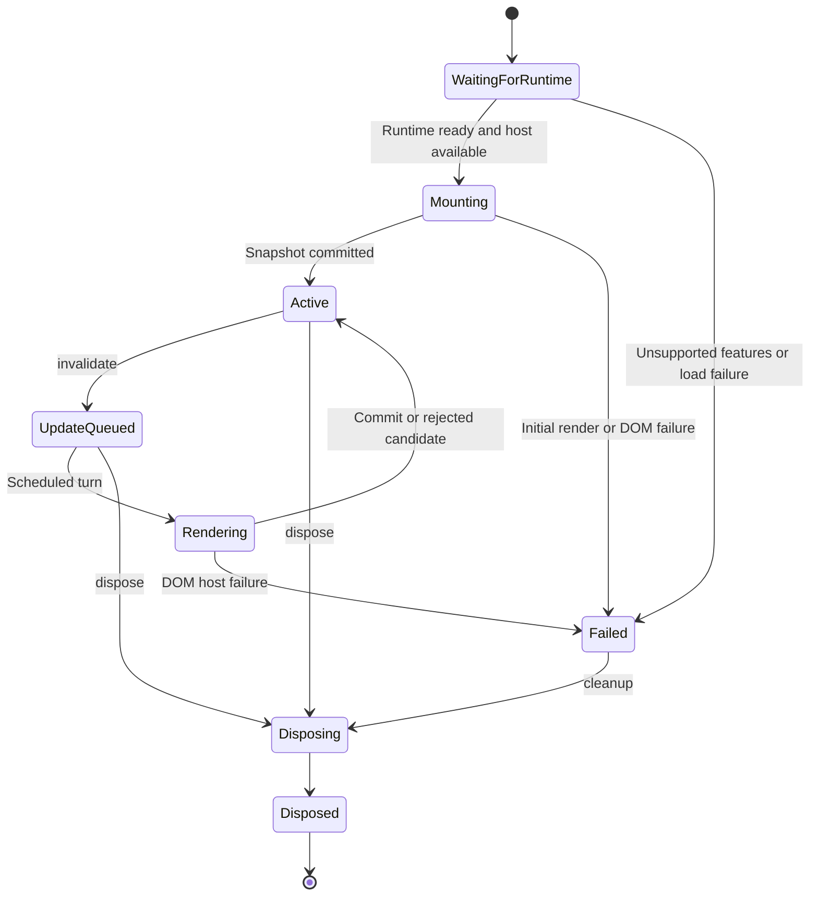

# Roadmap: browser-native Java rendering

## Decision and scope

Add `dev.nthings:tessera-wasm` as a sibling Maven module providing a live browser backend for portable Tessera components. Compile application entry points and their reachable Java component code through GraalVM Web Image into WasmGC plus its required JavaScript launcher. Share component definitions, render/style callbacks, typed CSS and accessibility semantics with the JVM static backend rather than implementing a second widget library in JavaScript.

This is a proposed design, not an implemented capability, and `tessera-wasm` is not on `main`. Every verification checkbox below is pending. Completion requires executable evidence from the published browser application, not only JVM tests, successful AOT compilation or toolchain examples. The static compiler on `main` is expand, link, validate, then emit.

The module is independent of any agent, UI-description protocol or transport. It contains no A2UI, AG-UI or MCP types, schemas, catalogs, routing or function-dispatch rules. Applications can use it for ordinary forms, local interactive tools, dashboards and live regions inside static sites. Protocol renderers are downstream consumers, not prerequisites.

Breaking changes to core, components and compiler APIs are permitted. Replace superseded contracts directly and update consumers, showcase and tests together, without compatibility shims or deprecated aliases.

### Outcomes and exclusions

| In scope | Outside this design |
| --- | --- |
| Shared Java component authoring with static and live DOM backends | Porting the entire site compiler, filesystem publisher or preview server into browsers |
| Explicit invalidation, fresh render snapshots and keyed DOM reconciliation | A mandatory global state store or implicit observation of arbitrary Java object mutation |
| Native events, properties, focus, selection and deterministic cleanup | Serializing JVM closures, services or object graphs into browser programs |
| Local packaging of Wasm, launcher, bootstrap, CSS and other resources | Runtime compilation or downloading executable component implementations |
| Independent mounted roots in an otherwise static page | Hydration or automatic adoption of server-rendered component trees |
| A selected Web Image implementation behind generic contracts | A multi-toolchain provider framework, worker-based DOM rendering or standalone WASI support |

## Architecture

The [current architecture](architecture.md) remains the description of implemented behavior. A browser turn runs the same expand, link and validate phases, then emits DOM from that linked tree. It is another writer, not a second layout engine, and it does not add `requestLayout`, prepaint or paint phases. `PreparedPage` stays an immutable static compilation result, not a live component store.

Solid arrows mean dependencies or host calls. Dashed arrows describe build and publication, not dependencies from the portable kernel on the compiler.

| Layer | Contract |
| --- | --- |
| Portable `tessera` packages | Components, the linked tree from expand, link and validate, explicit `DocumentContext`, keys and references, typed properties and events, tokens, styles and resource descriptors. No Web Image or native DOM types in public signatures. |
| JVM/static backend | The same linked tree, emitted as HTML, plus whole-document validation, source diagnostics, site orchestration and publication. It must not initialize browser interop. |
| `tessera-wasm` | Mounted roots, invalidation, scheduling, retained instances, DOM patching, event registration, cleanup and generic browser service adapters. Depends on portable Tessera, not the other way around. |
| Internal Web Image bridge | `@JS`, `@JS.Coerce`, `JSObject`, launcher integration and conversions between typed Java contracts and native browser objects. These implementation details stay inside the module. |
| Application | Browser entry point, state and event handlers, selected components, remote-service policy, mount configuration and application-specific resources. |

Start with portable package boundaries inside the existing `tessera` artifact. Prove their AOT reachability and class-initialization closure. If the toolchain requires physical isolation before reachability pruning, split the portable artifact before adding browser features. Maven `optional` dependencies alone are not evidence of isolation.

## Shared expansion and context

The browser backend consumes the same linked tree the static backend emits as HTML: elements, text and wrapper-free fragments, with sibling keys, attributes, symbolic references and style definitions. Live bindings that HTML emit does not need, such as typed native properties and event handlers, belong on that tree. They are not a second snapshot and not a second layout engine. Static output emits HTML. Live output emits DOM and reconciles it against mounted instances.

Each turn expands, links and validates a fresh tree from application state. Builder mutation constructs that tree; mutating a previously expanded builder does not update the DOM. [`TagElement.copy`](../tessera/src/main/java/dev/nthings/tessera/core/TagElement.java) already copies descendant elements, so [field](../tessera/src/main/java/dev/nthings/tessera/components/Field.java) and image wiring cannot touch the caller's children. A component that still mutates a retained input while expanding must not accumulate children, stale references or duplicate contributions across turns.

[`DocumentContext`](../tessera/src/main/java/dev/nthings/tessera/core/DocumentContext.java) is already the explicit context passed through expansion. A browser turn passes a fresh one. It carries the id scope, script and style registration, and diagnostics for that turn. Persistent mounted state, listeners and application data do not live in that context. Async completions request a new turn rather than retaining the old one. `DocumentContext` does not use `ScopedValue`. The only `ScopedValue` in the library is the JVM source-capture helper in `SourceProvenance`.

Keep static document contributions, including head content, late references, headings and end sections, in the static backend. Shared components request semantic contributions through explicit contracts. A browser root resolves live references within its mounted scope and registers local resources; it does not rerun site generation or append document contributions on every update. Unsupported document-only contributions fail explicitly before mounting instead of disappearing silently.

### Public runtime surface

The following are proposed contracts, not existing API names or final signatures:

| Contract | Required semantics |
| --- | --- |
| Browser entry point | Starts after runtime initialization, receives validated configuration and mounts into an identified host. Reachable Java code is compiled, not uploaded as a closure. |
| Mounted-root handle | Supports `invalidate`, deterministic test flushing and idempotent `dispose`. It exposes no Web Image objects. |
| Render callback | Receives the current turn context and reads application-managed state to produce a snapshot. Rendering must not perform network requests or uncontrolled side effects. |
| Event binding | Typed event data and synchronous operations for default prevention/propagation; explicit capture/passive options and replaceable handler identity. Native event objects cannot escape their valid lifetime. |
| Lifetime registration | Registers listener, subscription, timer and request cleanup for a mounted root or retained instance; async results are checked against its generation. |
| Host-service adapters | DOM operations, scheduling, focus/selection, dialog/media operations and Fetch/stream/abort completion. Application protocol framing and business decisions stay outside the module. |

Initial invalidation is explicit: an event or async completion updates application state and invalidates its root. Multiple invalidations coalesce into a scheduled turn; invalidation during a turn schedules a subsequent one. Apply a configurable work budget per flush, yield between batches and diagnose runaway self-invalidation rather than starving the event loop. No automatic dependency-tracking framework is required. Observable-state conveniences can later target the same invalidation contract without redefining rendering semantics.

Java event closures are callable only when compiled into the browser program. The static compiler rejects live callback bindings outside a declared browser mount; a mount contributes its host, optional noninteractive fallback and named browser entry point. It never serializes captured Java services or credentials. The first live mount replaces only the fallback contents of its designated host and does not claim hydration.

## Live rendering and lifecycle

### Reconciliation rules

1. Expand, link and validate the candidate tree before changing the live DOM. Reject duplicate sibling keys, invalid references and invalid semantic or property combinations without modifying the mounted tree.
2. Match retained instances by parent scope, key and compatible element/component type. Unkeyed children use positional identity; require explicit keys for reorderable or stateful collections. Fragments retain an anchored DOM range so moving one moves all of its siblings together.
3. Compute text, attribute, property, event and child-order changes. Publish required styles/resources before exposing new instances.
4. Reuse compatible native nodes and move them without disposal. Replace incompatible instances; remove obsolete nodes and run their cleanup exactly once.
5. Commit the new snapshot and reference map. Preserve stable DOM/ARIA identifiers for surviving instances and isolate failures to the affected root.

Keep sibling keys, component definition keys, authoring references and DOM identifiers distinct. Explicit keys must remain stable across snapshots; fresh Java object identity and per-compilation counters are not sufficient. Detect collisions across independent roots in one document.

Candidate validation is not a promise that arbitrary DOM operations can be rolled back. A host-operation failure stops further work for that root, reports the failure and requires controlled disposal/remount; other roots remain usable. Render callback exceptions leave the previously committed tree intact. Cleanup exceptions are reported without preventing the remaining cleanup operations.

### Native properties and behavior

Patch live properties such as `value`, `checked` and selected options rather than treating them as initial HTML attributes. Controlled inputs receive explicit desired values; uncontrolled inputs receive initial values and retain browser edits. Unchanged controlled values must not reset caret/selection. Composition-aware updates must not interrupt IME input.

Run handlers synchronously in the native event call chain. Gesture-sensitive operations, including dialog opening or navigation where activation is required, happen before yielding to promises or scheduled rendering. Expensive follow-up work is queued cooperatively so the browser can paint; no Java virtual-thread or executor support is assumed.

Assign each mutable widget property one authoritative implementation. For mounted tabs, selection, roving tabindex and dynamic child discovery belong to the Java live behavior rather than competing Java and existing JavaScript initializers. Native dialog focus/dismissal, input selection and media state remain platform state unless explicitly controlled. Static pages can retain their existing behaviors, but both paths share component semantics and parity tests.

Disposal cancels queued work, removes listeners, releases Java/JavaScript callback references, aborts root-scoped requests and closes transient UI. Generation checks prevent late completions from changing disposed or replaced instances. Removing a view, moving it and temporarily disconnecting its host are distinct operations; the embedding API must define when a detached root is explicitly disposed rather than guessing from every DOM move.

## Styles, assets and initialization

Replace the single-module-string [`PageScript`](../tessera/src/main/java/dev/nthings/tessera/core/PageScript.java) contract with a generic immutable resource graph. Describe entry points, binary and text files, content types, dependencies, load paths and integrity metadata. Keep bootstrap data separate from executable code. The static backend can publish a browser application without importing or invoking its interop classes. The three scripts on `main` stay page scripts: tabs, because HTML has no roving-tab widget; search filtering, because that is not HTML; and the interest tooltip, because it is a Firefox polyfill. Do not add an action or entity runtime to replace them.

The application build compiles its selected Java entry point with Web Image and packages Wasm, required launcher, external bootstrap, CSS and referenced assets as one local distribution. Preserve tool-generated paths, or rewrite every affected graph edge consistently before hashing. A library JAR alone does not supply a closed-world image for arbitrary application callbacks. Debug artifacts and compiler intermediates are not public assets by default.

Use one style-definition registry shared by static and live rendering. Static builds collect styles deterministically. Browser mounts register and deduplicate component rules before first use, including components first introduced after startup. Keep definition rules available for subsequent mounts; do not append duplicate style blocks on every render. Prefer prepublished definition styles where the application component set is known; explicitly test any dynamic style sink against the supported CSP.

Bootstrap checks required browser features, loads the launcher, awaits runtime initialization and then mounts each configured root once. Unsupported browsers or failed loads retain readable fallback content and report an actionable error. Serve Wasm as `application/wasm` over HTTP(S); never assume `file://` or a generic WebAssembly feature check is sufficient. CSP tests must cover the actual launcher and WebAssembly compilation policy, not only script tags.

## Portability boundaries

Web Image is the selected experimental target, not proof that the existing dependency closure works unchanged. Its documented build uses `native-image --tool:svm-wasm` and produces WasmGC with JavaScript host support. Pin the compiler distribution, API artifact, Native Image build plugin, Binaryen tools and browser-test versions together. Record the supported browser features and toolchain commands in the reproducible verification fixture.

| Existing seam | Design action | Evidence required |
| --- | --- | --- |
| `SourceTracking` initializes stack/class machinery even when tracking is off | Isolate JVM stack capture; portable diagnostics use explicit component/key paths and optional generated source metadata | Browser root initializes without reaching JVM stack/protection-domain services |
| `Scope` default names use `ClassValue`; typed document keys use class metadata | Use stable explicit/generated definition keys where needed; verify remaining metadata operations | Deterministic keys and successful AOT/runtime tests, not inferred Java 25 support |
| Stream gatherers, regex, CSS and encoding helpers | Audit exact reachable methods and libraries | Executed representative component/CSS fixtures in the browser |
| Classpath-loaded behavior resources and component static fields | Build explicit resource manifests and separate JVM loaders | No runtime classpath fetch assumption or hidden initializer failure |
| Site writer, preview server and virtual-thread orchestration | Keep outside browser entry-point reachability | Build analysis and final image inspection show no reachable JVM publication/server code |

Do not introduce a JavaScript replacement widget layer if a portability gate fails. Refactor the shared boundary or resolve the supported implementation explicitly. Web Image annotations and host objects must not escape into generic authoring APIs.

## Verification roadmap

Execute gates in order. A box is complete only when its named scenario has a reproducible fixture and passing evidence. Use JVM tests for portable rules and the existing [showcase browser harness](architecture.md#verification-and-remaining-limits) for the actual HTTP-served distribution in Chromium and Firefox. Record exact build commands, dependency versions, browser versions and artifact manifests with results. New test/artifact names below describe required scenarios, not existing files.

### Gate 1: prove the Java browser target

- [ ] **V1.1, reproducible image:** from a clean checkout, a pinned Maven browser-build profile produces a Wasm image, required launcher and manifest. A normal JVM-only build still runs without Web Image/Binaryen installed.
- [ ] **V1.2, real component execution:** after boot, a captured Java render callback creates a semantic button and a styled field through shared Tessera factories. The fixture must not substitute prewritten JavaScript markup.
- [ ] **V1.3, event round trip:** a native click invokes a retained Java lambda, changes Java state, invalidates the root and changes visible text with no network request.
- [ ] **V1.4, runtime closure:** exercise records/sealed dispatch, CSS composition, explicit contexts, references and required JDK APIs in the compiled image; attach reachability/class-initialization evidence excluding JVM stack capture, site I/O and server services.
- [ ] **V1.5, browser support:** run the actual WasmGC/exception/function-reference image in both supported engines; simulate unsupported features and a missing launcher/image to verify readable fallback and useful errors.

### Gate 2: establish portable component semantics

- [ ] **V2.1, static/live parity:** render the same button, labelled field, conditional fragment and keyed list with both backends; compare normalized semantic DOM and computed style behavior, not HTML serialization details.
- [ ] **V2.2, repeatable expansion:** repeatedly render a field while toggling hints/errors; references, children, CSS and contributions neither accumulate nor remain stale. Verify independent roots and static compilations do not share turn state.
- [ ] **V2.3, context and diagnostics:** throw inside nested render/style callbacks, then render again; context is restored, errors identify the component/key and no prior turn leaks into the next.
- [ ] **V2.4, boundary enforcement:** inspect dependencies and public signatures for Web Image/native types outside the bridge, application protocols in core/wasm, and browser initialization during static compilation. Reject live callbacks outside declared browser mounts.

### Gate 3: prove retained DOM and event correctness

- [ ] **V3.1, keyed identity:** insert, reorder and remove keyed inputs and multi-node fragments; surviving native nodes, references, DOM/ARIA IDs and local state remain stable. Duplicate keys fail before mutation.
- [ ] **V3.2, native input state:** edit controlled and uncontrolled text, checkbox and select controls; verify value/attribute differences, selection, caret, focus and IME composition across unrelated updates.
- [ ] **V3.3, scheduling:** coalesce repeated invalidations; invalidation during rendering schedules a subsequent turn. Verify paint between budgeted batches and diagnostics for runaway invalidation; rejected/stale async results do not corrupt the tree.
- [ ] **V3.4, event replacement:** rerender with a new handler and capture/passive settings; invoke only the current handler once, preserve default-prevention semantics and prevent callback retention after removal.
- [ ] **V3.5, native activation:** a real browser click enters Java with `navigator.userActivation.isActive` still true and performs a supported gesture-gated operation synchronously. Verify dialog focus separately; opening a dialog or dispatching a synthetic event alone is not proof of preserved activation.
- [ ] **V3.6, failures and disposal:** reject invalid snapshots without changing the last committed view; inject host and cleanup failures; dispose twice, resolve pending work afterward and confirm sibling roots remain functional with no active callbacks/timers/requests.

### Gate 4: prove styles and deployable assets

- [ ] **V4.1, late styles:** introduce a component type only after an interaction; its rules are available before display, scoped correctly and deduplicated across renders and roots.
- [ ] **V4.2, distribution integrity:** publish under both root and nested base paths; all launcher/Wasm/chunk/CSS/font/icon references resolve with correct MIME types and consistent hashes. Missing resources report failures rather than partial silent mounts.
- [ ] **V4.3, bootstrap isolation:** initialize several roots once, dispose/remount one and load two compatible application entries; verify runtime/registration behavior explicitly without assuming globals can be overwritten safely.
- [ ] **V4.4, CSP and data safety:** serve the actual image with documented CSP, no `unsafe-inline` bootstrap and only explicitly required Wasm permissions; configuration is safely serialized, text is not interpreted as markup and no secrets are published. Trusted raw HTML, if supported, remains an explicit unsafe boundary.
- [ ] **V4.5, build evidence:** inspect the packaged resource graph for remote executable dependencies and compiler/debug artifacts. Record compressed bytes, boot-to-interactive timing, interop/render timings and retained handles after repeated mount/dispose cycles; do not infer these measurements from other projects.

### Gate 5: demonstrate reusable interactive components

- [ ] **V5.1, dynamic widgets:** add/remove tabs while selected, open/dismiss a modal and update a field error; verify focus restoration, labels/references, roving tabindex and one authoritative behavior per property.
- [ ] **V5.2, async host services:** stream a local test response through browser Fetch, abort it on disposal and reject late completion. JVM networking and protocol-specific framing are absent from the fixture.
- [ ] **V5.3, accessibility:** run keyboard flows, accessibility-tree assertions and axe checks after dynamic updates in both engines, including reduced-motion and forced-colors cases.
- [ ] **V5.4, standalone acceptance:** publish an interactive form and local list/filter application using only Tessera and `tessera-wasm`, with no agent/protocol modules, external renderer or separately implemented JavaScript widgets. Existing static showcase verification remains passing.

Passing these gates establishes a general-purpose Java browser rendering backend. Hydration, automatic observable-state tracking and alternate compiler targets require separate designs rather than being implied by shared component execution.

## References

- [GraalVM Web Image build, runtime and prerequisites](https://www.graalvm.org/latest/reference-manual/web-image/)
- [Web Image JavaScript interoperability API](https://www.graalvm.org/latest/reference-manual/web-image/api-guide/)
- [Official Java DOM and event callback example](https://github.com/graalvm/graalvm-demos/blob/1b01fee194f35574c3413bbae0260727a0bbeac0/web-image/javac/src/main/java/com/example/WebMain.java)
- [Existing Tessera architecture and verification](architecture.md)
