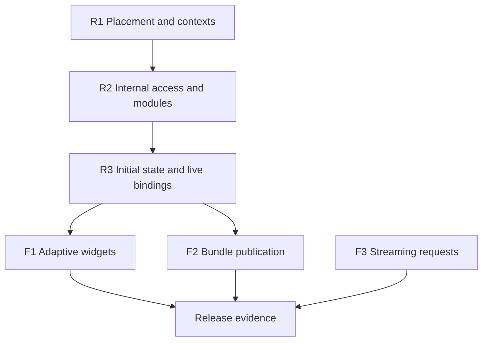

# Dual-backend delivery roadmap

Implement the [architecture proposal](architecture-redesign.md), then browser publication and additional services. This roadmap tells maintainers what to do next and what evidence completes each step.

[Architecture](architecture.md) describes the current implementation. The opt-in browser backend is already available; its setup and commands belong in [Browser rendering](browser-rendering.md#build-and-verify).

## Delivery order

The arrows express dependencies, not dates. Streaming is a host-service feature and can be delivered separately from the refactor.

## Acceptance rules

- Read related tests first. Adapt existing fixtures and scenarios before adding another suite.
- Test observable failures and outcomes. Do not pin private tree layouts, wrapper classes, exact diagnostic prose, source structure, or build configuration.
- Use normal consumer compilation and focused API inspection for type and module boundaries. Do not create a parallel invariant-testing framework.
- Verify DOM, interaction, lifecycle, and deployment behavior in HTTP-served Chromium and Firefox. JVM tests and image compilation alone cannot establish those results.
- Keep static compilation and its browser showcase passing. Update affected implementation, examples, tests, and documentation together.
- Replace superseded APIs directly. Do not add compatibility shims, deprecated aliases, silent capability fallbacks, or duplicate old/new paths.

A capability fallback that preserves readable document content in an unsupported browser is part of the product behavior. It is distinct from preserving an obsolete Java API.

## Refactoring

### R1: Enforce placement and context boundaries

Implement [content families and contexts](design/authoring.md#separate-capabilities-from-placement). This stage changes supported composition, rather than renaming `DocumentContext` while retaining one unrestricted node type.

| Work | Completion evidence |
| --- | --- |
| Introduce portable, document, and live output families | Done: a portable component with expansion state renders identically in a compiled page and in live renders, and the keyed-list fixture's portable structure has matching semantic DOM and computed styles statically and in a browser root |
| Restrict every child path, including callbacks and collections | Done: compiled consumer snippets fail to place document or live content in portable content, including through `Callout`, `Card`, and `Prose` children and component callbacks, and fail to mix document and live content |
| Separate expansion state from persistent application state | Done: `ViewKey` state lasts one expansion; a candidate rejected in the browser leaves no expansion state behind and never starts its effect |
| Migrate the [component inventory](design/authoring.md#assign-existing-components-to-a-family) and placement factories | Done: footnotes, table of contents, documentation layout, and the hero decorator are document components; browser bindings wrap portable elements through `LiveElement`; the bundled callout icon is structured SVG in both outputs' DOM; universal raw, deferred, late, effect, event, and control factories and setters are removed |
| Preserve shared passes | Done: both backends run the same `ViewExpansion`, reference linking, CSS collection, and semantic validation |

### R2: Restrict internal access and module exports

Implement the [module and accessor design](architecture-redesign.md#package-and-module-boundaries) after placement types define the public boundary.

| Work | Completion evidence |
| --- | --- |
| Introduce narrowly scoped authoring and CSS accessors | Done: builder accessors supply expansion data, and the CSS accessor keeps serialization and scope construction in the CSS package |
| Hide wrappers, collection plumbing, and linked representations | Done: named-module fixtures compile public static and live authoring, and javac rejects internal imports and removed inspection APIs |
| Qualify the shared backend export | Done: `view` is exported only to `dev.nthings.tessera.wasm`, and a named static application compiles and renders without the browser runtime |
| Preserve toolchain reachability | Done: both Web Images build and mount in the HTTP-served Chromium and Firefox suite, and the static showcase browser tests pass |
| Remove obsolete hooks and aliases | Done: document and live lowering feed one typed linked tree. The compiler receives HTML payloads, and the browser receives its own bindings and effects |

### R3: Unify initial control state and separate live bindings

Implement the [control ownership model](design/authoring.md#distinguish-initial-state-from-live-ownership). Keep control lowering in shared code and native property updates in the browser backend.

| Work | Completion evidence |
| --- | --- |
| Lower portable initial state | Done: the same portable form has matching current and reset values in static and live output in Chromium and Firefox |
| Preserve browser-owned changes | Done: browser edits, caret selection, focus, and option selection survive renders and reordering. Native reset restores the insertion defaults, and keyed replacement applies new defaults |
| Apply explicit live bindings | Done: tests cover accepted and rejected edits, native and application resets, and binding removal during markup and radio-group changes |
| Preserve composition behavior | Done: real input and IME scenarios pass in both engines, including restoration of caret and selection when a retained textarea gains a typed default |
| Diagnose conflicting configuration | Done: both outputs report located errors for unsupported hosts, invalid select multiplicity, and conflicts with generic attributes or textarea children |

## Feature delivery after the refactor

These features use the new boundaries. Keep their implementation and review separate from the structural migration.

| Stage | Specification | Completion evidence |
| --- | --- | --- |
| F1: Adaptive widgets | [Widget state rules](design/authoring.md#adaptive-widgets) | Done: browser adapters cover tab removal and keyboard focus, field validation, native dialog dismissal and focus return, search filtering and result focus, and tooltip interaction and cleanup |
| F2: Bundle publication | [Resource graph and mount design](design/runtime.md#publish-complete-browser-bundles) | Root/nested asset bases, media types, escaped attributes, verified integrity, complete files, and full CSP work in the deployed distribution; missing resources and initial failures preserve usable fallback |
| F3: Streaming requests | [Streaming boundary](design/runtime.md#stream-updates-within-their-owner) | Chunks update the DOM incrementally; cancellation releases the reader/request; late chunks cannot update removed effects or closed roots |

## Release evidence

Use a representative form and filterable keyed list built through the public API. Verify the complete published distribution, rather than a test-only loader or manually assembled substitute.

| Area | Required evidence |
| --- | --- |
| Static regression | Default verification, site output, and document examples pass |
| Browser behavior | Both engines pass real-image interaction, identity, composition, disposal, and failure-recovery scenarios |
| Dynamic accessibility | Keyboard, accessibility-tree, and axe-core checks after mutations; reduced-motion and forced-colors coverage |
| Distribution | No missing graph resources, compiler intermediates, unexpected remote dependencies, or full-policy violations |
| Documentation | Current guides match implemented APIs; proposal links and remaining roadmap work are accurate |

Build and verification commands stay in [Development](development.md) and [Browser rendering](browser-rendering.md#build-and-verify). Update those commands when the corresponding implementation is runnable, rather than documenting future commands as available.
