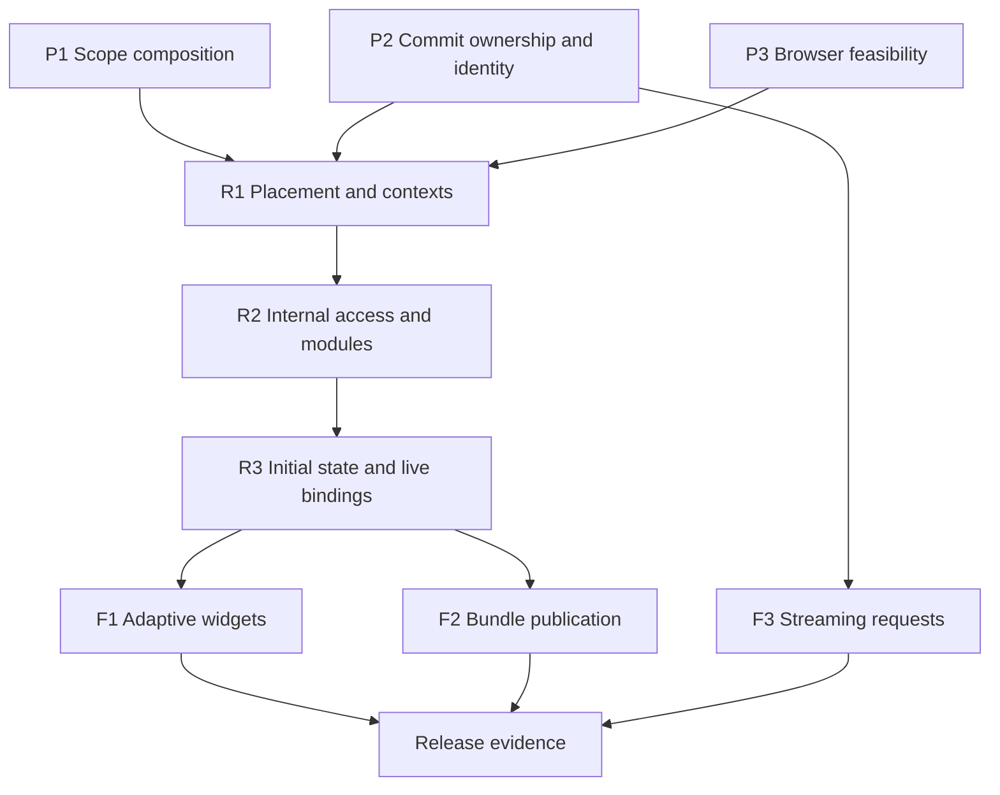

# Dual-backend delivery roadmap

Stabilize the existing compiler and browser runtime before changing their public boundaries. Then implement the [architecture proposal](architecture-redesign.md), followed by browser publication and additional services. This roadmap tells maintainers what to do next and what evidence completes each step.

[Architecture](architecture.md) describes the current implementation. The opt-in browser backend is already available; its setup and commands belong in [Browser rendering](browser-rendering.md#build-and-verify).

## Delivery order

The prerequisite fixes use the current implementation and the target ownership rules. They do not depend on the new placement types or module exports. Complete them before migrating the authoring API.

The arrows express dependencies, not dates. Streaming can be delivered separately from the refactor once its lifetime prerequisite passes.

## Acceptance rules

- Read related tests first. Adapt existing fixtures and scenarios before adding another suite.
- Test observable failures and outcomes. Do not pin private tree layouts, wrapper classes, exact diagnostic prose, source structure, or build configuration.
- Use normal consumer compilation and focused API inspection for type and module boundaries. Do not create a parallel invariant-testing framework.
- Verify DOM, interaction, lifecycle, and deployment behavior in HTTP-served Chromium and Firefox. JVM tests and image compilation alone cannot establish those results.
- Keep static compilation and its browser showcase passing. Update affected implementation, examples, tests, and documentation together.
- Replace superseded APIs directly. Do not add compatibility shims, deprecated aliases, silent capability fallbacks, or duplicate old/new paths.

A capability fallback that preserves readable document content in an unsupported browser is part of the product behavior. It is distinct from preserving an obsolete Java API.

## Pre-refactoring work

### P1: Correct scope composition

Runtime expansion already applies the observable part of the [explicit scope-root rule](design/authoring.md#require-explicit-scope-roots). A scope must resolve to one authored element through ordinary component and keyed wrappers. Direct delegation to another scope reports `scope-root` and preserves the inner boundary. A fragment, text, raw HTML, late or deferred content, or an empty root reports `scope-root`. Expansion inserts no host.

`Scope.expand` still returns `IntoElement`. Changing that return type, together with the wider placement families, remains [R1](#r1-enforce-placement-and-context-boundaries).

| Work | Completion evidence |
| --- | --- |
| Require an authored scope host at runtime | Done: nested scopes retain their own selectors and computed styles in static and live output, and a missing host reports `scope-root` |
| Remove implicit host insertion | Done: expansion inserts no wrapper, and a missing host is rejected rather than wrapped |
| Compile-time host API | Deferred to R1 with the other placement-family changes |

### P2: Correct commit ownership and ID reservations

Implement the [commit and closure rules](design/runtime.md#own-resources-before-exposing-callbacks) inside the current runtime. The host-ID reservation is complete at the existing identity boundary; the commit and closure rows remain.

| Work | Completion evidence |
| --- | --- |
| Track acquired, committed, and retiring resources through a commit | Removing an effect whose cleanup closes the root releases a newly created replacement button's handler; clicking its retained detached node cannot change application state |
| Settle closure at defined boundaries | Closure during expansion, native mutation, effect startup, or after-render work cannot publish later or start subsequent work |
| Release resources from partial failures | An induced failure after acquiring listeners or styles leaves no callable detached handlers or retained ownership after closure |
| Reserve the mount host ID | Done: a child claiming the host's ID is rejected before publication, and the previous tree or fallback remains intact |
| Preserve ordinary disposal behavior | Key changes, request cancellation, repeated close, and cleanup failures still release each resource once |

Exercise these through the existing lifecycle and identity fixtures. Add failure injection only where a real acquisition or mutation boundary needs evidence; avoid synthetic permutations that cannot occur through supported APIs.

### P3: Establish browser feasibility

Use the existing toolchain and packaged application to establish the [policy and performance baseline](design/runtime.md#establish-policy-and-performance-evidence-early). This gate happens before substantial API migration, so unacceptable runtime costs can change the design early.

| Work | Completion evidence |
| --- | --- |
| Pin reproducible build inputs | Record GraalVM/Web Image, interoperability SDK, Binaryen, and browser versions beside build instructions |
| Exercise the complete target CSP | Launch, fetch binaries, render controls, and update styles without policy violations in both engines |
| Define workload and budgets | Record test device, network settings, list size, number of roots, cold-start procedure, and numeric thresholds before evaluating results |
| Measure the real distribution | Report compressed bytes, boot-to-interaction time, update latency, and retained resources for one and two entries |
| Evaluate the result | Thresholds are met, or the proposal is revised before dependent work starts; do not silently relax budgets after measurement |

Keep results in build artifacts or a dedicated performance record with its measurement conditions. Do not hard-code one machine's observations into architecture contracts.

## Refactoring

### R1: Enforce placement and context boundaries

Implement [content families and contexts](design/authoring.md#separate-capabilities-from-placement). This stage changes supported composition, rather than renaming `DocumentContext` while retaining one unrestricted node type.

| Work | Completion evidence |
| --- | --- |
| Introduce portable, document, and live output families | A portable component reused in a static page and browser root compiles and behaves correctly |
| Restrict every child path, including callbacks and collections | Representative consumer snippets cannot place document or live content inside portable content, including through a wrapper accepting caller-supplied children |
| Separate expansion state from persistent application state | A rejected render does not retain expansion-local values or start external work |
| Migrate the [component inventory](design/authoring.md#assign-existing-components-to-a-family) and placement factories | Document components and browser adapters use their own contracts; bundled icons render as structured SVG in both outputs; obsolete universal factories and setters are removed |
| Preserve shared passes | Both backends use the same identity, reference, CSS, and semantic validation operations |

### R2: Restrict internal access and module exports

Implement the [module and accessor design](architecture-redesign.md#package-and-module-boundaries) after placement types define the public boundary.

| Work | Completion evidence |
| --- | --- |
| Introduce narrowly scoped authoring and CSS accessors | Expansion and CSS collection work without public inspection getters or reflective access |
| Hide wrappers, collection plumbing, and linked representations | Ordinary modular consumers compile using public APIs and need no export overrides |
| Qualify the shared backend export | The browser module builds against `view`; authoring modules have no browser-runtime dependency |
| Preserve toolchain reachability | Both real Web Image entry points build and mount with the new module/source layout |
| Remove obsolete hooks and aliases | No backend policy exists solely to reject capabilities excluded by the new placement types |

### R3: Unify initial control state and separate live bindings

Implement the [control ownership model](design/authoring.md#distinguish-initial-state-from-live-ownership). Keep control lowering in shared code and native property updates in the browser backend.

| Work | Completion evidence |
| --- | --- |
| Lower portable initial state | Input, textarea, checkbox/radio, and select examples have equivalent initial values in static and live output |
| Preserve browser-owned changes | Unrelated renders retain edits, selection, focus, and native reset behavior |
| Apply explicit live bindings | Accepted and rejected edits, binding removal, and application-driven reset follow the declared owner |
| Preserve composition behavior | Existing real input and IME cases pass without equal-value writes that reset caret or selection |
| Diagnose conflicting configuration | Unsupported hosts and conflicting initial declarations produce actionable authoring errors |

## Feature delivery after the refactor

These features use the new boundaries. Keep their implementation and review separate from the structural migration.

| Stage | Specification | Completion evidence |
| --- | --- | --- |
| F1: Adaptive widgets | [Widget state rules](design/authoring.md#adaptive-widgets) | Tabs handle selected-item removal and keyboard focus; fields apply and clear errors; dialogs acknowledge native dismissal and restore focus; live search and tooltips operate through browser adapters without document script contributions |
| F2: Bundle publication | [Resource graph and mount design](design/runtime.md#publish-complete-browser-bundles) | Root/nested asset bases, media types, escaped attributes, verified integrity, complete files, and full CSP work in the deployed distribution; missing resources and initial failures preserve usable fallback |
| F3: Streaming requests | [Streaming boundary](design/runtime.md#establish-policy-and-performance-evidence-early) | Chunks update the DOM incrementally; cancellation releases the reader/request; late chunks cannot update removed effects or closed roots |

## Release evidence

Use a representative form and filterable keyed list built through the public API. Verify the complete published distribution, rather than a test-only loader or manually assembled substitute.

| Area | Required evidence |
| --- | --- |
| Static regression | Default verification, site output, and document examples pass |
| Browser behavior | Both engines pass real-image interaction, identity, composition, disposal, and failure-recovery scenarios |
| Dynamic accessibility | Keyboard, accessibility-tree, and axe-core checks after mutations; reduced-motion and forced-colors coverage |
| Distribution | No missing graph resources, compiler intermediates, unexpected remote dependencies, or full-policy violations |
| Performance | Repeat the P3 workload and compare against its recorded budgets, including repeated mount/close cycles |
| Documentation | Current guides match implemented APIs; proposal links and remaining roadmap work are accurate |

Build and verification commands stay in [Development](development.md) and [Browser rendering](browser-rendering.md#build-and-verify). Update those commands when the corresponding implementation is runnable, rather than documenting future commands as available.
