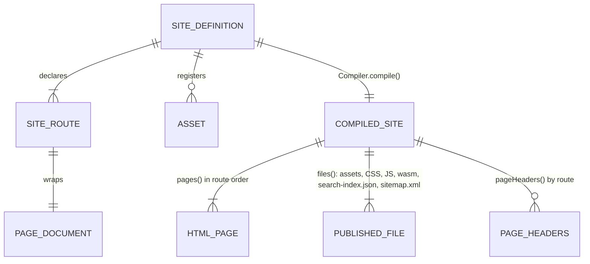

# Sites

Compile routes and static assets together into a validated, publishable site. The [Getting started](getting-started.md) guide walks through a minimal application; this guide covers routing, output modes, assets, link validation, navigation, search, and hosting.

## Define routes

`SiteDefinition` requires at least one `SiteRoute`. Each route pairs a logical path with a `PageDocument`:

```java
var site =
    SiteDefinition.builder()
        .route(
            new SiteRoute(
                "/", new PageDocument("Home", Elements.main().child(Elements.h1().text("Home")))))
        .route(
            new SiteRoute(
                "/guide",
                new PageDocument("Guide", Elements.main().child(Elements.h1().text("Guide")))))
        .build();

var compiled = Compiler.compile(site);
SiteWriter.writeToDirectory(compiled, Path.of("target/site"));
```

`PageDocument(lang, title, body)` sets the document language and `<title>`; the two-argument constructor defaults to English (`en`). An optional route title overrides navigation and search labels without altering `<title>`, and route descriptions populate search metadata.

| Logical route | Public document URL (`documentUri()`) | Generated file     |
| ------------- | ------------------------------------- | ------------------ |
| `/`           | `/`                                   | `index.html`       |
| `/guide`      | `/guide/`                             | `guide/index.html` |
| `/about.html` | `/about.html`                         | `about.html`       |

`site.route("/guide")` returns `Optional<SiteRoute>` using the same path normalization as route construction.

`SiteDefinition.builder()` also accepts:

- `theme(Theme)`: Design tokens shared by every route; see [Styling](styling.md#set-a-theme).
- `outputMode(OutputMode)`: Controls inline or external packaging for CSS and scripts.
- `asset(Asset)` / `assets(...)`: Static files published alongside pages.
- `baseUrl("https://example.com")`: Generates `sitemap.xml` using absolute HTTP(S) URLs. Omit it to skip sitemap generation.
- `linkSpeculation(LinkSpeculation)`: Defaults to `PRERENDER`. Pages with a browser-bundle deployment policy publish rules via a `Speculation-Rules` response header; other pages embed them in `<head>`.

## Choose an output mode

Standalone `Compiler.compile(document)` defaults to `OutputMode.inline()`. Multi-page `SiteDefinition` defaults to `OutputMode.external("/assets")` so every route shares one content-hashed stylesheet.

| Mode | Stylesheet | Page scripts | Publication contract |
| --- | --- | --- | --- |
| `OutputMode.inline()` | Embedded `<style>` | Embedded `<script type="module">` | Standalone pages emit no stylesheet or script assets |
| `OutputMode.external("/assets")` | `/assets/styles-<hash>.css` | `/assets/scripts/<sanitized-id>-<hash>.js` | Publish every returned asset at its path |

Compile a standalone page with external assets:

```java
var page = Compiler.compile(document, Theme.defaults(), OutputMode.external("/assets"));
```

Asset base paths must be absolute URL paths; relative paths, `//`, and `..` are rejected. Because filenames include content hashes, changing a resource produces a new URL.

### Understand compiled outputs

Compilation returns immutable data structures and performs no output I/O.



| Result type | Accessors |
| --- | --- |
| `CompiledPage` | `html()`, `css()`, `assets()`, `responseHeaders()` |
| `CompiledSite` | `pages()` (in route order), `css()`, `files()`, `pageHeaders()`, `searchIndexJson()`, `sitemapXml()` |

## Register assets and images

Register static files with absolute logical paths so site validation recognizes them as valid link and media destinations:

```java
builder.asset(Asset.file("/assets/logo.svg", Path.of("assets/logo.svg")));
builder.asset(Asset.text("/assets/robots.txt", "User-agent: *\nAllow: /\n"));
```

`Asset.file(...)` reads bytes explicitly at registration time. Byte-backed assets flow through compilation and publishing together.

Use `Image.of(src, alt).dimensions(width, height)` to reserve layout space and supply accessible text. Images load lazily and decode asynchronously by default. For the primary above-the-fold image, wrap it with [`HeroImage.of(image)`](documents.md#preload-a-hero-image).

Configure styles, aspect ratios, ARIA attributes, or references on the underlying `` through `element(...)`:

```java
Image.of("/assets/divider.svg", "")
    .dimensions(640, 8)
    .element(img -> img.ariaHidden(true).inlineSize(CssLength.pct(100)));
```

The compiler requires non-empty `alt` text and explicit dimensions or an aspect ratio. Decorative images must use empty `alt` text paired with `role(Role.PRESENTATION)` or `ariaHidden(true)`.

## Write links as browser URLs

Site validation resolves local `href`, `src`, and `poster` attributes against the source route's public `documentUri()`:

- Query strings remain in output but are ignored during target lookup.
- Percent-encoded paths and fragments are decoded for comparison (`+` in a fragment stays `+`).
- Explicit `index.html` links are accepted for directory routes.
- Absolute (`https://...`) and protocol-relative (`//...`) URLs are treated as external and skipped by local validation.

| Source route | Authored link | Validated destination |
| --- | --- | --- |
| `/guides/start` | `../install?mode=full#requirements` | Route `/guides/install`, ID `requirements` |
| `/guides/start.html` | `?mode=full#requirements` | Same HTML file, ID `requirements` |
| `/` | `/guides/caf%C3%A9/#caf%C3%A9%2Bintro` | Route `/guides/café`, ID `café+intro` |
| `/guide` | `../assets/manual%20v1.pdf?download=1` | Asset `/assets/manual v1.pdf` |

Define route and asset paths in unescaped logical form (such as `/guides/café`) and URL-encode them in links. Duplicate routes, file path collisions, missing targets, missing fragments, and malformed URLs report [compilation diagnostics](diagnostics.md).

## Add navigation and search

The compiler builds `search-index.json` automatically from routes and [outlined headings](documents.md#outline-headings-and-build-a-table-of-contents) (`Section` and outlined `Heading` elements), independent of `TableOfContents`.

`SiteNavigation` (in `dev.nthings.tessera.navigation`) derives navigation components directly from your routes:

- `SiteNavigation.searchPalette(site)` builds a `SearchPalette` pre-populated with every route.
- `SiteNavigation.docPager(site, currentPath)` builds a previous/next `DocPager` in route declaration order.

You can also populate `SearchPalette` manually with custom groups, descriptions, and badges:

```java
var search =
    SearchPalette.of()
        .id("guide-search")
        .placeholder("Search pages and sections...")
        .item("Guide", "Installation", "/guide/#installation")
        .item(
            "Guide",
            SearchPalette.Item.of("Publishing", "/guide/#publishing")
                .description("Upload the generated site")
                .badge("New"));

DocumentElement.of(Elements.main().child(search.triggerButton()))
    .child(Documents.deferred(search, 10));
```

`SearchPalette` filters its rendered links in the browser without fetching `search-index.json` or calling a backend endpoint. `search-index.json` is emitted separately for external search consumers.

| User action | Behavior |
| --- | --- |
| Press `Alt+K` | Open the first search palette on the page |
| Type query words | Filter by group, title, and description (case- and accent-insensitive) |
| Clear query | Restore all entries |
| Press Up or Down arrow | Move focus through matching links |
| Press Enter in input | Navigate to the first matching link |
| Press Enter on a link | Follow the focused link |
| Press Escape | Close the dialog |

See [Browser support](browser-support.md#component-scripts) for the bundled module lifecycle.

## Publish and preview

Write a compiled site to disk with `SiteWriter.writeToDirectory(compiled, output)` and upload the entire directory to your static host:

- Enable directory indexes and redirect extensionless directory paths (such as `/guide`) to trailing slashes (`/guide/`).
- Apply `compiled.pageHeaders()` on your host for routes that mount [browser bundles](browser-rendering.md#publish-a-browser-bundle).
- Setting an external asset base relocates generated assets; it does not rewrite route paths or authored links for subdirectory hosting.

To preview a compiled site in memory with accurate headers and redirects:

```java
try (var server = SitePreviewServer.start(compiled, 8080)) {
  // Serves http://127.0.0.1:8080/ until closed
}
```

`SitePreviewServer` binds to loopback, serves the fixed compiled snapshot with `Cache-Control: no-store`, redirects directory paths while preserving query strings, accepts `index.html` aliases, and applies compiled `pageHeaders()`. Recompile and restart the server after changes.

To inspect the written showcase directory as a static host sees it:

```sh
just site
jwebserver -b 127.0.0.1 -d target/site -p 8081
```

Continue with [Diagnostics](diagnostics.md) to troubleshoot errors or [Browser rendering](browser-rendering.md) to embed live Java views.
