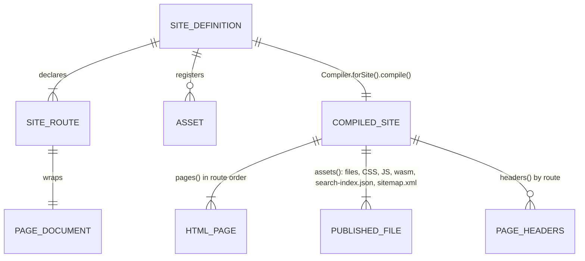

# Sites

Compile routes and static assets together into a validated, publishable site. The [Getting started](getting-started.md) guide walks through a minimal application; this guide covers routing, output modes, assets, link validation, navigation, search, and hosting.

## Define routes

`SiteDefinition` requires at least one `SiteRoute`. Each route pairs a logical path with a `PageDocument`:

```java
var site =
    SiteDefinition.of(
        SiteRoute.of("/", PageDocument.of("Home", Elements.main(Elements.h1("Home")))),
        SiteRoute.of(
            "/guide",
            PageDocument.of("Guide", Elements.main(Elements.h1("Guide")))
                .withDescription("Publishing guide")));

var compiled = Compiler.forSite().compile(site);
SiteWriter.writeToDirectory(compiled, Path.of("target/site"));
```

`PageDocument.of(title, body)` defaults to `Locale.ENGLISH`. Page metadata belongs to the document, and each `with...` call returns a new document:

| Call | Emits |
| --- | --- |
| `.withLang(Locale)` | `<html lang>` with the BCP 47 language tag |
| `.withDescription(String)` | `<meta name="description">`, the route's `search-index.json` entry, and its `SiteNavigation.searchPalette` item |
| `.withCanonicalUrl(URI)` | `<link rel="canonical">` with an absolute `http(s)` URL; in a site with a `baseUrl`, this replaces the route's default canonical URL |

On `SiteRoute`, `.withTitle(String)` overrides navigation and search labels without altering `<title>`.

| Logical route | Public document URL (`documentUri()`) | Generated file     |
| ------------- | ------------------------------------- | ------------------ |
| `/`           | `/`                                   | `index.html`       |
| `/guide`      | `/guide/`                             | `guide/index.html` |
| `/about.html` | `/about.html`                         | `about.html`       |

`site.route("/guide")` returns `Optional<SiteRoute>` using the same path normalization as route construction.

`SiteDefinition` is a record; each `with...` call returns a new site:

- `withAssets(List<Asset>)`: Static files published alongside pages.
- `withFonts(List<FontFace>)`: Self-hosted font faces (see [Self-host fonts](#self-host-fonts)).
- `withBaseUrl(URI.create("https://example.com"))`: Takes a site origin (no path). Generates `sitemap.xml` and gives each page a `<link rel="canonical">` to its absolute URL, such as `https://example.com/guide/`. Omit it to skip both.
- `withLinkSpeculation(LinkSpeculation)`: Defaults to `PRERENDER`. Pages with a browser-bundle deployment policy publish rules via a `Speculation-Rules` response header; other pages embed them in `<head>`.

Configure themes and output modes on the immutable [`Compiler`](#choose-an-output-mode) value (`Compiler.forSite().withTheme(theme).withOutputMode(mode)`).

## Choose an output mode

`Compiler.forPage()` defaults to `OutputMode.inline()`. `Compiler.forSite()` defaults to `OutputMode.external("/assets")` so every route shares one content-hashed stylesheet. `OutputMode` is a sealed interface (`OutputMode.Inline` or `OutputMode.External`).

| Mode | Stylesheet | Page scripts | Publication contract |
| --- | --- | --- | --- |
| `OutputMode.inline()` | Embedded `<style>` | Embedded `<script type="module">` | Standalone pages emit no stylesheet or script assets |
| `OutputMode.external("/assets")` | `/assets/styles-<hash>.css` | `/assets/scripts/<sanitized-id>-<hash>.js` | Publish every returned asset at its path |

Compile a standalone page with external assets:

```java
var page = Compiler.forPage().withOutputMode(OutputMode.external("/assets")).compile(document);
```

Asset base paths must be absolute URL paths; relative paths, `//`, and `..` are rejected. Because filenames include content hashes, changing a resource produces a new URL.

### Understand compiled outputs

Compilation returns immutable data structures and performs no output I/O.



| Result type | Accessors |
| --- | --- |
| `CompiledPage` | `html()`, `css()`, `assets()`, `headers()` |
| `CompiledSite` | `pages()` (in route order), `css()`, `assets()`, `headers()`, `searchIndexJson()`, `sitemapXml()` |

## Register assets and images

Register static files with absolute logical paths so site validation recognizes them as valid link and media destinations:

```java
var withAssets =
    site.withAssets(
        List.of(
            Asset.file("/assets/logo.svg", Path.of("assets/logo.svg")),
            Asset.text("/assets/robots.txt", "User-agent: *\nAllow: /\n")));
```

`Asset.file(...)` reads bytes explicitly at registration time. Byte-backed assets flow through compilation and publishing together.

Use `Image.of(src, alt).dimensions(width, height)` to reserve layout space and supply accessible text. Images load lazily and decode asynchronously by default. For the primary above-the-fold image, wrap it with [`HeroImage.of(image)`](documents.md#preload-a-hero-image).

Configure styles, aspect ratios, ARIA attributes, or references on the underlying `` through `element(...)`:

```java
Image.of("/assets/divider.svg", "")
    .dimensions(640, 8)
    .element(img -> img.ariaHidden(true).inlineSize(CssLength.pct(100)));
```

The compiler requires non-empty `alt` text and explicit dimensions or an aspect ratio. When an image comes from an external or user-supplied source whose intrinsic dimensions are unknown at authoring time, opt out of `image-dimensions` explicitly with `.unknownDimensions()` on `Image` or `Elements.img(...)` rather than guessing a fixed ratio. Decorative images must use empty `alt` text paired with `role(Role.PRESENTATION)` or `ariaHidden(true)`.

### Self-host fonts

Register each font file as a `FontFace`. The site publishes the file, the stylesheet declares its `@font-face` rule with `font-display: swap`, and a preloaded face gets a `<link rel="preload" as="font">` on every page. Point a font token at the family to use it:

```java
var withFonts =
    site.withFonts(
        List.of(
            FontFace.of("Inter", Asset.file("/fonts/inter.woff2", Path.of("fonts/inter.woff2")))
                .withWeight(100, 900)
                .withPreload(),
            FontFace.of("Inter", Asset.file("/fonts/inter-italic.woff2", Path.of("fonts/inter-italic.woff2")))
                .withWeight(100, 900)
                .withItalic()));

var theme = Theme.defaults()
    .with(Tokens.FONT_BODY, FontStack.of(FontStack.named("Inter"), FontStack.Generic.SYSTEM_UI));
```

Preload only the faces the first screen draws with; each preload competes with the page for bandwidth.

## Write links as browser URLs

Site validation resolves local `href`, `src`, and `poster` attributes against the source route's public `documentUri()`:

- Query strings remain in output but are ignored during target lookup.
- Percent-encoded paths and fragments are decoded for comparison (`+` in a fragment stays `+`).
- Explicit `index.html` links are accepted for directory routes.
- Absolute (`https://...`) and protocol-relative (`//...`) URLs are treated as external and skipped by local validation.

| Source route | Authored link | Validated destination |
| --- | --- | --- |
| `/guides/start` | `../install?mode=full#requirements` | Route `/guides/install`, ID `requirements` |
| `/guides/start.html` | `?mode=full#requirements` | Same HTML file, ID `requirements` |
| `/` | `/guides/caf%C3%A9/#caf%C3%A9%2Bintro` | Route `/guides/café`, ID `café+intro` |
| `/guide` | `../assets/manual%20v1.pdf?download=1` | Asset `/assets/manual v1.pdf` |

Define route and asset paths in unescaped logical form (such as `/guides/café`) and URL-encode them in links. Duplicate routes, file path collisions, missing targets, missing fragments, and malformed URLs report [compilation diagnostics](diagnostics.md).

## Add navigation and search

The compiler builds `search-index.json` automatically from routes and [outlined headings](documents.md#outline-headings-and-build-a-table-of-contents) (`Section` and outlined `Heading` elements), independent of `TableOfContents`.

`SiteNavigation` (in `dev.nthings.tessera.compiler`) derives navigation components directly from your routes:

- `SiteNavigation.searchPalette(site.routes(), "Pages")` builds a `SearchPalette` pre-populated with every route under one group.
- `SiteNavigation.docPager(site.routes(), current)` builds a previous/next `DocPager` around the page at a `PageAddress`, in route declaration order.

### Know the current page in a shared layout

Inside a `DocumentComponent` or `DocumentScope`, `context.address()` returns the `PageAddress` of the route being compiled, so one layout can serve every route:

```java
DocumentComponent layout =
    context -> {
      var here = context.address().orElseThrow();
      var nav =
          Stream.of("/", "/guide/")
              .map(href -> here.isCurrent(href) ? a(href, href).ariaCurrent(AriaCurrent.PAGE) : a(href, href))
              .toList();
      return DocumentElement.of(Elements.main().children(nav))
          .child(SiteNavigation.docPager(site.routes(), here));
    };
```

| `PageAddress` member | Value for route `/guide` under `baseUrl("https://example.com")` |
| --- | --- |
| `routePath()` | `/guide` |
| `documentUri()` | `/guide/` |
| `absoluteUrl()` | `https://example.com/guide/` (empty without a `baseUrl`) |
| `isCurrent(href)` | `true` for `/guide`, `/guide/`, `/guide/index.html`, `./`, `#install`, and same-origin absolute URLs of the page |

`isCurrent` resolves the link against `documentUri()` exactly as [site link validation](#write-links-as-browser-urls) does, ignoring the query and fragment. A page compiled on its own with `Compiler.forPage()` has no address, so `context.address()` is empty.

You can also populate `SearchPalette` manually with custom groups, descriptions, and badges:

```java
var search =
    SearchPalette.of()
        .id("guide-search")
        .placeholder("Search pages and sections...")
        .item("Guide", "Installation", "/guide/#installation")
        .item(
            "Guide",
            SearchPalette.Item.of("Publishing", "/guide/#publishing")
                .description("Upload the generated site")
                .badge("New"));

DocumentElement.of(Elements.main().child(search.triggerButton()))
    .child(Documents.deferred(search, 10));
```

`SearchPalette` filters its rendered links in the browser without fetching `search-index.json` or calling a backend endpoint. `search-index.json` is emitted separately for external search consumers.

The trigger lists the palette's shortcuts in `aria-keyshortcuts` and shows a hint for the first one. `shortcuts(Shortcut.MOD_K, Shortcut.SLASH)` is the default; `Shortcut.ALT_K` also sets `accesskey="k"`, and `shortcuts()` with no arguments leaves only the button.

| User action | Behavior |
| --- | --- |
| Press a shortcut from `shortcuts(...)` (by default `Ctrl+K`, `Cmd+K` on Apple platforms, or `/` outside a text field) | Open the first search palette whose trigger advertises it |
| Type query words | Filter by group, title, and description (case- and accent-insensitive) |
| Clear query | Restore all entries |
| Press Up or Down arrow | Move focus through matching links |
| Press Enter in input | Navigate to the first matching link |
| Press Enter on a link | Follow the focused link |
| Press Escape | Close the dialog |

See [Browser support](browser-support.md#component-scripts) for the bundled module lifecycle.

## Publish and preview

Write a compiled site to disk with `SiteWriter.writeToDirectory(compiled, output)` and upload the entire directory to your static host:

- Enable directory indexes and redirect extensionless directory paths (such as `/guide`) to trailing slashes (`/guide/`).
- Apply `compiled.headers()` on your host for routes that mount [browser bundles](browser-rendering.md#publish-a-browser-bundle).
- Setting an external asset base relocates generated assets; it does not rewrite route paths or authored links for subdirectory hosting.

To preview a compiled site in memory with accurate headers and redirects:

```java
try (var server = SitePreviewServer.start(compiled, 8080)) {
  // Serves http://127.0.0.1:8080/ until closed
}
```

`SitePreviewServer` binds to loopback, serves the fixed compiled snapshot with `Cache-Control: no-store`, redirects directory paths while preserving query strings, accepts `index.html` aliases, and applies compiled `headers()`.

To rebuild while you write, pass a build function and the directories to watch instead of a compiled site:

```java
try (var server = SitePreviewServer.watch(8080, () -> compiler.compile(site()), Path.of("content"))) {
  // Rebuilds when a file under content/ changes, and reloads open pages
}
```

Changes within 100 ms of each other cause one rebuild. A failed rebuild prints its stack trace and keeps serving the last good site. Pages load a small script from `/_tessera/live.js` that checks `/_tessera/version` and reloads after a rebuild. Java classes are not reloaded, so restart after changing code.

To inspect the written showcase directory as a static host sees it:

```sh
just site
jwebserver -b 127.0.0.1 -d target/site -p 8081
```

Continue with [Diagnostics](diagnostics.md) to troubleshoot errors or [Browser rendering](browser-rendering.md) to embed live Java views.
