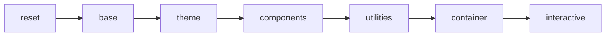

# Styling

Style elements with typed CSS values, scopes with `ScopeStyle`, and applications with shared design tokens in `Theme`. All styling APIs live in `dev.nthings.tessera.css` and produce identical cascade behavior in static pages and [browser roots](browser-rendering.md).

## Set a theme

Built-in components reference CSS custom properties defined by `Tokens`. Start from `Theme.defaults()` and retain the returned immutable `Theme` from each `with(...)` call:

```java
var theme =
    Theme.defaults()
        .with(Tokens.FONT_BODY, FontStack.of(FontStack.named("Georgia"), FontStack.Generic.SERIF))
        .with(Tokens.DENSITY, CssNumber.of(0.8))
        .with(Tokens.RADIUS_XL, CssLength.rem(1))
        .with(Tokens.CONTROL_FG, Tokens.ACCENT_TEXT);

var site = Compiler.forSite().withTheme(theme).compile(siteDefinition);
var page = Compiler.forPage().withTheme(theme).compile(document);
```

Each token accepts only values from its own category: color, length, duration, font family, or number. Because tokens are valid values of their own category, one token can alias another (such as `CONTROL_FG` referring to `ACCENT_TEXT`). Define application tokens with category records, such as `new DesignToken.Color("brand", CssColor.oklch(60, 0.2, 300))`, then register them with `theme.with(brand, value)`.

Token names accept `[A-Za-z0-9_-]` and cannot start with `-`. Invalid names throw immediately rather than being rewritten.

| Family | Tokens | Default values or behavior |
| --- | --- | --- |
| Fonts | `FONT_BODY`, `FONT_MONO` | System UI and monospace stacks |
| Type scale | `FONT_SIZE_XS` through `FONT_SIZE_2XL` | `0.75`, `0.875`, `1`, `1.125`, `1.25`, `1.5` rem |
| Line height and tracking | `LINE_HEIGHT_BODY`, `TRACKING_NORMAL` | `1.5` and `0` |
| Spacing | `SPACE_1` through `SPACE_6`, `SPACE_8`, `SPACE_10`, `SPACE_12`; half steps `SPACE_0_5`, `SPACE_1_5`, `SPACE_2_5`, `SPACE_3_5` | Quarter-rem steps multiplied by `DENSITY` |
| Density | `DENSITY` | `1`; scales spacing and control padding without changing typography or motion |
| Controls | `CONTROL_PADDING_INLINE`, `CONTROL_FAMILY`, `CONTROL_FONT_SIZE`, `CONTROL_LINE_HEIGHT`, `CONTROL_TRACKING`, `CONTROL_FG` | Density-aware padding, body family, small type, body line height, normal tracking, primary text |
| Motion | `CONTROL_FEEDBACK_DURATION`, `OVERLAY_DURATION`, `DISCLOSURE_DURATION` | `150ms`, `200ms`, `250ms` |
| Corners | `RADIUS_SM`, `RADIUS_MD`, `RADIUS_LG`, `RADIUS_XL`, `RADIUS_FULL` | `0.25`, `0.375`, `0.5`, `0.75` rem; pill radius |
| Colors | `SURFACE_*`, `TEXT_*`, `ACCENT_PRIMARY`, `BORDER_SUBTLE`, `STATUS_*` | Adaptive light and dark OKLCH colors |

`Typography.LABEL` combines the control typography tokens used by field labels and callout titles alongside `CONTROL_FG`. Overriding `CONTROL_FONT_SIZE` changes those labels directly; overriding `FONT_SIZE_SM` also changes them while `CONTROL_FONT_SIZE` aliases `FONT_SIZE_SM`.

`Tone` supplies semantic roles (`NEUTRAL`, `ACCENT`, `INFO`, `SUCCESS`, `WARNING`, `DANGER`). Components map each tone to surface, border, and foreground tokens. `Callout.Kind` also picks a matching default icon and title.

## Write typed declarations

`TagElement` and `Declarations` implement `Styled`. Components that own a tag, such as `Image`, expose `Styled` methods through `element(...)`.

```java
Elements.div()
    .p(Tokens.SPACE_4)
    .bg(Tokens.SURFACE_CARD)
    .border(Border.hairline(Tokens.BORDER_SUBTLE))
    .rounded(Tokens.RADIUS_XL)
    .gridColumns(TrackList.autoFit(CssLength.rem(16)))
    .inlineSize(CssLength.pct(100).minus(CssLength.rem(2)));
```

| Need | Values and operations |
| --- | --- |
| Dimensions and math | `CssLength`: `plus`, `minus`, `times`, `dividedBy`, `min`, `max`, `anchor` |
| Durations | `CssDuration.ms(double)` and `CssDuration.of(java.time.Duration)` |
| Colors | `CssColor`: `mix`, `mixTransparent`, `sameHue`, `lightDark`, `contrast` |
| Shadows | `Shadow.drop(...)`, `Shadow.inset(...)`; `offsetX(...)` adjusts a layer |
| Keyword properties | Enums such as `Overflow.AUTO`, `TextWrap.BALANCE`, `Cursor.POINTER`, `Appearance.NONE`, `Resize.VERTICAL` |
| Single-purpose helpers | Methods such as `listStyleNone()` and `tabularNums()` |
| Named CSS handles | Validated `Container`, `Keyframes`, `Anchor`, `Counter`, and `CustomProperty` |
| Grouped typography | `Typography` sets family, size, weight, line height, and tracking together |

Selectors passed to `ScopeStyle.select(...)` are emitted verbatim; treat selectors and authored CSS resource names as trusted input.

### Shorthand and longhand precedence

Later writes replace earlier declarations for the same property. A shorthand clears earlier longhands it covers, while a later longhand refines the shorthand:

| Calls                  | Retained declarations             |
| ---------------------- | --------------------------------- |
| `pt(...).p(...)`       | Padding shorthand only            |
| `p(...).pt(...)`       | Padding shorthand and top padding |
| `rowGap(...).gap(...)` | Gap shorthand only                |
| `gap(...).rowGap(...)` | Gap shorthand and row gap         |

The same rule applies to borders and merged `Declarations`. Immutable value types (`Theme`, `CssLength`, `Transition`, `Animation`) carry `@CheckReturnValue`, so always retain their returned values.

## Share rules and flex layouts

Reuse declaration sets with `StyleBlock` across elements, conditional callbacks, scope rules, starting styles, and keyframe steps:

```java
StyleBlock card = s -> s.p(Tokens.SPACE_4).rounded(Tokens.RADIUS_XL).bg(Tokens.SURFACE_CARD);

Elements.div().styles(card).on(State.HOVER, s -> s.bg(Tokens.SURFACE_SUBTLE));
scope.select(":scope > article", card);
```

Configure flex containers with `FlexLayout` while keeping semantic HTML tags:

```java
var links = FlexLayout.row(Tokens.SPACE_4, FlexLayout.Align.CENTER, FlexLayout.Wrap.WRAP);
var stack = FlexLayout.column(Tokens.SPACE_4, FlexLayout.Align.STRETCH, FlexLayout.Wrap.NOWRAP);

Elements.section()
    .layout(stack)
    .children(
        Elements.nav()
            .layout(links)
            .ariaLabel("Site navigation")
            .children(Elements.a("/").text("Home"), Elements.a("/guide/").text("Guide")),
        Elements.p().text("Introduction"));
```

Use `inlineRow` and `inlineColumn` for `inline-flex`. A subsequent property call such as `gap(...)` overrides that property on the element without mutating the shared `FlexLayout`.

For a scrolling panel inside a fixed-height column, give the column a block size and configure the inner panel with `flexGrow(1)`, `flexShrink(1)`, `minBlockSize(CssLength.zero())`, and `overflowY(Overflow.AUTO)`.

## Apply conditional styles and cascade layers

Tessera orders generated rules into explicit CSS cascade layers so overrides stay predictable without specificity escalation:



Call `on(condition, styles)` to apply declarations while a `Condition` holds. Conditions can nest.

| Condition | Layer and behavior |
| --- | --- |
| `State` | `interactive` layer. Pseudo-classes emit in fixed order: `HOVER`, `FOCUS_VISIBLE`, `ACTIVE`, `CHECKED`, `OPEN`, `USER_INVALID`, `USER_VALID`, `DISABLED`. |
| `Media.MOTION_SAFE` | `interactive` layer. Matches `prefers-reduced-motion: no-preference`. |
| Container query | `container` layer. Matches size, stuck-edge, or snapped-axis conditions on a `Container` handle. |

Because state order is fixed regardless of call order, `ACTIVE` always beats `HOVER`, and `DISABLED` beats all other states. Hover and active rules exclude disabled elements with a zero-specificity guard. Because `interactive` comes after `container`, state styles remain active across container breakpoints. Inside a `ScopeStyle` rule, conditions nest inside that selector; `ScopeStyle.on(query, rules)` wraps multiple rules in one media or container query.

Use `startingStyle(...)` to define entry-transition starting values:

```java
scope.select(":scope:open", s -> s.opacity(1).startingStyle(start -> start.opacity(0)));
```

Declare a container once and query it through its handle:

```java
var cards = Container.named("cards", Container.Type.INLINE_SIZE);
Elements.div()
    .container(cards)
    .child(Elements.article().on(cards.atLeast(CssLength.rem(30)), s -> s.flexRow()));
```

Size queries support `atLeast(length)` and `below(length)`. A `SCROLL_STATE` container supports `stuck(edge)` and `snapped(axis)`. An unnamed handle targets the nearest ancestor container of the matching type; `containerNone()` clears a container declaration.

## Add transitions and animations

`Transition.controlFeedback()`, `Transition.overlayEntry()`, and `Transition.disclosure()` provide coordinated duration, easing, and property sets. For spatial movement, place transitions inside `on(Media.MOTION_SAFE, ...)` and keep the resting visible state outside the condition.

`Animation` registers its `Keyframes` automatically and runs only when the user does not prefer reduced motion:

```java
var pulse =
    Keyframes.named("pulse")
        .start(s -> s.opacity(1))
        .at(50, s -> s.opacity(0.5))
        .end(s -> s.opacity(1));

Elements.div().animation(Animation.of(pulse, CssDuration.ms(800), Easing.ease()));
Elements.div().animation(Animation.enterViewport(Keyframes.FADE_UP));
```

| Effect | API |
| --- | --- |
| Animate through viewport entry or exit | `Animation.enterViewport(...)`, `Animation.leaveViewport(...)` |
| Reveal once with sibling stagger | `Animation.revealOnce(...).staggerBySiblingIndex(60)` |
| Track page scroll progress | `Animation.scrollProgress(...)` |
| Follow the inline scroll axis | `.along(TimelineAxis.INLINE)` |
| Built-in keyframe presets | `Keyframes.FADE_IN`, `FADE_UP`, `SCALE_IN`, `SLIDE_INLINE`, `FADE_OUT` |

For values that change on every frame in a browser root, use [`live(...)`](browser-rendering.md#animate-values-without-new-rules) so CSS rules stay bounded. Check engine availability for scroll-state and scroll-triggered features in [Browser support](browser-support.md#platform-features).
