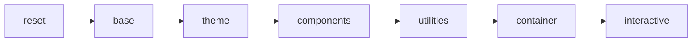

# Styling

Style elements with typed CSS values, scopes with `ScopeStyle`, and applications with shared design tokens in `Theme`. All styling APIs live in `dev.nthings.tessera.css` and produce identical cascade behavior in static pages and [browser roots](browser-rendering.md).

## Set a theme

Built-in components reference CSS custom properties defined by `Tokens`. Start from `Theme.defaults()` and retain the returned immutable `Theme` from each `with(...)` call:

```java
var theme =
    Theme.defaults()
        .with(Tokens.FONT_BODY, FontStack.of(FontStack.named("Georgia"), FontStack.Generic.SERIF))
        .with(Tokens.DENSITY, CssNumber.of(0.8))
        .with(Tokens.RADIUS_XL, CssLength.rem(1))
        .with(Tokens.CONTROL_FG, Tokens.ACCENT_TEXT);

var site = Compiler.forSite().withTheme(theme).compile(siteDefinition);
var page = Compiler.forPage().withTheme(theme).compile(document);
```

Each token accepts only values from its own category: color, length, duration, easing, font family, or number. Because tokens are valid values of their own category, one token can alias another (such as `CONTROL_FG` referring to `ACCENT_TEXT`). Define application tokens with category records, such as `new DesignToken.Color("brand", CssColor.oklch(60, 0.2, 300))`, then register them with `theme.with(brand, value)`.

Token names accept `[A-Za-z0-9_-]` and cannot start with `-`. Invalid names throw immediately rather than being rewritten.

`Compiler.withTheme` and `MountOptions.withTheme` reject a theme whose text colors fall below WCAG AA contrast on the surfaces built-in components draw them on, in either color scheme; see [Theme contrast](diagnostics.md#theme-contrast). Override a color token with `CssColor.lightDark(light, dark)` so each scheme gets a readable value:

```java
var theme =
    Theme.defaults()
        .with(
            Tokens.ACCENT_PRIMARY,
            CssColor.lightDark(CssColor.oklch(50, 0.16, 150), CssColor.oklch(72, 0.16, 150)));
```

| Family | Tokens | Default values or behavior |
| --- | --- | --- |
| Fonts | `FONT_BODY`, `FONT_MONO` | System UI and monospace stacks |
| Type scale | `FONT_SIZE_XS` through `FONT_SIZE_2XL` | `0.75`, `0.875`, `1`, `1.125`, `1.25`, `1.5` rem |
| Line height and tracking | `LINE_HEIGHT_BODY`, `TRACKING_NORMAL` | `1.5` and `0` |
| Spacing | `SPACE_1` through `SPACE_6`, `SPACE_8`, `SPACE_10`, `SPACE_12`; half steps `SPACE_0_5`, `SPACE_1_5`, `SPACE_2_5`, `SPACE_3_5` | Quarter-rem steps multiplied by `DENSITY` |
| Density | `DENSITY` | `1`; scales spacing and control padding without changing typography or motion |
| Controls | `CONTROL_PADDING_INLINE`, `CONTROL_FAMILY`, `CONTROL_FONT_SIZE`, `CONTROL_LINE_HEIGHT`, `CONTROL_TRACKING`, `CONTROL_FG` | Density-aware padding, body family, small type, body line height, normal tracking, primary text |
| Motion | `CONTROL_FEEDBACK_DURATION`, `OVERLAY_DURATION`, `DISCLOSURE_DURATION` | `150ms`, `200ms`, `250ms` |
| Corners | `RADIUS_SM`, `RADIUS_MD`, `RADIUS_LG`, `RADIUS_XL`, `RADIUS_FULL` | `0.25`, `0.375`, `0.5`, `0.75` rem; pill radius |
| Colors | `SURFACE_*`, `TEXT_*`, `ACCENT_PRIMARY`, `BORDER_SUBTLE`, `STATUS_*` | Adaptive light and dark OKLCH colors |

Color tokens resolve through `light-dark()`, so the root's `color-scheme` picks every value. It follows the system preference until `<html>` carries `data-color-scheme="light"` or `data-color-scheme="dark"`. Place a `ColorSchemeToggle` to let readers pick: it cycles system, light, and dark, saves the choice in `localStorage`, and a page that places one restores the saved choice from an inline `<head>` script before first paint.

`Typography.LABEL` combines the control typography tokens used by field labels and callout titles alongside `CONTROL_FG`. Overriding `CONTROL_FONT_SIZE` changes those labels directly; overriding `FONT_SIZE_SM` also changes them while `CONTROL_FONT_SIZE` aliases `FONT_SIZE_SM`.

`Tone` supplies semantic roles (`NEUTRAL`, `ACCENT`, `INFO`, `SUCCESS`, `WARNING`, `DANGER`). Components map each tone to surface, border, and foreground tokens: `color()` paints fills, borders, and icons, `textColor()` paints text on the page, cards, and tints, and `onSolid()` paints labels on a solid fill. Tinted surfaces, such as tinted badges, callouts, and `highlight(tone)`, mix `color()` into the surface at fixed strengths that the [theme contrast check](diagnostics.md#theme-contrast) measures. `Callout.Kind` also picks a matching default icon and title.

## Write typed declarations

`TagElement` and `Declarations` implement `Styled`. Components that own a tag, such as `Image`, expose `Styled` methods through `element(...)`.

```java
Elements.div()
    .p(Tokens.SPACE_4)
    .bg(Tokens.SURFACE_CARD)
    .border(Border.hairline(Tokens.BORDER_SUBTLE))
    .rounded(Tokens.RADIUS_XL)
    .gridColumns(TrackList.autoFit(CssLength.rem(16)))
    .inlineSize(CssLength.pct(100).minus(CssLength.rem(2)));
```

| Need | Values and operations |
| --- | --- |
| Dimensions and math | `CssLength`: `plus`, `minus`, `times`, `dividedBy`, `min`, `max`, `anchor` |
| Durations | `CssDuration.ms(double)` and `CssDuration.of(java.time.Duration)` |
| Easings | `Easing.ease()`, `Easing.cubicBezier(...)`, and `Spring.easing()` for a compiled `linear()` curve |
| Colors | `CssColor`: `oklch`, `srgb`, `parseHex`, `mix`, `mixTransparent`, `sameHue`, `lightDark`, `contrast` |
| Shadows | `Shadow.drop(...)`, `Shadow.inset(...)`; `offsetX(...)` adjusts a layer |
| Keyword properties | Enums such as `Overflow.AUTO`, `TextWrap.BALANCE`, `Cursor.POINTER`, `Appearance.NONE`, `Resize.VERTICAL` |
| Single-purpose helpers | Methods such as `listStyleNone()` and `tabularNums()` |
| Named CSS handles | Validated `Container`, `Keyframes`, `Anchor`, `Counter`, and `CustomProperty` |
| Grouped typography | `Typography` sets family, size, weight, line height, and tracking together |

Selectors passed to `ScopeStyle.select(...)` are emitted verbatim; treat selectors and authored CSS resource names as trusted input.

### Shorthand and longhand precedence

Later writes replace earlier declarations for the same property. A shorthand clears earlier longhands it covers, while a later longhand refines the shorthand:

| Calls                  | Retained declarations             |
| ---------------------- | --------------------------------- |
| `pt(...).p(...)`       | Padding shorthand only            |
| `p(...).pt(...)`       | Padding shorthand and top padding |
| `rowGap(...).gap(...)` | Gap shorthand only                |
| `gap(...).rowGap(...)` | Gap shorthand and row gap         |

The same rule applies to borders and merged `Declarations`. Immutable value types (`Theme`, `CssLength`, `Transition`, `Animation`, `Spring`) carry `@CheckReturnValue`, so always retain their returned values.

## Share rules and flex layouts

Reuse declaration sets with `StyleBlock` across elements, conditional callbacks, scope rules, starting styles, and keyframe steps:

```java
StyleBlock card = s -> s.p(Tokens.SPACE_4).rounded(Tokens.RADIUS_XL).bg(Tokens.SURFACE_CARD);

Elements.div().styles(card).on(State.HOVER, s -> s.bg(Tokens.SURFACE_SUBTLE));
scope.select(":scope > article", card);
```

Configure flex containers with `FlexLayout` while keeping semantic HTML tags:

```java
var links = FlexLayout.row(Tokens.SPACE_4, FlexLayout.Align.CENTER, FlexLayout.Wrap.WRAP);
var stack = FlexLayout.column(Tokens.SPACE_4, FlexLayout.Align.STRETCH, FlexLayout.Wrap.NOWRAP);

Elements.section()
    .layout(stack)
    .children(
        Elements.nav()
            .layout(links)
            .ariaLabel("Site navigation")
            .children(Elements.a("/").text("Home"), Elements.a("/guide/").text("Guide")),
        Elements.p().text("Introduction"));
```

Use `inlineRow` and `inlineColumn` for `inline-flex`. A subsequent property call such as `gap(...)` overrides that property on the element without mutating the shared `FlexLayout`.

For a scrolling panel inside a fixed-height column, give the column a block size and configure the inner panel with `flexGrow(1)`, `flexShrink(1)`, `minBlockSize(CssLength.zero())`, and `overflowY(Overflow.AUTO)`.

## Apply conditional styles and cascade layers

Tessera orders generated rules into explicit CSS cascade layers so overrides stay predictable without specificity escalation:



Call `on(condition, styles)` to apply declarations while a `Condition` holds. Conditions can nest, and a condition that already holds adds nothing when nested again: `on(State.HOVER, s -> s.on(State.HOVER, ...))` writes into the one hover rule, and `ScopeStyle.on(query, ...)` inside a block for an equal query joins that block. A conditional rule that ends up empty is not emitted.

| Condition | Layer and behavior |
| --- | --- |
| `State` | `interactive` layer. Pseudo-classes emit in fixed order: `HOVER`, `FOCUS_WITHIN`, `FOCUS_VISIBLE`, `ACTIVE`, `CHECKED`, `OPEN`, `USER_INVALID`, `USER_VALID`, `DISABLED`. |
| `GroupState` | `interactive` layer, after the element's own states, in the same state order. Matches while an enclosing element marked with the `Group` is in that state. |
| `Media.MOTION_SAFE` | `interactive` layer. Matches `prefers-reduced-motion: no-preference`. |
| Container query | `container` layer. Matches size, stuck-edge, or snapped-axis conditions on a `Container` handle. |

Because state order is fixed regardless of call order, `ACTIVE` always beats `HOVER`, and `DISABLED` beats all other states. Hover and active rules exclude disabled elements with a zero-specificity guard. Because `interactive` comes after `container`, state styles remain active across container breakpoints. Inside a `ScopeStyle` rule, conditions nest inside that selector; `ScopeStyle.on(query, rules)` wraps multiple rules in one media or container query.

Mark an element with a `Group` to style its descendants by its state. A group state adds no specificity, so a descendant's own states still override its group states:

```java
var row = Group.named("row");
Elements.li()
    .group(row)
    .child(Elements.button()
        .opacity(0)
        .on(row.state(State.HOVER), s -> s.opacity(1))
        .on(row.state(State.FOCUS_WITHIN), s -> s.opacity(1))
        .text("Rename"));
```

`group(row)` adds the class `g-row`, and `row.state(State.HOVER)` emits `:where(.g-row:hover:not(:where(:disabled))) &`, so it works the same in static pages and live roots. A descendant matches while *any* enclosing element marked with the group is in the state, not only the nearest, so give nested groups distinct names. To style an element by the state of its descendants instead, use a `:has()` selector in a `ScopeStyle` rule.

Use `startingStyle(...)` to define entry-transition starting values:

```java
scope.select(":scope:open", s -> s.opacity(1).startingStyle(start -> start.opacity(0)));
```

Declare a container once and query it through its handle:

```java
var cards = Container.named("cards", Container.Type.INLINE_SIZE);
Elements.div()
    .container(cards)
    .child(Elements.article().on(cards.atLeast(CssLength.rem(30)), s -> s.flexRow()));
```

Size queries support `atLeast(length)` and `below(length)`. A `SCROLL_STATE` container supports `stuck(edge)` and `snapped(axis)`. An unnamed handle targets the nearest ancestor container of the matching type; `containerNone()` clears a container declaration.

## Add transitions and animations

`Transition.controlFeedback()`, `Transition.overlayEntry()`, and `Transition.disclosure()` provide coordinated duration, easing, and property sets. For spatial movement, build the transition with `whenMotionSafe()` (or write it inside `on(Media.MOTION_SAFE, ...)`) and keep the resting visible state outside the condition. Because a condition that already holds adds nothing, a motion-safe transition written inside `on(Media.MOTION_SAFE, ...)` joins that rule rather than nesting a second `@media` block.

### Use spring transitions

A `Spring` describes motion by feel: a perceptual duration and a bounce from `-0.5` to `0.7`. Tessera solves the spring in closed form and compiles it to a CSS `linear()` easing, so the browser plays the motion natively without script.

```java
var lift = Transition.spring(Spring.SNAPPY, Animatable.TRANSLATE);

Elements.div()
    .transition(Transition.of(CssDuration.ms(150), Easing.ease(), Animatable.OPACITY))
    .transition(lift)
    .on(State.HOVER, s -> s.translate(Translation.y(CssLength.rem(-0.75))));
```

| Bounce | Motion | Presets (500ms) |
| --- | --- | --- |
| `0` | Fastest arrival without overshoot | `Spring.SMOOTH` |
| `0` to `0.7` | Overshoots, then settles in shrinking oscillations | `Spring.SNAPPY` (`0.15`), `Spring.BOUNCY` (`0.3`) |
| `-0.5` to `0` | Approaches more slowly, never overshooting | `Spring.of(duration, -0.5)` |

`Transition.spring(...)` runs over the spring's `settlingDuration()`, the whole milliseconds until it stays within 0.1% of its end value, so it lasts longer than the perceptual duration. The transition is always motion-safe: with reduced motion the properties change at once, or follow a plain transition written on the same style, such as the opacity fade above. A bouncy spring overshoots, so it suits position, size, and transforms; opacity and colors clamp at the ends of their range.

The compiled curve stays within 0.002 of the exact spring and is computed with `StrictMath`, so static pages and browser roots emit byte-identical CSS. A typical spring compiles to about 20 stops. Bounces further from `0` settle more slowly and compile to longer curves; the bounce range keeps every spring settling within about four times its perceptual duration and under 600 characters of CSS. Each `Spring` compiles once, the first time its `easing()` or `settlingDuration()` is read, so presets you never use cost nothing; keep springs in constants rather than creating them on every render.

To emit a spring's curve once in `@layer theme` instead of in every rule that uses it, store its easing and duration in tokens and register them in the theme:

```java
var settle = Spring.of(Duration.ofMillis(450), 0.2);
var easeSettle = new DesignToken.Easing("ease-settle", settle.easing());
var settleDuration = new DesignToken.Duration("settle-duration", settle.settlingDuration());
var theme =
    Theme.defaults()
        .with(easeSettle, settle.easing())
        .with(settleDuration, settle.settlingDuration());

var slide = Transition.of(settleDuration, easeSettle, Animatable.TRANSLATE).whenMotionSafe();
```

Pass a spring's `settlingDuration()` and `easing()` to `Animation.of(...)` to play keyframes along it.

### Play keyframe animations

`Animation` registers its `Keyframes` automatically and runs only when the user does not prefer reduced motion:

```java
var pulse =
    Keyframes.named("pulse")
        .start(s -> s.opacity(1))
        .at(50, s -> s.opacity(0.5))
        .end(s -> s.opacity(1));

Elements.div().animation(Animation.of(pulse, CssDuration.ms(800), Easing.ease()));
Elements.div().animation(Animation.enterViewport(Keyframes.FADE_UP));
```

| Effect | API |
| --- | --- |
| Animate through viewport entry or exit | `Animation.enterViewport(...)`, `Animation.leaveViewport(...)` |
| Reveal once with sibling stagger | `Animation.revealOnce(...).staggerBySiblingIndex(60)` |
| Track page scroll progress | `Animation.scrollProgress(...)` |
| Follow the inline scroll axis | `.along(TimelineAxis.INLINE)` |
| Built-in keyframe presets | `Keyframes.FADE_IN`, `FADE_UP`, `SCALE_IN`, `SLIDE_INLINE`, `FADE_OUT` |

For values that change on every frame in a browser root, use [`live(...)`](browser-rendering.md#animate-values-without-new-rules) so CSS rules stay bounded. Check engine availability for scroll-state and scroll-triggered features in [Browser support](browser-support.md#platform-features).

## Skip rendering far-off content

Long documents, lists, and tables can let the browser skip layout and paint for content far from the viewport. Call `contentVisibilityAuto(intrinsicBlockSize)` on each block-level section:

```java
Elements.li().contentVisibilityAuto(CssLength.rem(3)).children(title, summary);
```

It emits `content-visibility: auto` with `contain-intrinsic-block-size: auto <length>`. Until a section first renders it reserves the estimated block size, and afterwards the browser remembers the size it last rendered at, so the scrollbar stays steady. Skipped content stays in the accessibility tree, the tab order, and find-in-page, and renders as soon as it is focused, found, or scrolled near.

The section contains its layout, style, and paint: it clips overflowing content such as shadows, and it becomes the containing block of positioned descendants. Its inline size comes from its container, so apply it to sections stacked in the block direction rather than to shrink-to-fit items.
