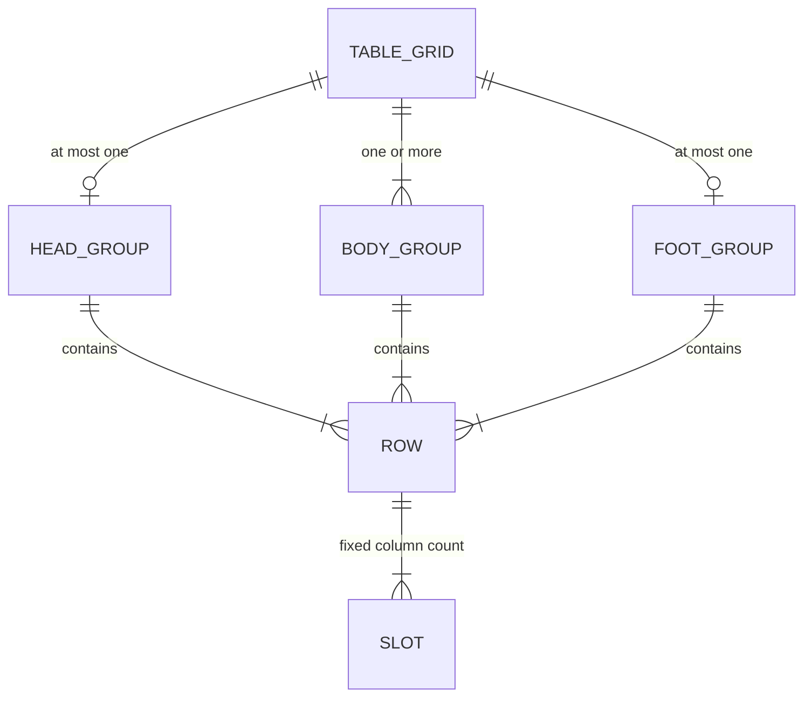

# Tables

Build accessible data tables from an immutable logical grid (`TableGrid`) rendered inside a keyboard-scrollable container (`DataTable`). Both types live in `dev.nthings.tessera.components` and are portable across static pages and browser roots.

## Structure a logical grid

`TableGrid.of(...)` organizes rows into `head(...)`, `body(...)`, and `foot(...)` row groups. Include at most one `head` and one `foot` group, and use a separate `body` group for each logical section of data.



Every row has one slot per logical column. Use OTSL continuation tokens (`TableGrid.Merge`) to span cells cleanly:

```java
import static dev.nthings.tessera.components.TableGrid.Merge.LEFT;
import static dev.nthings.tessera.components.TableGrid.Merge.UP;
import static dev.nthings.tessera.components.TableGrid.body;
import static dev.nthings.tessera.components.TableGrid.columnHeader;
import static dev.nthings.tessera.components.TableGrid.data;
import static dev.nthings.tessera.components.TableGrid.head;
import static dev.nthings.tessera.components.TableGrid.row;
import static dev.nthings.tessera.components.TableGrid.rowHeader;

var grid =
    TableGrid.of(
        head(
            row(columnHeader("Region"), columnHeader("2026"), LEFT),
            row(UP, columnHeader("Q1"), columnHeader("Q2"))),
        body(
            row(rowHeader("East"), data("12"), data("15")),
            row(rowHeader("West"), data("9"), data("11"))));

var table = DataTable.of("Quarterly sales", grid).id("sales").stickyHead().stickyFirstColumn();
```

| Slot | Meaning |
| --- | --- |
| `LEFT` | Extends the owning cell to its left across the first row of a horizontal span |
| `UP` | Extends the owning cell above it down the first column of a vertical span |
| `BOTH` | Fills the interior where both horizontal and vertical spans meet (for example, `row(data("A"), LEFT)` above `row(UP, BOTH)`) |
| `empty()` | Creates an independent empty cell |

Grid construction validates topology immediately and throws `IllegalArgumentException` for ragged rows, missing merge neighbors, non-rectangular spans, or merges that cross row-group boundaries. Grid topology is immutable; individual cell contents follow the standard mutable element-builder contract.

## Classify headers and align cells

`TableGrid` distinguishes four header roles so `DataTable` can bind table-local IDs and emit accurate HTML `headers` attributes automatically:

| Cell factory | Role and header scope |
| --- | --- |
| `columnHeader(...)` | Labels cells in its column. Headers in `head` apply to all later groups; headers inside another group apply only within that group. |
| `rowHeader(...)` | Labels cells to its right in the same row |
| `sectionHeader(...)` | Names a `body` group and labels data and row-header cells within that group |
| `cornerHeader(...)` | Marks the intersection of row and column headers without associating it with data cells |
| `data(...)` | Standard table data cell |

Cells accept plain text or any portable `IntoElement`, including links, code spans, or nested tables. When a column header contains rich elements and the table uses card mode, pass `columnHeader(plainTextLabel, content)` so card labels remain readable plain text.

Control cell alignment with `cell.align(TableGrid.Align)`:

- `NUMERIC` aligns values to the inline end with tabular numerals.
- `START`, `CENTER`, and `END` control standard inline alignment.

## Scroll, stick, and stack on narrow viewports

`DataTable.of(caption, grid)` wraps the table in a labelled, keyboard-scrollable region that scrolls horizontally whenever columns exceed the container width.

| Option | Behavior |
| --- | --- |
| `stickyHead()` | Pins the entire `head` group, including multi-row headers, during vertical scrolling |
| `stickyFirstColumn()` | Pins row headers starting in logical column 0 while remaining columns scroll horizontally |
| `stackBelow(CssLength)` | Switches body rows into labelled cards below the given container width |

`stickyHead()` and `stickyFirstColumn()` are independent.

Card mode (`stackBelow`) applies only to flat grids and throws `IllegalArgumentException` otherwise. A flat grid has:

1. Exactly one `head` row containing only column headers.
2. No merged or spanned cells.
3. `body` groups containing only data cells or row headers.

In card mode, visible cell labels are hidden from assistive technology because the emitted `headers` attributes already name each cell. Stacking resets numeric alignment and sticky row headers so every card reads cleanly from inline start to end.
